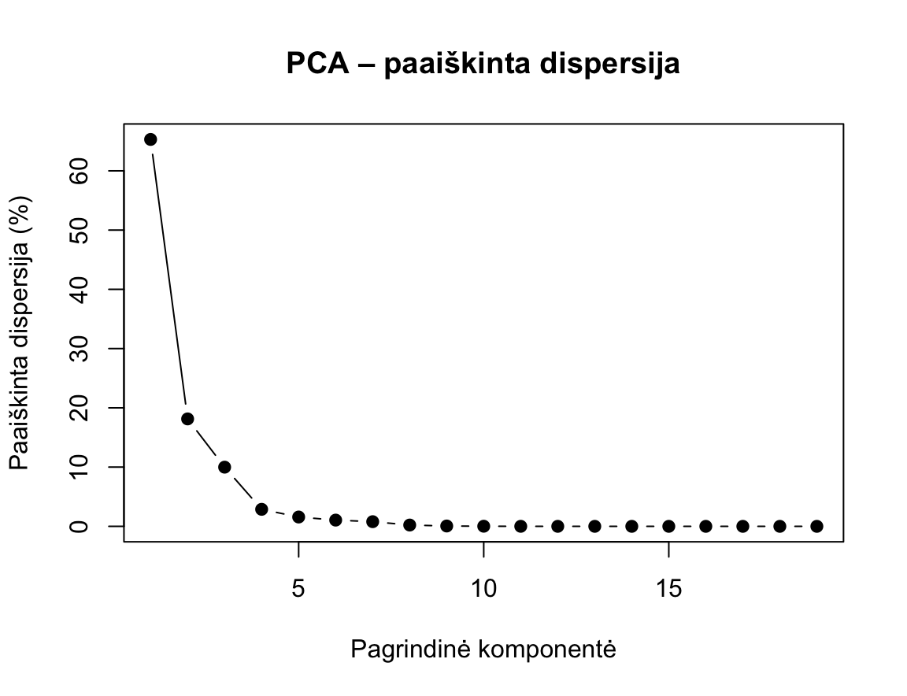
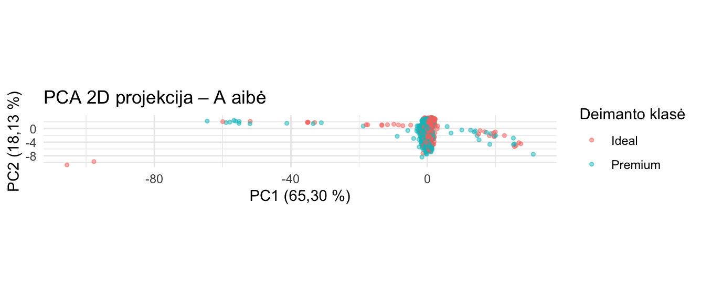
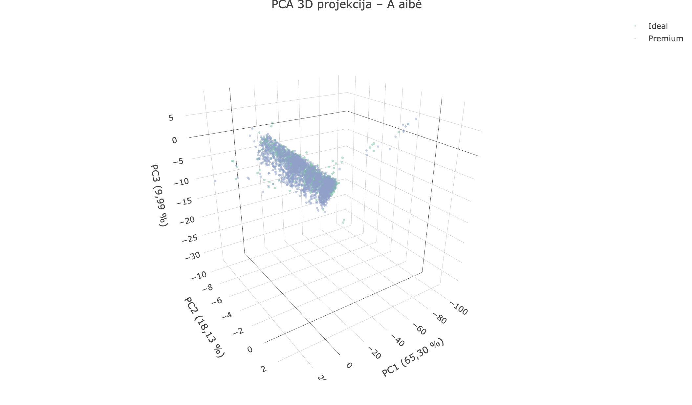
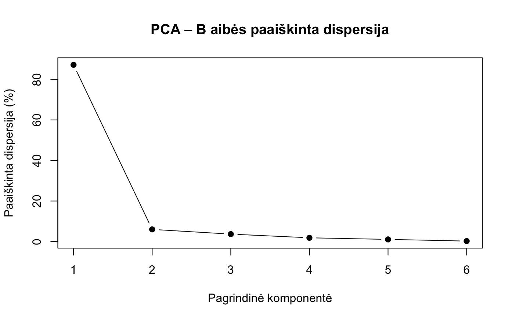
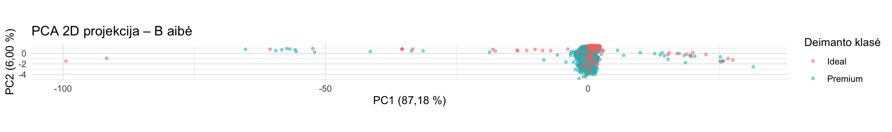
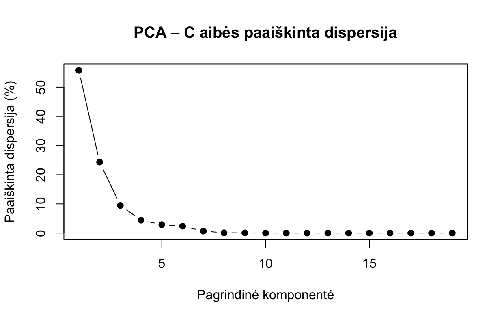
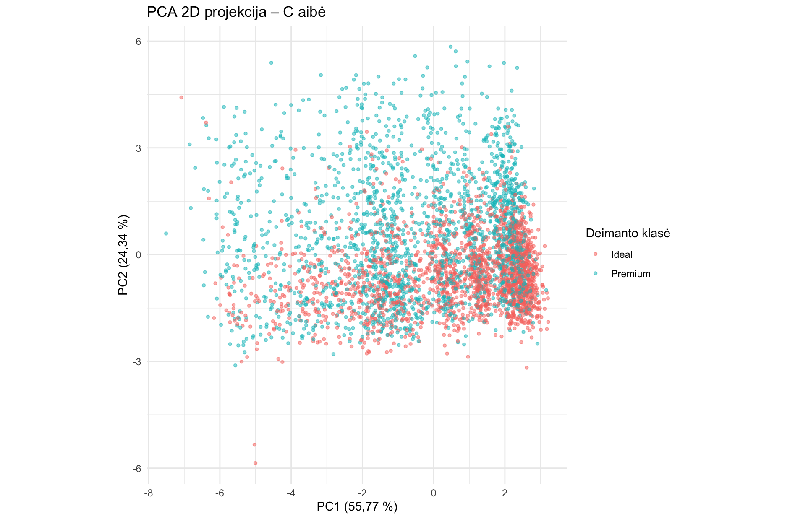
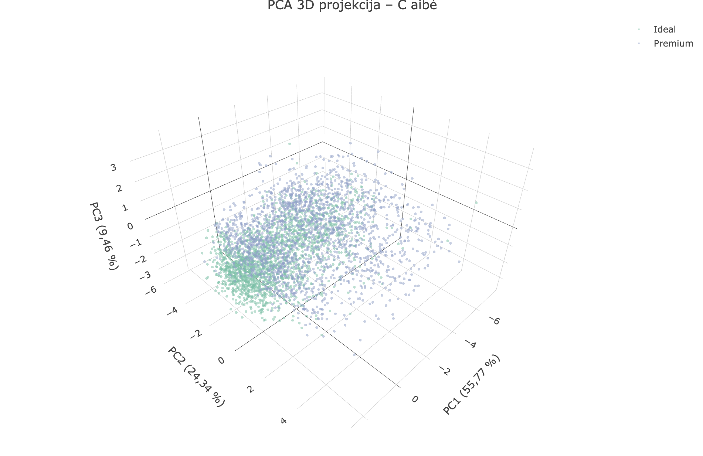

# A02 deimantų dimensijos mažinimas

Šiame projekte atliekamas daugiamačių duomenų(A02 aibės) dimensijos mažinimas. Šis darbas pradedamas su po pirminio apdorojimo sutvarkyta duomenų aibe.
## Duomenų rinkinys

A02 duomenys aprašo realius apvaliai šlifuotus deimantus.

- Objektų skaičius: **4000**
- Stulpelių skaičius: **20**
- Skaitinių požymių skaičius: **19**
- Kategorinis požymis: `class`
- Klasės: **Ideal** ir **Premium**

Bazinė duomenų aibė: `ggplot2::diamonds`.

Pagrindiniai požymiai:

- `carat` – deimanto masė;
- `depth`, `table` – deimanto proporcijų rodikliai;
- `price` – kaina;
- `x`, `y`, `z` – geometriniai matmenys;
- `volume_xyz`, `area_xy`, `area_xz`, `area_yz`, `mean_dimension` – išvestiniai dydžio rodikliai;
- `price_per_carat`, `length_width_ratio`, `depth_ratio`, `table_depth_ratio`, `carat_per_volume`, `price_per_volume`, `dimension_cv` – išvestiniai santykiniai rodikliai.

Duomenų būklė po pirmojo darbo:

| Charakteristika | Galutinė reikšmė |
|---|---:|
| Objektai | 4000 |
| Požymiai | 20 |
| Ideal | 2000 |
| Premium | 2000 |
| Dublikatai | 0 |
| Likę NA | 0 |

---

## Trys duomenų aibės

| Aibė | Failas | Eilučių | Požymių | Aprašymas |
|---|---|---:|---|---|
| A. Pagrindinė | `aibe_A.csv` | 4000 | 19 skaitinių + `class` | Visi sutvarkyti požymiai ir objektai |
| B. Be koreliuotų požymių | `aibe_B.csv` | 4000 | 6 skaitiniai + `class` | Pašalinti perteklinais laikomi koreliuoti požymiai, objektų skaičius nesikeičia |
| C. Be ekstremumų | `aibe_C.csv` | 3928 | 19 skaitinių + `class` | Pašalintos 72 eilutės su ekstremumais |

Kiekviename faile yra papildomas stulpelis `id` (eilutės numeris A aibėje).
Pagal jį randami bendri A ir C objektai. `id` ir `class` į projekcijų
įėjimą nepatenka.

### B aibė: pašalinti koreliuoti požymiai

Šalinimo kriterijus: |Spearman r| ≥ 0,90 su paliekamu požymiu, o šalinamas
požymis neneša naujos informacijos (yra to paties požymio perskaičiavimas arba
matuoja tą patį dalyką). Naudotas Spearman koeficientas, nes požymiai
asimetriški.

| Pašalintas požymis | Paliktas požymis | Spearman r | Pagrindimas |
|---|---|---:|---|
| `x` | `carat` | 0,991 | Matmuo, matuoja deimanto dydį kaip ir `carat` |
| `y` | `carat` | 0,990 | Tas pats |
| `z` | `carat` | 0,988 | Tas pats |
| `volume_xyz` | `carat` | 0,991 | Išvestas iš `x·y·z` |
| `area_xy` | `carat` | 0,991 | Išvestas iš `x·y` |
| `area_xz` | `carat` | 0,990 | Išvestas iš `x·z` |
| `area_yz` | `carat` | 0,990 | Išvestas iš `y·z` |
| `mean_dimension` | `carat` | 0,992 | Išvestas iš `(x+y+z)/3` |
| `depth_ratio` | `depth` | 0,990 | `depth` perskaičiavimas pagal formulę |
| `dimension_cv` | `depth` | -0,990 | Su `depth_ratio` koreliuoja -0,99997 |
| `price_per_carat` | `price` | 0,943 | Išvestas iš `price / carat` |
| `price_per_volume` | `price` | 0,947 | Išvestas iš `price / volume_xyz`; su `price_per_carat` r = 0,996 |
| `table_depth_ratio` | `table` | 0,941 | Išvestas iš `table / depth` |

Palikti požymiai (6 skaitiniai + `class`): `carat`, `depth`, `table`,
`price`, `length_width_ratio`, `carat_per_volume`, `class`.

- Deimanto formą ir toliau nusako `length_width_ratio` (x/y), kuris su kitais
  požymiais koreliuoja silpnai (didžiausia |r| ≈ 0,32).
- `carat` ir `price` (r = 0,948) palikti abu: tai pagrindinis ryšys duomenyse,
  o `price` nėra išvedamas iš `carat` taip, kaip tūris iš `x`, `y`, `z`. Koreliacija tarp jų yra tikras
  duomenų ryšys, bet ne perteklius.

### C aibė: pašalinti ekstremumai

Ekstremumu laikoma reikšmė už ribų [Q1 − 3·IQR ; Q3 + 3·IQR]. Ekstremumai
ieškomi visuose 19 skaitinių požymių, o eilutė šalinama, jei ekstremumas yra
bent viename iš jų.

| Požymis | Ekstremumų kiekis | % |
|---|---:|---:|
| `carat_per_volume` | 61 | 1,52 |
| `price_per_carat` | 15 | 0,38 |
| `price_per_volume` | 8 | 0,20 |
| `carat` | 3 | 0,07 |
| `volume_xyz` | 3 | 0,07 |
| `depth_ratio` | 3 | 0,07 |
| `dimension_cv` | 3 | 0,07 |
| `table_depth_ratio` | 2 | 0,05 |
| `depth` | 1 | 0,03 |
| `table` | 1 | 0,03 |
| `price`, `x`, `y`, `z`, `area_xy`, `area_xz`, `area_yz`, `length_width_ratio`, `mean_dimension` | 0 | 0,00 |

Ekstremumų kiekių suma (100) didesnė už pašalintų eilučių skaičių (72), nes
vienoje eilutėje ekstremumų gali būti keliuose požymiuose iš karto.

**Rezultatas:** pašalinta 72 eilutės (1,80 %), liko 3928 iš 4000.

Daugiausia ekstremumų (61 iš 100) yra išvestiniame požymyje `carat_per_volume`.
Baziniuose požymiuose `price`, `x`, `y`, `z` ekstremumų nėra, todėl pašalintos
eilutės daugiausia išsiskiria santykiniais, o ne pagrindiniais matmenimis ar kaina.

---

## Mastelio keitimas

Visi dimensijos mažinimo metodai remiasi atstumais tarp objektų, todėl
požymiai turi būti vienodo mastelio. Naudojamas **Robust Scaling**:

`x' = (x − mediana) / IQR`

Pasirinkimo pagrindimas: po sutvarkymo daugelis požymių yra asimetriški ir
turi realių išskirčių, kurių pirmoje užduotyje nešalinome. Mediana ir IQR į
kraštines reikšmes reaguoja silpnai, todėl mastelis nustatomas pagal didžiąją
duomenų dalį. Min-Max ir standartizavimas (vidurkis, SD) yra jautrūs
išskirtims.

Mastelis skaičiuojamas kiekvienai aibei atskirai (A, B ir C), tik
skaitiniams požymiams. Failuose `aibe_A.csv`, `aibe_B.csv`, `aibe_C.csv`
požymiai jau yra pakeisti.

## Įėjimas projekcijoms

- Į projekcijas patenka tik skaitiniai požymiai (A: 19, B: 6, C: 19).
- `class` projekcijai kurti nenaudojama. Ji naudojama tik spalvoms ir kNN
  tikslumui.
- `id` naudojamas tik bendriems A ir C objektams (3928) rasti.
- Visi metodai gauna tą pačią paruoštą duomenų versiją.


## PCA analizė – A aibė

Pagrindinių komponenčių analizė (PCA) atlikta su pagrindine A duomenų aibe, kurią sudaro **4000 objektų ir 19 skaitinių požymių**.

Duomenims jau buvo pritaikytas **Robust Scaling** metodas, todėl papildomas standartizavimas neatliktas. PCA metu duomenys centruojami pagal vidurkį.

### PCA atlikimas

```r
pca_A <- prcomp(X_A, center = TRUE, scale. = FALSE)

summary(pca_A)
```

### Paaiškinta dispersija

Gauti rezultatai:

| Komponentė | Paaiškinta dispersija | Sukaupta dispersija |
|---|---:|---:|
| PC1 | 65,30 % | 65,30 % |
| PC2 | 18,13 % | 83,43 % |
| PC3 | 9,99 % | 93,42 % |
| PC4 | 2,87 % | 96,29 % |
| PC5 | 1,57 % | 97,86 % |

Pirmoji pagrindinė komponentė (PC1) paaiškina **65,30 %** visos duomenų dispersijos. Antroji komponentė (PC2) paaiškina papildomus **18,13 %**, o trečioji (PC3) – **9,99 %**.

Pirmosios dvi komponentės kartu paaiškina **83,43 %**, o pirmosios trys – **93,42 %** visos dispersijos.

### Paaiškintos dispersijos vizualizavimas

```r
dispersija <- 100 * pca_A$sdev^2 / sum(pca_A$sdev^2)

plot(
  dispersija,
  type = "b",
  pch = 19,
  main = "PCA – paaiškinta dispersija",
  xlab = "Pagrindinė komponentė",
  ylab = "Paaiškinta dispersija (%)"
)
```




**1 pav.** A aibės PCA pagrindinių komponenčių paaiškinta dispersija (%).


Grafike matyti, kad didžiausią dispersijos dalį paaiškina pirmoji komponentė. Antrosios ir trečiosios komponenčių indėlis mažesnis, o nuo ketvirtosios komponentės paaiškintos dispersijos dalis tampa nedidelė.

### Preliminari išvada

PCA rezultatai rodo, kad sumažinus A aibės dimensiją nuo 19 iki 3 galima išsaugoti **93,42 %** pradinės duomenų dispersijos.

Pasirinkus 2 dimensijas, išsaugoma **83,43 %** dispersijos, todėl 2D projekcija taip pat gali būti naudinga duomenų vizualizavimui.

Tolimesniame tyrime bus nagrinėjamos 2D projekcijos, o 3D vertinama kaip alternatyva, leidžianti išsaugoti didesnę dispersijos dalį. Galutinis pasirinkimas bus pagrįstas kitų dimensijos mažinimo metodų rezultatais ir projekcijų kokybės metrikomis.


### Pagrindinių komponenčių interpretacija

Siekiant nustatyti, kurie pradiniai požymiai labiausiai prisideda prie pagrindinių komponenčių, išanalizuoti PCA požymių svoriai (*loadings*).

```r
# Pirmųjų trijų komponenčių požymių svoriai
svoriai <- pca_A$rotation[, 1:3]

round(svoriai, 3)
```

#### Pirmoji komponentė (PC1)

Pirmoji komponentė paaiškina **65,30 %** visos dispersijos.

Didžiausi absoliutūs požymių svoriai:

| Požymis | PC1 svoris |
|---|---:|
| `carat_per_volume` | -0,990 |
| `dimension_cv` | -0,103 |
| `depth_ratio` | 0,086 |

PC1 beveik visiškai dominuoja `carat_per_volume` požymis, kuris nusako deimanto masės ir apskaičiuoto tūrio santykį. Kitų požymių svoriai yra gerokai mažesni.

Tai rodo, kad pirmoji komponentė daugiausia atspindi vieno požymio sklaidą, o ne visų deimanto charakteristikų bendrą kitimą.

#### Antroji komponentė (PC2)

Antroji komponentė paaiškina **18,13 %** dispersijos.

Didžiausi absoliutūs požymių svoriai:

| Požymis | PC2 svoris |
|---|---:|
| `price` | -0,369 |
| `price_per_carat` | -0,315 |
| `price_per_volume` | -0,310 |
| `carat` | -0,293 |
| `volume_xyz` | -0,291 |

PC2 daugiausia susijusi su deimanto dydžio ir kainos charakteristikomis. Šioje komponentėje reikšmingus svorius turi tiek baziniai, tiek išvestiniai požymiai.

#### Trečioji komponentė (PC3)

Trečioji komponentė paaiškina **9,99 %** dispersijos.

Didžiausi absoliutūs požymių svoriai:

| Požymis | PC3 svoris |
|---|---:|
| `dimension_cv` | -0,611 |
| `depth_ratio` | 0,575 |
| `depth` | 0,404 |
| `table_depth_ratio` | -0,259 |

PC3 daugiausia susijusi su deimanto geometrinėmis proporcijomis ir matmenų santykiais.

### PCA komponenčių interpretacijos išvada

Pirmosios trys komponentės kartu paaiškina **93,42 %** duomenų dispersijos.

- **PC1** daugiausia atspindi masės ir tūrio santykį.
- **PC2** apibendrina deimanto dydžio ir kainos charakteristikas.
- **PC3** susijusi su geometrinėmis proporcijomis.

Pastebėta, kad PC1 beveik visiškai dominuoja vienas požymis (`carat_per_volume`). Tai rodo, kad Robust Scaling neužtikrina vienodų požymių dispersijų, todėl atskiri didelę sklaidą turintys požymiai gali stipriai paveikti PCA rezultatus.

Tolimesniuose eksperimentuose bus vertinama, kaip PCA projekcija keičiasi pašalinus koreliuojančius požymius ir ekstremalias išskirtis.

### PCA 2D projekcija

Toliau nubraižyta A aibės 2D projekcija, naudojant dvi pirmąsias pagrindines komponentes.

```r
# Pirmųjų dviejų komponenčių koordinatės
pca_2d <- as.data.frame(pca_A$x[, 1:2])

# Pridedame klases
pca_2d$class <- aibe_A$class

library(ggplot2)

ggplot(pca_2d, aes(x = PC1, y = PC2, color = class)) +
  geom_point(alpha = 0.5, size = 1) +
  labs(
    title = "PCA 2D projekcija – A aibė",
    x = "PC1 (65,30 %)",
    y = "PC2 (18,13 %)",
    color = "Deimanto klasė"
  ) +
  coord_equal() +
  theme_minimal()
```



**2 pav.** A aibės 2D projekcija pagal pirmąsias dvi pagrindines komponentes.

Grafike matyti, kad `Ideal` ir `Premium` klasės aiškiai neatsiskiria. Dauguma abiejų klasių taškų persidengia centrinėje projekcijos dalyje, todėl vien pagal pirmąsias dvi PCA komponentes šių klasių atskyrimas yra ribotas.

Taip pat matomi keli stipriai nutolę taškai pagal pirmąją komponentę (PC1), dėl kurių projekcija išsitempia horizontalia kryptimi. Tai siejasi su tuo, kad pirmąją komponentę labai stipriai veikia požymis `carat_per_volume`.

Apibendrinant, PCA 2D projekcija leidžia sumažinti duomenų dimensiją ir išsaugo didelę dalį dispersijos, tačiau vizualiai `Ideal` ir `Premium` klasių aiškiai neatskiria.


### PCA 3D projekcija

Siekiant įvertinti, ar papildoma komponentė leidžia geriau atskleisti duomenų struktūrą, A aibei sudaryta trimatė PCA projekcija.

```r
library(plotly)

pca_3d <- as.data.frame(pca_A$x[, 1:3])
pca_3d$class <- aibe_A$class

plot_ly(
  data = pca_3d,
  x = ~PC1,
  y = ~PC2,
  z = ~PC3,
  color = ~class,
  type = "scatter3d",
  mode = "markers",
  marker = list(size = 2, opacity = 0.5)
) %>%
  layout(
    title = "PCA 3D projekcija – A aibė",
    scene = list(
      xaxis = list(title = "PC1 (65,30 %)"),
      yaxis = list(title = "PC2 (18,13 %)"),
      zaxis = list(title = "PC3 (9,99 %)")
    )
  )
```



**3 pav.** A aibės PCA 3D projekcija.

Trijų pagrindinių komponenčių projekcija paaiškina **93,42 %** pradinės duomenų dispersijos, t. y. 9,99 procentinio punkto daugiau nei 2D projekcija.

Grafike matyti, kad `Ideal` ir `Premium` klasių objektai išlieka persidengę, todėl aiškaus klasių atsiskyrimo nėra. Dauguma objektų susitelkę vienoje srityje, tačiau matomi ir nuo pagrindinės sankaupos nutolę taškai.

Trečioji komponentė suteikia papildomos informacijos apie geometrines deimantų proporcijas, tačiau vizualiai reikšmingo klasių atsiskyrimo pagerėjimo nepastebėta.

**Preliminari išvada:** 3D projekcija geriau išsaugo bendrą dispersiją, o 2D yra paprastesnė duomenų vizualizavimui. Galutinis projekcijos kokybės vertinimas bus atliktas naudojant kiekybines metrikas.


## PCA analizė – B aibė

B aibę sudaro 4000 deimantų ir 6 skaitiniai požymiai. Iš pradinės A aibės pašalinta 13 stipriai koreliuojančių požymių, paliekant `carat`, `depth`, `table`, `price`, `length_width_ratio` ir `carat_per_volume`.

Šio tyrimo tikslas – nustatyti, kaip perteklinių požymių pašalinimas paveikia PCA rezultatus ir duomenų projekciją.

### PCA atlikimas

```r
pca_B <- prcomp(X_B, center = TRUE, scale. = FALSE)
summary(pca_B)
```

Duomenims jau pritaikytas Robust Scaling, todėl papildomas standartizavimas neatliekamas.

### Paaiškinta dispersija

| Komponentė | Paaiškinta dispersija | Sukaupta dispersija |
|---|---:|---:|
| PC1 | 87,18 % | 87,18 % |
| PC2 | 6,00 % | 93,17 % |
| PC3 | 3,67 % | 96,85 % |
| PC4 | 1,86 % | 98,71 % |
| PC5 | 1,06 % | 99,77 % |
| PC6 | 0,23 % | 100,00 % |

Pirmoji komponentė paaiškina net **87,18 %** B aibės dispersijos. Pirmosios dvi komponentės kartu paaiškina **93,17 %**, todėl dviejų dimensijų projekcija išsaugo didžiąją dalį šios aibės dispersijos.

#### Paaiškintos dispersijos grafikas

```r
dispersija_B <- 100 * pca_B$sdev^2 / sum(pca_B$sdev^2)

plot(
  dispersija_B,
  type = "b",
  pch = 19,
  main = "PCA – B aibės paaiškinta dispersija",
  xlab = "Pagrindinė komponentė",
  ylab = "Paaiškinta dispersija (%)"
)
```



**4 pav.** B aibės PCA komponenčių paaiškinta dispersija.

Grafike matomas ryškus dispersijos sumažėjimas po pirmosios komponentės. PC1 paaiškina didžiąją dispersijos dalį, o likusių komponenčių indėlis yra gerokai mažesnis.

### Pagrindinių komponenčių interpretacija

Pirmųjų trijų komponenčių požymių svoriai apskaičiuoti:

```r
svoriai_B <- pca_B$rotation[, 1:3]
round(svoriai_B, 3)
```

| Požymis | PC1 | PC2 | PC3 |
|---|---:|---:|---:|
| `carat` | -0,009 | -0,588 | 0,142 |
| `depth` | -0,010 | 0,166 | 0,870 |
| `table` | -0,007 | -0,196 | -0,400 |
| `price` | 0,006 | -0,752 | 0,213 |
| `length_width_ratio` | -0,003 | -0,150 | -0,136 |
| `carat_per_volume` | -1,000 | 0,001 | -0,006 |

**PC1 – masės ir tūrio santykis.**

Pirmojoje komponentėje beveik visiškai dominuoja `carat_per_volume` (svoris -1,000). Tai rodo, kad PC1 daugiausia atspindi šio požymio sklaidą.

**PC2 – deimanto dydis ir kaina.**

Didžiausi absoliutūs svoriai tenka `price` (-0,752) ir `carat` (-0,588). Todėl antroji komponentė daugiausia susijusi su deimanto kaina ir mase.

**PC3 – geometrinės proporcijos.**

Trečiojoje komponentėje didžiausią įtaką turi `depth` (0,870) ir `table` (-0,400). Ši komponentė daugiausia apibūdina deimanto proporcijas.

### PCA 2D projekcija

B aibės dimensija sumažinta nuo 6 iki 2, naudojant pirmąsias dvi pagrindines komponentes.

```r
pca_2d_B <- as.data.frame(pca_B$x[, 1:2])
pca_2d_B$class <- aibe_B$class

library(ggplot2)

ggplot(pca_2d_B, aes(x = PC1, y = PC2, color = class)) +
  geom_point(alpha = 0.5, size = 1) +
  labs(
    title = "PCA 2D projekcija – B aibė",
    x = "PC1 (87,18 %)",
    y = "PC2 (6,00 %)",
    color = "Deimanto klasė"
  ) +
  coord_equal() +
  theme_minimal()
```



**5 pav.** B aibės PCA 2D projekcija, kurioje `Ideal` ir `Premium` klasės pažymėtos skirtingomis spalvomis.

Grafike matyti, kad didžioji dalis abiejų klasių deimantų susitelkusi vienoje srityje. `Ideal` ir `Premium` klasės stipriai persidengia, todėl aiškaus jų atsiskyrimo nėra.

Taip pat matomi pavieniai objektai, stipriai nutolę nuo pagrindinės sankaupos pagal PC1. Dėl jų projekcija ištempta horizontalia kryptimi.

Tokį išsidėstymą galima sieti su `carat_per_volume` požymio dominavimu pirmojoje komponentėje.

### A ir B aibių PCA palyginimas

| Rodiklis | A aibė | B aibė |
|---|---:|---:|
| Objektų skaičius | 4000 | 4000 |
| Skaitinių požymių skaičius | 19 | 6 |
| PC1 dispersija | 65,30 % | 87,18 % |
| PC1 + PC2 dispersija | 83,43 % | 93,17 % |
| PC1 + PC2 + PC3 dispersija | 93,42 % | 96,85 % |

Pašalinus 13 stipriai koreliuojančių požymių, pirmųjų dviejų komponenčių paaiškinama dispersijos dalis padidėjo nuo 83,43 % iki 93,17 %.

Vis dėlto abiejų aibių PC1 daugiausia lemia `carat_per_volume` požymis. Be to, tiek A, tiek B aibės 2D projekcijose `Ideal` ir `Premium` klasės išlieka persidengusios.

**Preliminari išvada:** pašalinus stipriai koreliuojančius požymius, didesnė B aibės dispersijos dalis sutelkiama pirmosiose komponentėse, tačiau vizualiai klasių atsiskyrimas reikšmingai nepagerėja.

Kadangi A ir B aibės turi skirtingus požymių rinkinius, jų paaiškintos dispersijos procentai nėra tiesioginis projekcijų kokybės palyginimas. Vėliau struktūros išsaugojimas bus vertinamas kiekybinėmis metrikomis.


## PCA analizė – C aibė

C aibę sudaro **3928 deimantai ir 19 skaitinių požymių**. Palyginti su pagrindine A aibe, pašalinti 72 objektai (1,80 %), turėję bent vieną ekstremalią reikšmę pagal 3 × IQR kriterijų.

Tyrimo tikslas – nustatyti, kaip ekstremalių objektų pašalinimas paveikia PCA paaiškintą dispersiją, pagrindinių komponenčių sudėtį ir dvimatę projekciją.

### PCA atlikimas

PCA atlikta naudojant C aibės duomenis, kuriems pritaikytas Robust Scaling. Papildomas standartizavimas neatliekamas, tačiau duomenys centruojami pagal vidurkį.

```r
pca_C <- prcomp(X_C, center = TRUE, scale. = FALSE)
summary(pca_C)
```

### Paaiškinta dispersija

| Komponentė | Paaiškinta dispersija | Sukaupta dispersija |
|---|---:|---:|
| PC1 | 55,77 % | 55,77 % |
| PC2 | 24,34 % | 80,11 % |
| PC3 | 9,46 % | 89,56 % |
| PC4 | 4,41 % | 93,97 % |
| PC5 | 2,87 % | 96,85 % |
| PC6 | 2,35 % | 99,20 % |

Pirmoji pagrindinė komponentė paaiškina **55,77 %** duomenų dispersijos, antroji – **24,34 %**, o trečioji – **9,46 %**.

Pirmosios dvi komponentės kartu paaiškina **80,11 %**, o pirmosios trys – **89,56 %** dispersijos.

Norint išsaugoti bent 90 % C aibės dispersijos, reikalingos keturios pagrindinės komponentės, kurios kartu paaiškina **93,97 %**.

#### Paaiškintos dispersijos grafikas

```r
dispersija_C <- 100 * pca_C$sdev^2 / sum(pca_C$sdev^2)

plot(
  dispersija_C,
  type = "b",
  pch = 19,
  main = "PCA – C aibės paaiškinta dispersija",
  xlab = "Pagrindinė komponentė",
  ylab = "Paaiškinta dispersija (%)"
)
```



**7 pav.** C aibės PCA pagrindinių komponenčių paaiškinta dispersija.

Paaiškinta dispersija tarp pirmųjų komponenčių pasiskirsčiusi tolygiau nei A ir B aibėse. Pirmosios komponentės indėlis sumažėjęs, o antroji ir trečioji komponentės paaiškina reikšmingą papildomą dispersijos dalį.

### Pagrindinių komponenčių interpretacija

Siekiant nustatyti, kurie požymiai labiausiai prisideda prie pirmųjų trijų komponenčių, išanalizuoti PCA požymių svoriai (*loadings*).

```r
svoriai_C <- pca_C$rotation[, 1:3]
round(svoriai_C, 3)
```

#### Pirmoji komponentė (PC1)

| Požymis | PC1 svoris |
|---|---:|
| `price` | -0,374 |
| `price_per_carat` | -0,309 |
| `price_per_volume` | -0,305 |
| `carat` | -0,298 |
| `volume_xyz` | -0,293 |
| `area_xy` | -0,269 |

PC1 daugiausia susijusi su deimanto dydžio ir kainos charakteristikomis. Didžiausius absoliučius svorius turi `price`, `price_per_carat`, `price_per_volume`, `carat` ir `volume_xyz`.

Skirtingai nei A aibėje, kur PC1 beveik visiškai dominavo `carat_per_volume`, C aibėje pirmoji komponentė apibendrina kelių tarpusavyje susijusių požymių kitimą.

#### Antroji komponentė (PC2)

| Požymis | PC2 svoris |
|---|---:|
| `depth` | -0,517 |
| `dimension_cv` | 0,511 |
| `depth_ratio` | -0,509 |
| `table_depth_ratio` | 0,369 |

PC2 daugiausia atspindi deimanto geometrines proporcijas. Šioje komponentėje dominuoja gylio rodikliai ir matmenų variacijos koeficientas.

#### Trečioji komponentė (PC3)

| Požymis | PC3 svoris |
|---|---:|
| `carat_per_volume` | 0,654 |
| `table` | 0,496 |
| `table_depth_ratio` | 0,398 |
| `length_width_ratio` | 0,262 |

PC3 daugiausia susijusi su masės ir tūrio santykiu bei deimanto proporcijomis.

Požymis `carat_per_volume`, kuris A ir B aibėse dominavo pirmojoje komponentėje, C aibėje didžiausią svorį turi trečiojoje komponentėje.

### PCA 2D projekcija

C aibės dimensija sumažinta nuo 19 iki 2, naudojant pirmąsias dvi pagrindines komponentes.

```r
pca_2d_C <- as.data.frame(pca_C$x[, 1:2])
pca_2d_C$class <- aibe_C$class

library(ggplot2)

ggplot(pca_2d_C, aes(x = PC1, y = PC2, color = class)) +
  geom_point(alpha = 0.5, size = 1) +
  labs(
    title = "PCA 2D projekcija – C aibė",
    x = "PC1 (55,77 %)",
    y = "PC2 (24,34 %)",
    color = "Deimanto klasė"
  ) +
  coord_equal() +
  theme_minimal()
```



**8 pav.** C aibės PCA 2D projekcija, kurioje `Ideal` ir `Premium` klasės pažymėtos skirtingomis spalvomis.

Pašalinus ekstremalius objektus ir iš naujo pritaikius Robust Scaling, projekcijoje duomenų taškai pasiskirsto tolygiau nei A ir B aibių grafikuose. Pagrindinė objektų sankaupa nebėra taip stipriai suspausta, todėl galima aiškiau įžiūrėti duomenų išsidėstymą.

Nors `Ideal` ir `Premium` klasių objektai vis dar persidengia, pastebima, kad `Premium` klasės taškai dažniau išsidėsto aukštesnėje PC2 dalyje, o `Ideal` – žemesnėje.

Tai leidžia manyti, kad geometrinės deimanto proporcijos gali padėti iš dalies atskirti klases, tačiau aiškaus jų atsiskyrimo nėra.


### PCA 3D projekcija

Siekiant įvertinti trečiosios komponentės teikiamą papildomą informaciją, sudaryta C aibės trimatė PCA projekcija.



**Pav. C aibės PCA 3D projekcija.**

Pirmosios trys pagrindinės komponentės kartu paaiškina **89,56 %** C aibės dispersijos, t. y. 9,46 procentinio punkto daugiau nei 2D projekcija.

Grafike matyti, kad pašalinus ekstremalius objektus deimantų išsidėstymas yra aiškiau matomas nei A ir B aibių projekcijose.

`Ideal` ir `Premium` klasės vis dar persidengia, tačiau pastebima dalinio atsiskyrimo tendencija pagal trečiąją komponentę. Tai leidžia manyti, kad PC3 suteikia papildomos informacijos, naudingos klasių išsidėstymui interpretuoti.

Vis dėlto vizualaus atsiskyrimo nepakanka projekcijos kokybei nustatyti, todėl vėliau bus vertinamos kiekybinės kokybės metrikos.

### Preliminari išvada

Pašalinus 72 ekstremalius objektus ir iš naujo pritaikius Robust Scaling, PCA rezultatai pastebimai pasikeitė.

Pirmoji komponentė nebedominuojama vien `carat_per_volume` požymio, o apibendrina kelias deimanto dydžio ir kainos charakteristikas.

C aibės 2D projekcija paaiškina **80,11 %** dispersijos, o 3D projekcija teoriškai paaiškintų **89,56 %**. Nors paaiškintos dispersijos dalis mažesnė nei A ir B aibėse, C aibės 2D grafike bendras objektų išsidėstymas yra aiškiau matomas.

Galutiniam projekcijų kokybės palyginimui reikės apskaičiuoti struktūros išsaugojimo metrikas ir palyginti tuos pačius objektus prieš ekstremalių reikšmių pašalinimą ir po jo.


## PCA rezultatų palyginimas

Siekiant įvertinti duomenų paruošimo poveikį PCA rezultatams, palygintos trys duomenų aibės:

- **A** – pagrindinė sutvarkyta aibė (4000 objektų, 19 skaitinių požymių).
- **B** – aibė be 13 stipriai koreliuojančių požymių (4000 objektų, 6 skaitiniai požymiai).
- **C** – aibė be 72 ekstremalių objektų (3928 objektai, 19 skaitinių požymių).

### Paaiškintos dispersijos palyginimas

| Rodiklis | A aibė | B aibė | C aibė |
|---|---:|---:|---:|
| PC1 | 65,30 % | 87,18 % | 55,77 % |
| PC1 + PC2 | 83,43 % | 93,17 % | 80,11 % |
| PC1 + PC2 + PC3 | 93,42 % | 96,85 % | 89,56 % |
| Komponenčių skaičius 90 % ribai | 3 | 2 | 4 |

B aibėje pirmosios dvi komponentės paaiškina didžiausią dispersijos dalį (93,17 %), o C aibėje – mažiausią (80,11 %).

Vis dėlto šie procentai apskaičiuoti kiekvienai aibei atskirai, todėl didesnė paaiškintos dispersijos dalis savaime nereiškia geresnio pradinės A aibės struktūros išsaugojimo.

### Komponenčių interpretacijos palyginimas

| Komponentė | A aibė | B aibė | C aibė |
|---|---|---|---|
| PC1 | Masės ir tūrio santykis | Masės ir tūrio santykis | Dydis ir kaina |
| PC2 | Dydis ir kaina | Dydis ir kaina | Geometrinės proporcijos |
| PC3 | Geometrinės proporcijos | Geometrinės proporcijos | Masės ir tūrio santykis bei proporcijos |

A ir B aibėse pirmąją komponentę beveik visiškai lemia `carat_per_volume` požymis, kurio svoriai atitinkamai yra -0,990 ir -1,000.

C aibėje pirmoji komponentė pasikeičia: didžiausią svorį turi `price` (-0,374), o reikšmingus svorius taip pat turi deimanto masės, tūrio ir kainos santykiniai rodikliai.

Tai rodo, kad pašalinus ekstremalius objektus ir iš naujo pritaikius Robust Scaling, pasikeičia dispersijos pasiskirstymas ir pagrindinių komponenčių interpretacija.

### 2D projekcijų palyginimas

A ir B aibių PCA 2D projekcijose didžioji dalis objektų susitelkusi vienoje siauroje srityje. Matomi keli stipriai nutolę taškai, dėl kurių projekcijos ištemptos pagal PC1.

C aibėje objektai pasiskirstę tolygiau, todėl bendrą duomenų struktūrą galima įžiūrėti aiškiau.

Visose trijose projekcijose `Ideal` ir `Premium` klasės persidengia. C aibėje pastebima dalinio atsiskyrimo pagal PC2 tendencija, tačiau aiškios ribos tarp klasių nėra.

### PCA palyginimo išvada

PCA rezultatai parodė, kad duomenų paruošimo sprendimai turi įtakos dimensijos mažinimui.

Pašalinus stipriai koreliuojančius požymius (B aibė), pirmosiose komponentėse sutelkiama didesnė likusios dispersijos dalis, tačiau `carat_per_volume` dominavimas išlieka.

Pašalinus ekstremalius objektus (C aibė), pasikeičia pagrindinių komponenčių svoriai ir jų interpretacija. C aibės 2D projekcijoje duomenų pasiskirstymas vizualiai aiškiau matomas.

Tačiau vien PCA paaiškintos dispersijos ir vizualizacijų nepakanka nuspręsti, kuri projekcija geriausiai išsaugo pradinę duomenų struktūrą.

Tolimesniame tyrime bus skaičiuojamos Trustworthiness, Continuity, Spearman koreliacijos ir Normalized Stress metrikos, taip pat atliekamas bendrų objektų palyginimas.
