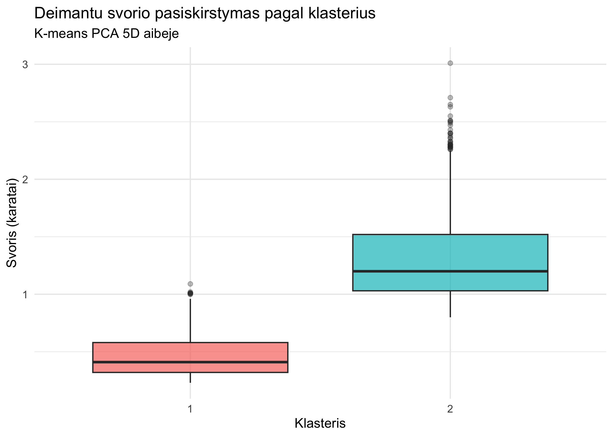
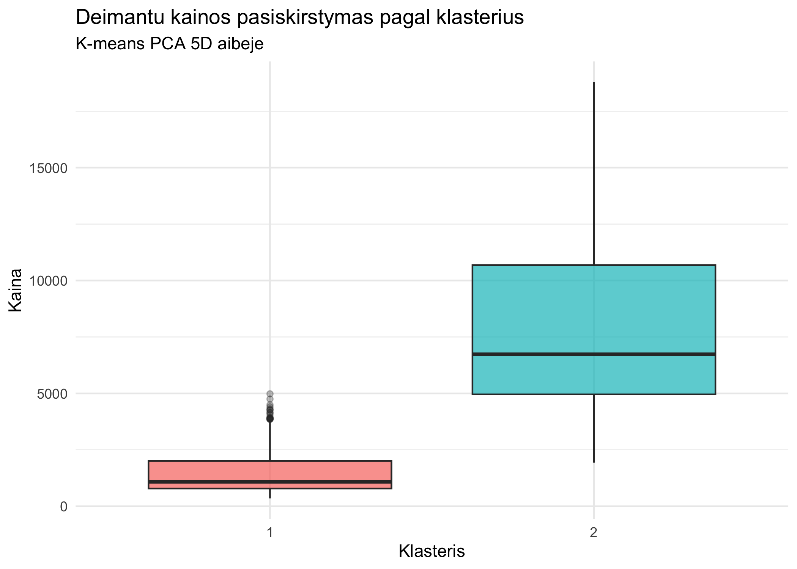
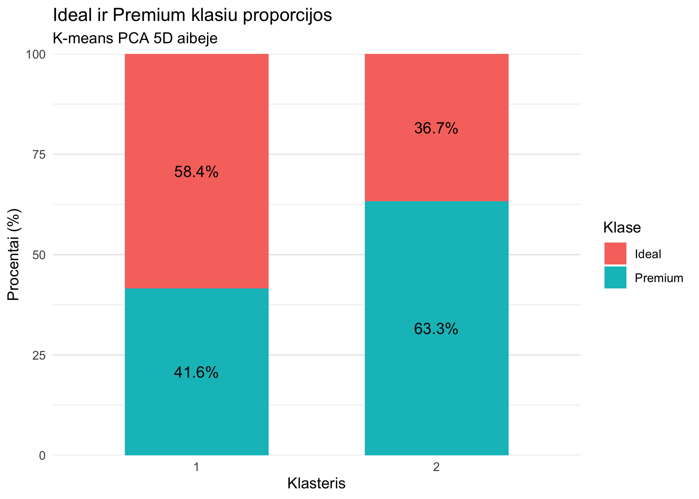
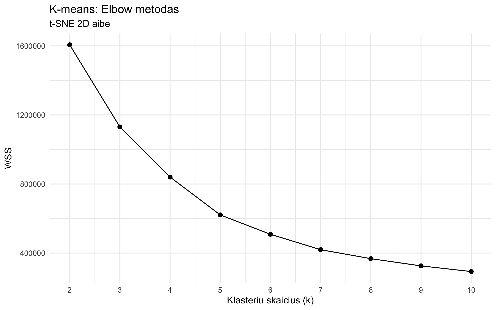
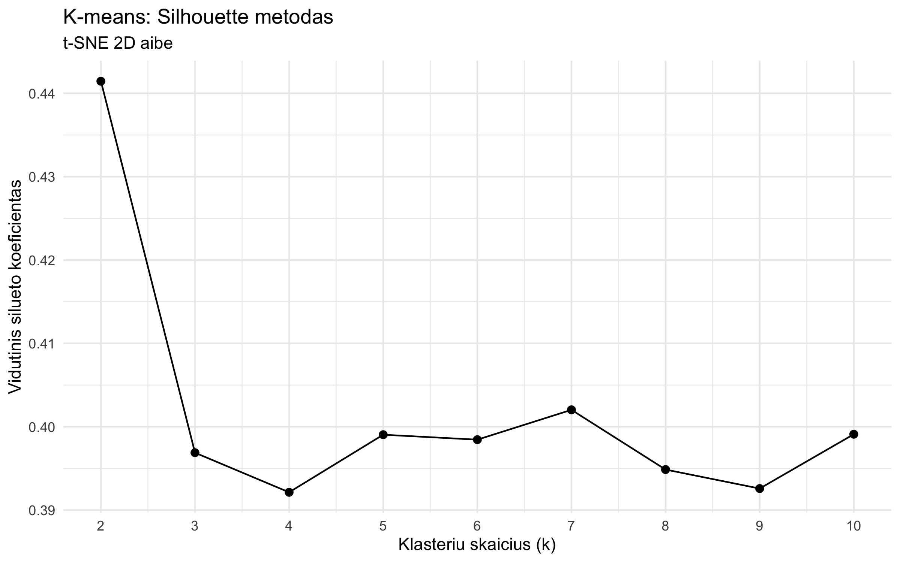
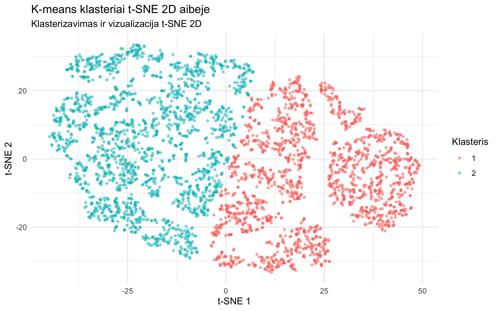
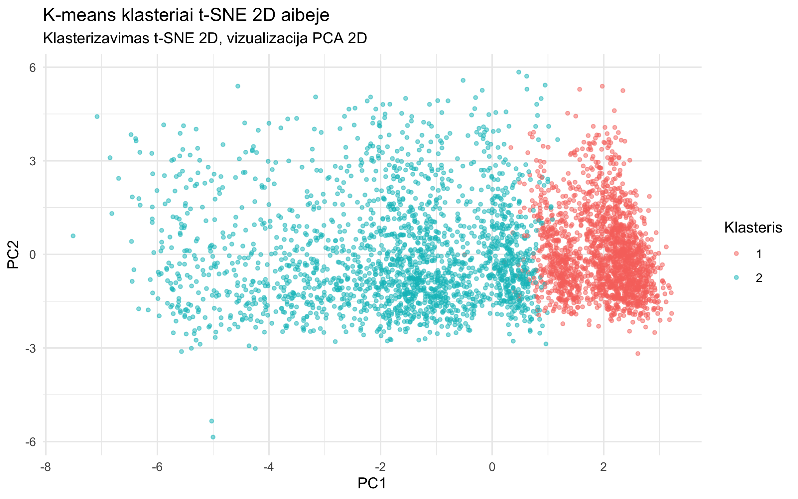
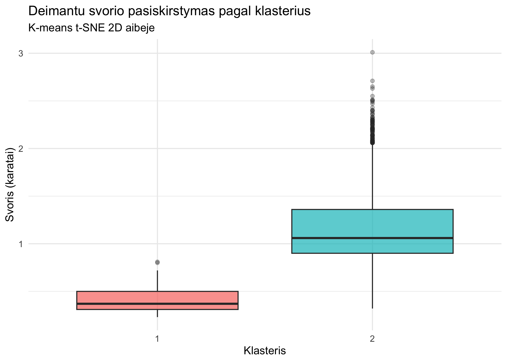
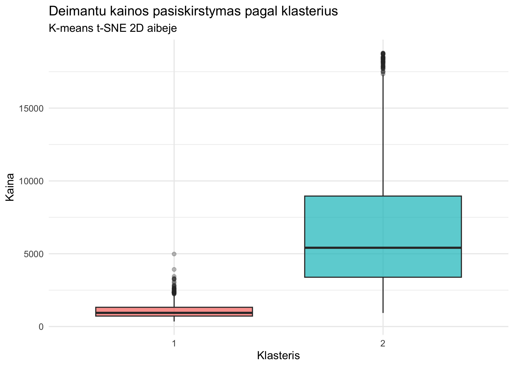
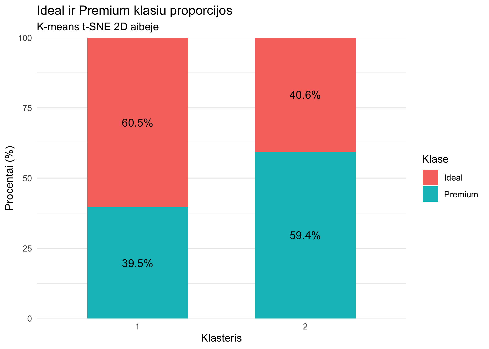

# A02 deimantų klasterizavimas

Šiame projekte atliekamas daugiamačių duomenų(A02 aibės) klasterizavimas. Šis darbas pradedamas su po pirminio apdorojimo sutvarkyta duomenų aibe.
## Duomenų rinkinys

A02 duomenys aprašo realius apvaliai šlifuotus deimantus.

- Objektų skaičius: **4000**
- Stulpelių skaičius: **20**
- Skaitinių požymių skaičius: **19**
- Kategorinis požymis: `class`
- Klasės: **Ideal** ir **Premium**

Bazinė duomenų aibė: `ggplot2::diamonds`.

Pagrindiniai požymiai:

- `carat` – deimanto masė;
- `depth`, `table` – deimanto proporcijų rodikliai;
- `price` – kaina;
- `x`, `y`, `z` – geometriniai matmenys;
- `volume_xyz`, `area_xy`, `area_xz`, `area_yz`, `mean_dimension` – išvestiniai dydžio rodikliai;
- `price_per_carat`, `length_width_ratio`, `depth_ratio`, `table_depth_ratio`, `carat_per_volume`, `price_per_volume`, `dimension_cv` – išvestiniai santykiniai rodikliai.

Duomenų būklė po pirmojo darbo:

| Charakteristika | Galutinė reikšmė |
|---|---:|
| Objektai | 4000 |
| Požymiai | 20 |
| Ideal | 2000 |
| Premium | 2000 |
| Dublikatai | 0 |
| Likę NA | 0 |

---

## 3 darbas. Dimensijos mažinimas klasterizavime

### 1. Duomenų paruošimas

Naudojome antrojo darbo **C duomenų aibę**, sudarytą iš `A02.csv`. Duomenų paruošimas išlaikytas toks pat kaip antrajame darbe, kad rezultatai būtų palyginami.

- Sutvarkytos neteisingos ir trūkstamos reikšmės.
- Apskaičiuoti išvestiniai požymiai.
- Pašalintos ekstremalios išskirtys pagal **3 × IQR** taisyklę.
- Atliktas **robust scaling** normavimas, kad skirtingų mastelių požymiai būtų palyginami.

**Gauta C aibė: 3928 objektai ir 19 požymių.**

### 2. Dimensijos mažinimas

Iš originalios C aibės sudarėme dar dvi aibes, kad galėtume palyginti klasterizavimo rezultatus skirtingų dimensijų erdvėse.

**PCA (5D)** – globalus dimensijos mažinimo metodas. Komponenčių skaičių parinkome pagal **95 % paaiškintos dispersijos kriterijų**. Pakako 5 komponenčių, todėl sumažinome dimensiją nuo 19D iki 5D, išsaugodami didžiąją dalį duomenų dispersijos.

**t-SNE (2D)** – lokalus dimensijos mažinimo metodas, pasirinktas remiantis antrojo darbo rezultatais. Duomenis sumažinome iki 2D, siekdami išsaugoti artimų objektų kaimynystes.

Naudoti t-SNE parametrai:
- `perplexity = 30`
- `max_iter = 1000`
- `seed = 42`

### 3. Gautos duomenų aibės

| Aibė | Objektų skaičius | Dimensija |
|---|---:|---:|
| Originali C | 3928 | 19D |
| PCA | 3928 | 5D |
| t-SNE | 3928 | 2D |

Visose trijose aibėse išsaugoti tie patys objektai, jų `id` ir `class`, kad būtų galima tiesiogiai palyginti klasterizavimo rezultatus. `class` nebuvo naudojamas dimensijos mažinimui.

Duomenų aibės išsaugotos `aibes/` aplanke, o jų paruošimo kodas pateiktas `vykdymas.R` faile.
 

### 4. K-means parametrų parinkimas originalioje C aibėje (19D)

Optimalų klasterių skaičių vertinome naudodami **Elbow** ir **vidutinio silueto** metodus. Tikrinome klasterių skaičių nuo `k = 2` iki `k = 10`.

#### Elbow metodas

WSS mažėjo didėjant klasterių skaičiui, tačiau maždaug nuo `k = 5` mažėjimas sulėtėjo. Tai rodo, kad toliau didinant klasterių skaičių papildoma nauda tampa mažesnė.

#### Silhouette metodas

Didžiausias vidutinis silueto koeficientas gautas, kai `k = 2` (0,3732). Didėjant `k`, silueto reikšmės nuosekliai mažėjo, todėl pagal šį metodą tinkamiausias klasterių skaičius yra 2.

#### Parametrų eksperimentai

Papildomai atlikome 6 bandymus, keisdami klasterių skaičių `k`, pradinių centrų parinkimų skaičių `nstart` ir atsitiktinę sėklą (`seed`).

| k | nstart | seed | WSS | Silhouette |
|---|---:|---:|---:|---:|
| 2 | 25 | 42 | 22174,12 | 0,3732 |
| 3 | 25 | 42 | 18210,08 | 0,3174 |
| 4 | 25 | 42 | 15077,90 | 0,2921 |
| 5 | 25 | 42 | 13346,07 | 0,2603 |
| 2 | 10 | 42 | 22174,12 | 0,3732 |
| 2 | 25 | 123 | 22174,12 | 0,3732 |

Keičiant `nstart` ir `seed`, kai `k = 2`, WSS, Silhouette ir klasterių dydžiai nepasikeitė. Tai rodo, kad šių bandymų metu rezultatai pagal vertintus rodiklius buvo stabilūs.

**Pagrindiniam K-means klasterizavimui pasirinkome `k = 2`, `nstart = 25`, `seed = 42`**, nes šis derinys davė didžiausią Silhouette reikšmę iš patikrintų klasterių skaičių.

Eksperimentų rezultatai išsaugoti `rezultatai/kmeans_eksperimentai_originali.csv`, o Elbow ir Silhouette grafikai – `grafikai/` aplanke.

### 5. K-means klasterizavimas originalioje C aibėje (19D)

Pritaikėme K-means algoritmą su pasirinktais parametrais `k = 2`, `nstart = 25` ir `seed = 42`. Gauti du klasteriai:

| Rodiklis | 1 klasteris | 2 klasteris |
|---|---:|---:|
| Objektų skaičius | 2399 | 1529 |
| Karatų mediana | 0,41 | 1,20 |
| Kainos mediana | 1080 | 6720 |
| Tūrio mediana | 67,77 | 193,23 |
| Kainos už karatą mediana | 2805,36 | 5743,52 |

**1 klasteris** apima mažesnius ir pigesnius deimantus, o **2 klasteris** – didesnius ir brangesnius. Taigi K-means daugiausia atskyrė objektus pagal jų dydį ir kainą.

#### Klasterizavimo kokybė

Apskaičiavome tris vidinius klasterizavimo kokybės rodiklius:

| Rodiklis | Reikšmė |
|---|---:|
| Silhouette | 0,3732 |
| Calinski–Harabasz | 2725,921 |
| Davies–Bouldin | 1,1218 |

Silhouette reikšmė rodo, kad klasteriai atskirti vidutiniškai. Kitus rodiklius naudosime rezultatams skirtingose dimensijų erdvėse palyginti.

#### Klasterių vizualizacija

Kadangi originali C aibė turi 19 požymių, klasterizavimo rezultatus pavaizdavome dvimatėse PCA ir t-SNE projekcijose. Abiem atvejais klasteriai nustatyti originalioje 19D erdvėje, o dimensijos mažinimas naudotas tik vizualizavimui.

**PCA 2D vizualizacija**

**t-SNE 2D vizualizacija**

Abiejose projekcijose matomos dvi gana aiškios grupės, tačiau jų sandūroje yra persidengiančių objektų. t-SNE projekcijoje taip pat išryškėja mažesnės lokalios objektų grupės.

#### Klasterių požymių palyginimas

Deimantų svorio ir kainos pasiskirstymus palyginome naudodami dėžučių diagramas (boxplot).

**Deimantų svoris (carat)**

**Deimantų kaina (price)**

Grafikai parodo, kad antrajame klasteryje deimantai paprastai yra didesni ir brangesni, taip pat matoma didesnė jų kainų sklaida.

#### Klasterių sudėtis pagal klases

Palyginome klasterius su pradinėmis `Ideal` ir `Premium` klasėmis, kurios nebuvo naudojamos klasterizavimui.

| Klasė | 1 klasteris | 2 klasteris |
|---|---:|---:|
| Ideal | 58,36 % | 36,82 % |
| Premium | 41,64 % | 63,18 % |

Pirmajame klasteryje daugiau `Ideal`, o antrajame – `Premium` klasės deimantų. Tačiau abi klasės pasitaiko abiejuose klasteriuose, todėl gautas suskirstymas labiau susijęs su deimantų dydžiu ir kaina nei su jų pradine klase.

### 6. K-means klasterizavimas PCA 5D aibėje

#### Parametrų parinkimas

Pritaikėme K-means algoritmą PCA metodu sumažintai aibei (3928 objektai, 5 komponentės). Klasterių skaičių iš naujo vertinome Elbow ir vidutinio silueto metodais, tikrindami `k = 2–10`.

**Elbow metodas**

WSS mažėjo didėjant klasterių skaičiui, tačiau maždaug nuo `k = 5` mažėjimas sulėtėjo.

**Silhouette metodas**

Didžiausias vidutinis silueto koeficientas gautas, kai `k = 2` (0,3852). Didėjant klasterių skaičiui, silueto koeficientas mažėjo.

#### Parametrų eksperimentai

Atlikome 6 bandymus, keisdami `k`, `nstart` ir `seed`.

| k | nstart | seed | WSS | Silhouette |
|---|---:|---:|---:|---:|
| 2 | 25 | 42 | 20996,16 | 0,3852 |
| 3 | 25 | 42 | 17038,72 | 0,3305 |
| 4 | 25 | 42 | 14010,12 | 0,3048 |
| 5 | 25 | 42 | 12264,17 | 0,2741 |
| 2 | 10 | 42 | 20996,16 | 0,3852 |
| 2 | 25 | 123 | 20996,16 | 0,3852 |

Keičiant `nstart` ir `seed`, kai `k = 2`, WSS, Silhouette ir klasterių dydžiai nepasikeitė.

**Pasirinkome `k = 2`, `nstart = 25`, `seed = 42`**, nes gautas didžiausias vidutinis silueto koeficientas.

#### Klasterizavimo rezultatai

PCA 5D aibėje išskirti du klasteriai:

| Rodiklis | 1 klasteris | 2 klasteris |
|---|---:|---:|
| Objektų skaičius | 2403 | 1525 |
| Ideal (%) | 58,39 | 36,72 |
| Premium (%) | 41,61 | 63,28 |

Klasterių dydžiai ir klasių proporcijos labai panašūs į originalios 19D aibės rezultatus.

#### Klasterizavimo kokybė

Apskaičiavome tris vidinius klasterizavimo kokybės rodiklius ir palyginome juos su originalios C aibės rezultatais.

| Rodiklis | Originali C (19D) | PCA 5D |
|---|---:|---:|
| Silhouette ↑ | 0,3732 | **0,3852** |
| Calinski–Harabasz ↑ | 2725,921 | **2877,729** |
| Davies–Bouldin ↓ | 1,1218 | **1,0877** |

Sumažinus dimensiją nuo 19D iki 5D, visi trys kokybės rodikliai šiek tiek pagerėjo. Tačiau jie apskaičiuoti skirtingose erdvėse, todėl vien iš jų negalima spręsti, ar išliko tas pats objektų suskirstymas.

#### Klasterių vizualizacija

PCA 5D aibėje gautus K-means klasterius pavaizdavome dvimatėse PCA ir t-SNE projekcijose. Abiem atvejais klasterizavimas atliktas PCA 5D erdvėje, o 2D projekcijos naudotos tik rezultatams vizualizuoti.

**PCA 2D vizualizacija**

**t-SNE 2D vizualizacija**

Abiejose projekcijose klasteriai gana aiškiai atsiskiria, nors jų sandūroje matomas nedidelis persidengimas. Vizualiai PCA 5D klasterizavimo rezultatai beveik nesiskiria nuo originalios C aibės rezultatų.

#### Klasterių požymių palyginimas

Klasterių charakteristikas įvertinome pagal originalius deimantų požymius, nes PCA komponentės tiesiogiai neatitinka pradinių matavimo vienetų.

**Deimantų svorio pasiskirstymas**

**Deimantų kainos pasiskirstymas**

Abiejuose grafikuose matyti, kad pirmąjį klasterį daugiausia sudaro mažesni ir pigesni deimantai, o antrąjį – didesni ir brangesni. Antrajame klasteryje taip pat pastebima didesnė svorio ir kainos sklaida.

#### Klasterių sudėtis pagal klases

Klasterių pasiskirstymą papildomai įvertinome pagal pradines `Ideal` ir `Premium` klases.

Pirmajame klasteryje `Ideal` sudaro 58,39 %, o antrajame `Premium` – 63,28 %. Abi klasės pasitaiko abiejuose klasteriuose, todėl suskirstymas labiau atspindi deimantų dydžio ir kainos skirtumus nei pradinę klasę.

#### Rezultatų išsaugojimas

Eksperimentų rezultatai išsaugoti `rezultatai/kmeans_eksperimentai_pca.csv`, kokybės rodikliai – `rezultatai/kmeans_kokybe_pca.csv`, o klasterių požymių medianos – `rezultatai/kmeans_pca_klasteriu_medianos.csv`.

Visi grafikai išsaugoti `grafikai/` aplanke.

### 7. K-means klasterizavimas t-SNE 2D aibėje

#### Parametrų parinkimas

Pritaikėme K-means algoritmą t-SNE metodu sumažintai aibei (3928 objektai, 2 dimensijos). Klasterių skaičių iš naujo vertinome Elbow ir vidutinio silueto metodais, tikrindami `k = 2–10`.

**Elbow metodas**

WSS mažėjo didėjant klasterių skaičiui. Ryškiausias mažėjimas pastebėtas esant mažesnėms `k` reikšmėms, o maždaug nuo `k = 5–6` kreivė pradėjo lėtėti.

**Silhouette metodas**

Didžiausias vidutinis silueto koeficientas gautas, kai `k = 2` (0,4415). Esant didesniam klasterių skaičiui rodiklis svyravo, tačiau šios reikšmės neviršijo `k = 2` rezultato.

#### Parametrų eksperimentai

Atlikome 6 bandymus, keisdami `k`, `nstart` ir `seed`.

| k | nstart | seed | WSS | Silhouette |
|---|---:|---:|---:|---:|
| 2 | 25 | 42 | 1606573,4 | 0,4415 |
| 3 | 25 | 42 | 1130509,9 | 0,3969 |
| 4 | 25 | 42 | 840259,4 | 0,3921 |
| 5 | 25 | 42 | 620763,8 | 0,3990 |
| 2 | 10 | 42 | 1606573,4 | 0,4415 |
| 2 | 25 | 123 | 1606573,4 | 0,4415 |

Keičiant `nstart` ir `seed`, kai `k = 2`, WSS, Silhouette ir klasterių dydžiai nepasikeitė.

**Pasirinkome `k = 2`, `nstart = 25`, `seed = 42`**, nes gautas didžiausias vidutinis silueto koeficientas.

#### Klasterizavimo rezultatai

t-SNE 2D aibėje išskirti du klasteriai:

| Rodiklis | 1 klasteris | 2 klasteris |
|---|---:|---:|
| Objektų skaičius | 1856 | 2072 |
| Ideal (%) | 60,45 | 40,59 |
| Premium (%) | 39,55 | 59,41 |

Pirmajame klasteryje daugiau `Ideal`, o antrajame – `Premium` klasės deimantų. Tačiau abi klasės pasitaiko abiejuose klasteriuose.

#### Klasterizavimo kokybė

Apskaičiavome tris vidinius kokybės rodiklius ir palyginome juos su originalios C bei PCA 5D aibių rezultatais.

| Rodiklis | Originali C (19D) | PCA 5D | t-SNE 2D |
|---|---:|---:|---:|
| Silhouette ↑ | 0,3732 | 0,3852 | **0,4415** |
| Calinski–Harabasz ↑ | 2725,921 | 2877,729 | **4426,787** |
| Davies–Bouldin ↓ | 1,1218 | 1,0877 | **0,8825** |

Pagal visus tris rodiklius t-SNE 2D erdvėje gauti palankiausi rezultatai. Tačiau t-SNE pakeičia atstumus tarp objektų, todėl šie rodikliai neįrodo, kad originali duomenų struktūra išsaugota geriau.

#### Klasterių vizualizacija

t-SNE 2D aibėje gautus klasterius pavaizdavome tiek t-SNE 2D, tiek PCA 2D projekcijose. Abiem atvejais naudoti tie patys t-SNE erdvėje gauti K-means klasteriai, keičiamos tik jų atvaizdavimo koordinatės.

**t-SNE 2D vizualizacija**

**PCA 2D vizualizacija**

t-SNE projekcijoje klasteriai gana aiškiai atsiskiria, tačiau PCA projekcijoje jų riba labiau persidengia. Palyginti su originalios 19D ir PCA 5D aibių rezultatais, t-SNE erdvėje dalis objektų buvo priskirta kitaip.

#### Klasterių požymių palyginimas

Klasterius interpretavome pagal originalius deimantų požymius.

| Požymis (mediana) | 1 klasteris | 2 klasteris |
|---|---:|---:|
| Karatai | 0,37 | 1,06 |
| Kaina | 940 | 5410,5 |
| Tūrio rodiklis | 60,61 | 174,43 |
| Kaina už karatą | 2586,58 | 4871,71 |

**Deimantų svorio pasiskirstymas**

**Deimantų kainos pasiskirstymas**

Pirmąjį klasterį daugiausia sudaro mažesni ir pigesni deimantai, o antrąjį – didesni ir brangesni. Antrajame klasteryje matoma didesnė svorio ir kainos sklaida.

#### Klasterių sudėtis pagal klases

Pirmajame klasteryje `Ideal` sudaro 60,45 %, o antrajame `Premium` – 59,41 %. Taigi klasteriai nėra tapatūs pradinėms klasėms ir labiau atspindi deimantų dydžio bei kainos skirtumus.

#### Rezultatų išsaugojimas

Eksperimentų rezultatai išsaugoti `rezultatai/kmeans_eksperimentai_tsne.csv`, kokybės rodikliai – `rezultatai/kmeans_kokybe_tsne.csv`, o klasterių požymių medianos – `rezultatai/kmeans_tsne_klasteriu_medianos.csv`.

Visi grafikai išsaugoti `grafikai/` aplanke.

### 8. K-means klasterizavimo rezultatų palyginimas naudojant išorinius rodiklius

#### 8.1. Vertinimo tikslas

Siekiant įvertinti, kaip dimensijos mažinimas paveikė K-means klasterizavimo rezultatus, palyginome objektų priskyrimus klasteriams trijose duomenų erdvėse:

- **Originalioje C aibėje (19D)** – atskaitos rezultatas.
- **PCA sumažintoje aibėje (5D)** – globalus dimensijos mažinimo metodas.
- **t-SNE sumažintoje aibėje (2D)** – lokalus dimensijos mažinimo metodas.

Visose aibėse buvo tie patys 3928 objektai, o K-means algoritmui parinkti vienodi pagrindiniai parametrai: `k = 2`, `nstart = 25` ir `seed = 42`.

Objektai prieš palyginimą suderinti pagal jų identifikatorius (`id`), kad būtų lyginami tų pačių deimantų priskyrimai klasteriams.

#### 8.2. Naudoti išoriniai vertinimo rodikliai

Klasterizavimo rezultatų panašumui įvertinti apskaičiavome tris išorinius rodiklius.

**Adjusted Rand Index (ARI)** – vertina dviejų suskirstymų panašumą pagal objektų porų priskyrimus, atsižvelgdamas į galimą atsitiktinį sutapimą. Reikšmė `1` reiškia visišką suskirstymų sutapimą, o reikšmė apie `0` – panašumą, artimą atsitiktiniam.

**Normalized Mutual Information (NMI)** – vertina, kiek bendros informacijos turi du klasterizavimo rezultatai. Reikšmės kinta nuo `0` iki `1`, kur `1` reiškia visišką informacinį suskirstymų atitikimą. Naudojome normalizavimą pagal aritmetinį abiejų suskirstymų entropijų vidurkį.

**Jaccard indeksas** – vertina objektų porų, priskirtų tam pačiam klasteriui abiejuose suskirstymuose, sutapimą. Reikšmė `1` reiškia visišką porų sutapimą.

Šie rodikliai nepriklauso nuo klasterių numerių, todėl leidžia korektiškai palyginti suskirstymus net tada, kai klasterių numeracija skiriasi.

#### 8.3. Išorinių rodiklių rezultatai

| Palyginimas | ARI ↑ | NMI ↑ | Jaccard ↑ |
|---|---:|---:|---:|
| **Originali 19D ir PCA 5D** | **0,9959** | **0,9891** | **0,9961** |
| Originali 19D ir t-SNE 2D | 0,5218 | 0,5332 | 0,6220 |
| PCA 5D ir t-SNE 2D | 0,5204 | 0,5347 | 0,6212 |

Gauti rezultatai rodo, kad PCA 5D klasterizavimo rezultatai beveik visiškai sutampa su originalios 19D aibės rezultatais. Tuo tarpu t-SNE 2D erdvėje gautas suskirstymas pastebimai labiau skiriasi.

#### 8.4. Originalios 19D ir PCA 5D aibių palyginimas

Palyginus originalios ir PCA sumažintos aibės objektų priskyrimus, gauta tokia sutapimo lentelė:

| Originalios 19D aibės klasteris | PCA 5D: 1 klasteris | PCA 5D: 2 klasteris |
|---|---:|---:|
| 1 klasteris | 2399 | 0 |
| 2 klasteris | 4 | 1525 |

Iš 3928 objektų **3924 išliko tuose pačiuose klasteriuose**, o tik 4 objektai pakeitė klasterį.

Tai sudaro:

- **99,90 %** sutampančių objektų priskyrimų.
- **0,10 %** pasikeitusių priskyrimų.

Šį rezultatą patvirtina ir išoriniai rodikliai:

- ARI = 0,9959
- NMI = 0,9891
- Jaccard = 0,9961

Visos trys reikšmės labai artimos `1`, todėl galima teigti, kad **PCA sumažinimas nuo 19 iki 5 dimensijų beveik visiškai išsaugojo originalų K-means objektų suskirstymą**.

Tai ypač svarbu, nes PCA 5D aibė buvo sudaryta siekiant sumažinti požymių skaičių ir kartu išsaugoti ne mažiau kaip 95 % pradinės dispersijos.

#### 8.5. Originalios 19D ir t-SNE 2D aibių palyginimas

Palyginus originalios aibės ir t-SNE 2D klasterizavimo rezultatus, gauta tokia sutapimo lentelė:

| Originalios 19D aibės klasteris | t-SNE 2D: 1 klasteris | t-SNE 2D: 2 klasteris |
|---|---:|---:|
| 1 klasteris | 1855 | 544 |
| 2 klasteris | 1 | 1528 |

Matome, kad:

- 1855 pirmojo klasterio objektai išliko pirmajame klasteryje.
- 544 pirmojo klasterio objektai t-SNE erdvėje pateko į antrąjį klasterį.
- 1528 antrojo klasterio objektai išliko antrajame.
- 1 antrojo klasterio objektas pateko į pirmąjį.

Iš viso **545 objektai iš 3928 pakeitė klasterį**, o 3383 objektų priskyrimai sutapo.

Tai sudaro:

- **86,13 %** sutampančių objektų priskyrimų.
- **13,87 %** pasikeitusių priskyrimų.

Išoriniai rodikliai:

- ARI = 0,5218
- NMI = 0,5332
- Jaccard = 0,6220

Šios reikšmės gerokai mažesnės nei PCA atveju, todėl galima teigti, kad **t-SNE 2D dimensijos mažinimas pastebimai pakeitė pradinį K-means suskirstymą**.

Tai galima paaiškinti tuo, kad t-SNE pirmiausia siekia išsaugoti lokalias objektų kaimynystes, o ne visus globalius atstumus tarp objektų. Todėl dvimatėje erdvėje objektų tarpusavio išsidėstymas gali pasikeisti ir turėti įtakos K-means rezultatams.

#### 8.6. PCA 5D ir t-SNE 2D palyginimas

Palyginus abu dimensijos mažinimo metodus, gauti rodikliai:

| Rodiklis | Reikšmė |
|---|---:|
| ARI | 0,5204 |
| NMI | 0,5347 |
| Jaccard | 0,6212 |

Rezultatai labai panašūs į originalios 19D ir t-SNE 2D aibių palyginimą.

Tai rodo, kad PCA 5D suskirstymas išlieka artimas originaliam, o t-SNE 2D suformuoja labiau besiskiriantį objektų grupavimą.

#### 8.7. Vidinių ir išorinių rodiklių palyginimas

Norėdami įvertinti ne tik klasterių sutapimą, bet ir jų kokybę skirtingose erdvėse, palyginome anksčiau apskaičiuotus vidinius rodiklius.

| Rodiklis | Originali C (19D) | PCA 5D | t-SNE 2D |
|---|---:|---:|---:|
| Silhouette ↑ | 0,3732 | 0,3852 | **0,4415** |
| Calinski–Harabasz ↑ | 2725,921 | 2877,729 | **4426,787** |
| Davies–Bouldin ↓ | 1,1218 | 1,0877 | **0,8825** |
| ARI su originalia 19D ↑ | 1,0000 | **0,9959** | 0,5218 |
| NMI su originalia 19D ↑ | 1,0000 | **0,9891** | 0,5332 |
| Jaccard su originalia 19D ↑ | 1,0000 | **0,9961** | 0,6220 |

Pagal vidinius kokybės rodiklius geriausios reikšmės gautos t-SNE 2D erdvėje. Šioje erdvėje klasteriai atrodo geriau atskirti ir kompaktiškesni pagal joje apskaičiuotus atstumus.

Tačiau išoriniai rodikliai parodo kitokią situaciją: **PCA 5D beveik visiškai išsaugo originalius klasterius, o t-SNE 2D juos pakeičia labiau**.

Svarbu atsižvelgti į tai, kad vidiniai rodikliai buvo apskaičiuoti skirtingų dimensijų erdvėse. Ypač t-SNE atveju atstumų struktūra yra pakeista, todėl didesnės Silhouette ar Calinski–Harabasz reikšmės savaime neįrodo, kad geriau išsaugota originalių duomenų struktūra.

#### 8.8. Išvados

1. **PCA 5D beveik visiškai išsaugojo originalų K-means suskirstymą.** Tik 4 iš 3928 objektų pakeitė klasterį, o ARI siekė 0,9959.

2. **t-SNE 2D klasterizavimo rezultatai skyrėsi labiau.** Palyginti su originalia 19D aibe, pasikeitė 545 objektų priskyrimai, o ARI sumažėjo iki 0,5218.

3. **t-SNE 2D pasižymėjo palankiausiais vidiniais kokybės rodikliais**, tačiau tai nereiškia, kad originalus suskirstymas buvo išsaugotas geriausiai.

4. **PCA 5D šiuo atveju yra tinkamesnis metodas, jei siekiama sumažinti dimensiją ir išlaikyti originalią klasterių struktūrą.** Jis sumažino požymių skaičių nuo 19 iki 5 ir beveik nepakeitė objektų priskyrimų klasteriams.

5. **Vidiniai ir išoriniai rodikliai vertina skirtingus klasterizavimo aspektus.** Todėl norint įvertinti dimensijos mažinimo poveikį svarbu nagrinėti tiek klasterių kokybę sumažintoje erdvėje, tiek jų sutapimą su originalios aibės rezultatais.

#### 8.9. Rezultatų failai

Išorinių rodiklių rezultatai išsaugoti faile:

`rezultatai/kmeans_isoriniai_rodikliai.csv`

Skaičiavimai atlikti `kmeans.R` failo 31 skyriuje.
