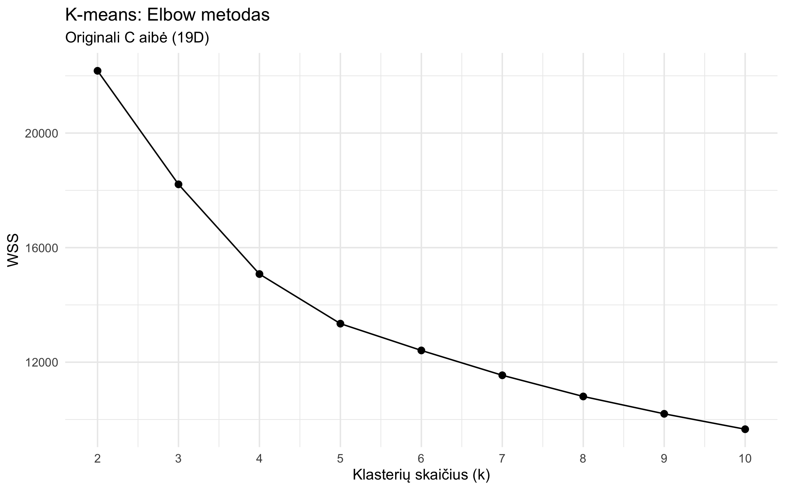
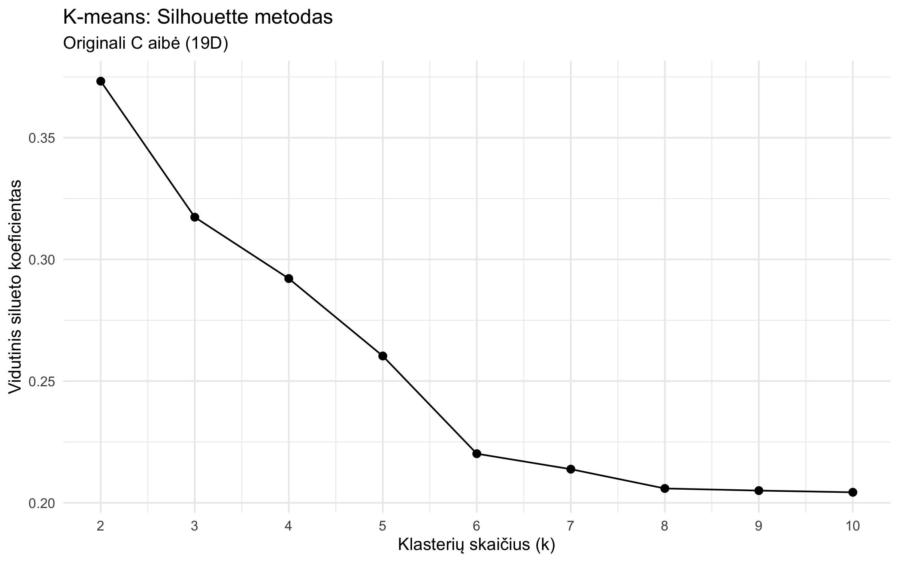
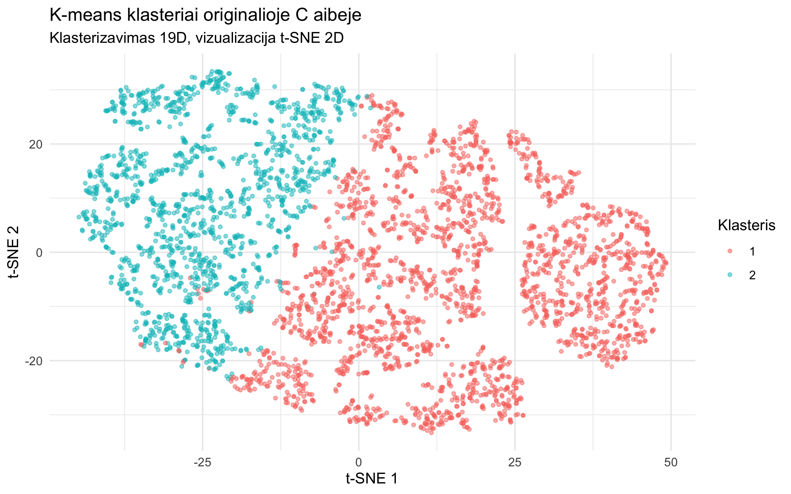
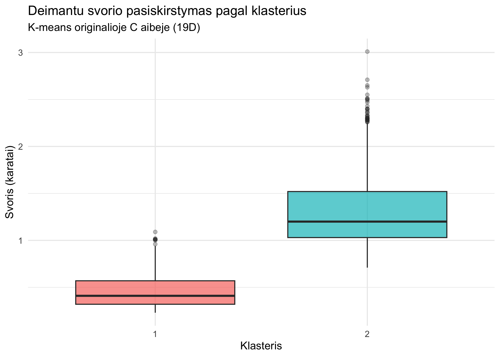
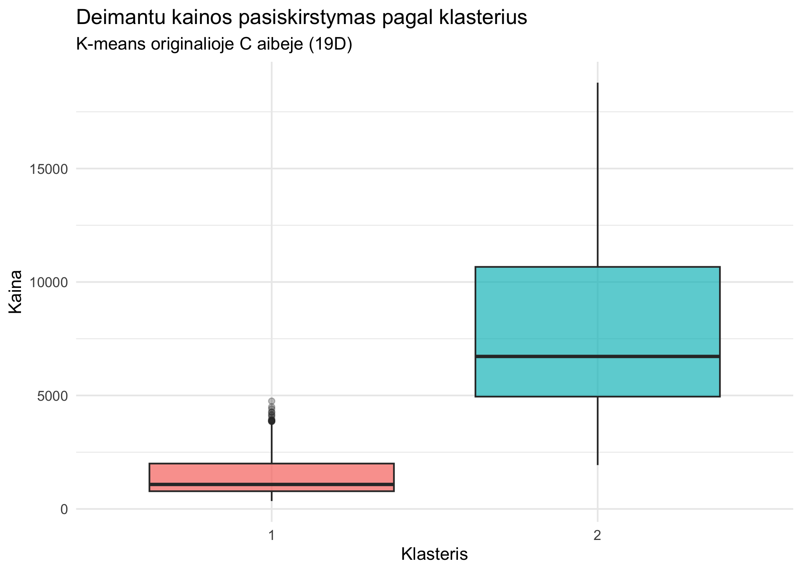
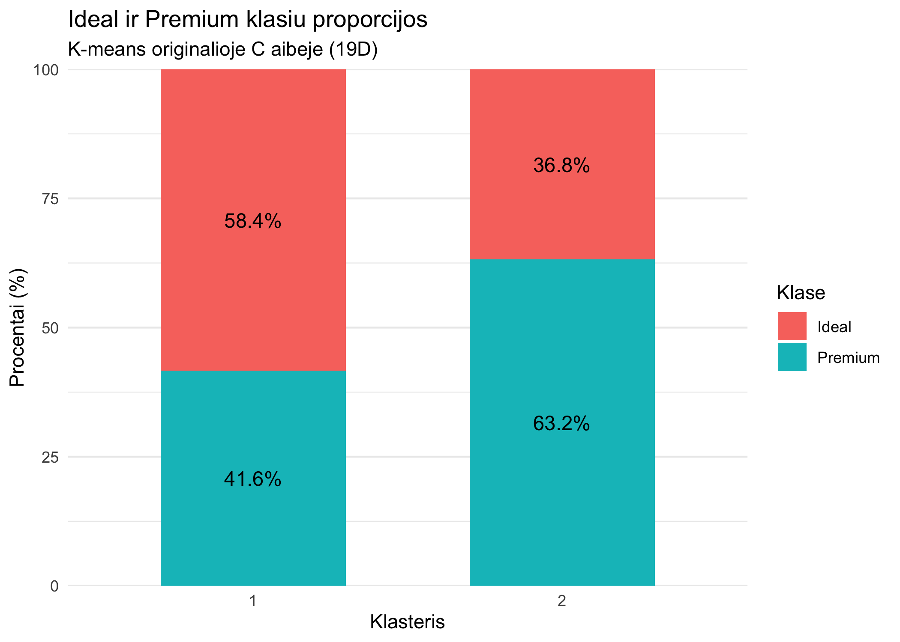
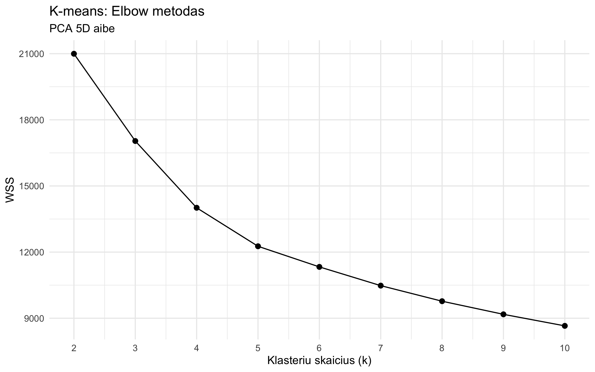
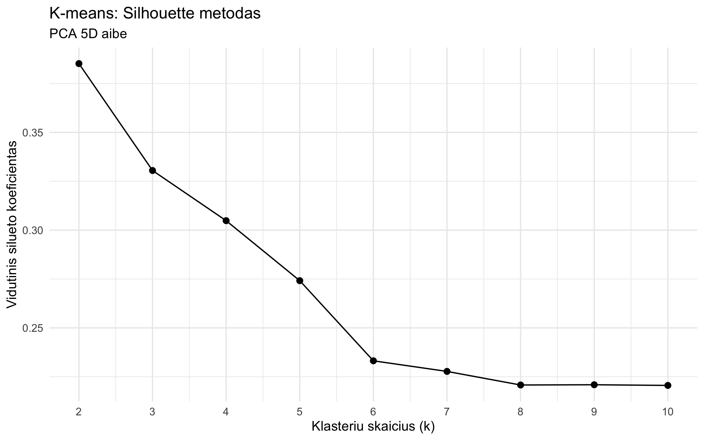
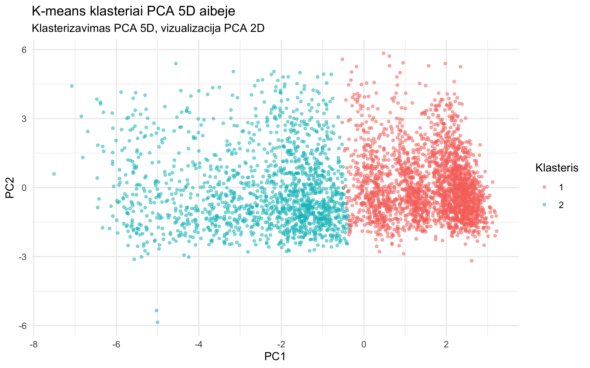
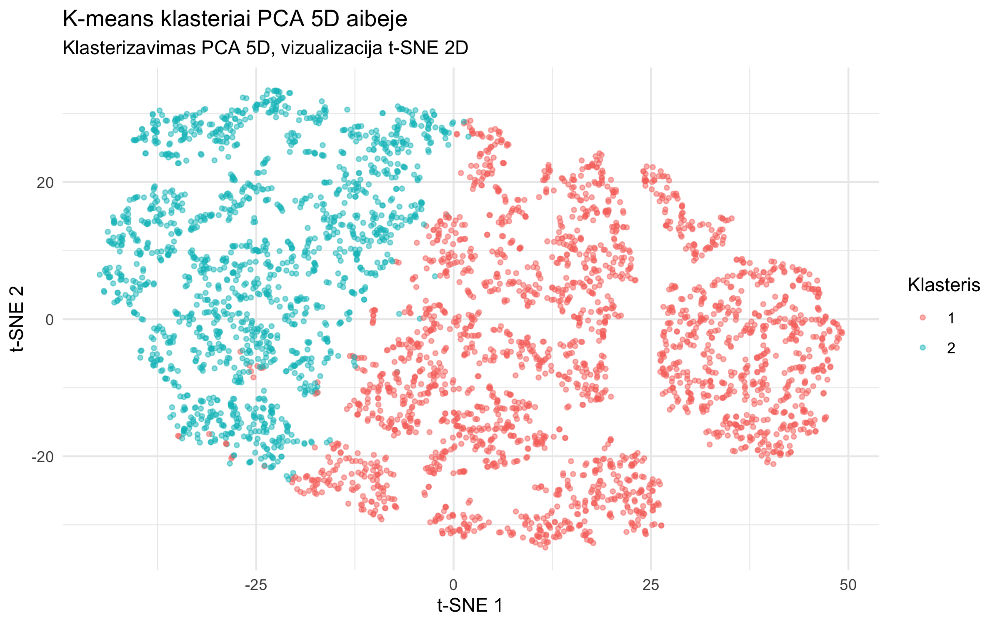

# A02 deimantų klasterizavimas

Šiame projekte atliekamas daugiamačių duomenų(A02 aibės) klasterizavimas. Šis darbas pradedamas su po pirminio apdorojimo sutvarkyta duomenų aibe.
## Duomenų rinkinys

A02 duomenys aprašo realius apvaliai šlifuotus deimantus.

- Objektų skaičius: **4000**
- Stulpelių skaičius: **20**
- Skaitinių požymių skaičius: **19**
- Kategorinis požymis: `class`
- Klasės: **Ideal** ir **Premium**

Bazinė duomenų aibė: `ggplot2::diamonds`.

Pagrindiniai požymiai:

- `carat` – deimanto masė;
- `depth`, `table` – deimanto proporcijų rodikliai;
- `price` – kaina;
- `x`, `y`, `z` – geometriniai matmenys;
- `volume_xyz`, `area_xy`, `area_xz`, `area_yz`, `mean_dimension` – išvestiniai dydžio rodikliai;
- `price_per_carat`, `length_width_ratio`, `depth_ratio`, `table_depth_ratio`, `carat_per_volume`, `price_per_volume`, `dimension_cv` – išvestiniai santykiniai rodikliai.

Duomenų būklė po pirmojo darbo:

| Charakteristika | Galutinė reikšmė |
|---|---:|
| Objektai | 4000 |
| Požymiai | 20 |
| Ideal | 2000 |
| Premium | 2000 |
| Dublikatai | 0 |
| Likę NA | 0 |

---

## 3 darbas. Dimensijos mažinimas klasterizavime

### 1. Duomenų paruošimas

Naudojome antrojo darbo **C duomenų aibę**, sudarytą iš `A02.csv`. Duomenų paruošimas išlaikytas toks pat kaip antrajame darbe, kad rezultatai būtų palyginami.

- Sutvarkytos neteisingos ir trūkstamos reikšmės.
- Apskaičiuoti išvestiniai požymiai.
- Pašalintos ekstremalios išskirtys pagal **3 × IQR** taisyklę.
- Atliktas **robust scaling** normavimas, kad skirtingų mastelių požymiai būtų palyginami.

**Gauta C aibė: 3928 objektai ir 19 požymių.**

### 2. Dimensijos mažinimas

Iš originalios C aibės sudarėme dar dvi aibes, kad galėtume palyginti klasterizavimo rezultatus skirtingų dimensijų erdvėse.

**PCA (5D)** – globalus dimensijos mažinimo metodas. Komponenčių skaičių parinkome pagal **95 % paaiškintos dispersijos kriterijų**. Pakako 5 komponenčių, todėl sumažinome dimensiją nuo 19D iki 5D, išsaugodami didžiąją dalį duomenų dispersijos.

**t-SNE (2D)** – lokalus dimensijos mažinimo metodas, pasirinktas remiantis antrojo darbo rezultatais. Duomenis sumažinome iki 2D, siekdami išsaugoti artimų objektų kaimynystes.

Naudoti t-SNE parametrai:
- `perplexity = 30`
- `max_iter = 1000`
- `seed = 42`

### 3. Gautos duomenų aibės

| Aibė | Objektų skaičius | Dimensija |
|---|---:|---:|
| Originali C | 3928 | 19D |
| PCA | 3928 | 5D |
| t-SNE | 3928 | 2D |

Visose trijose aibėse išsaugoti tie patys objektai, jų `id` ir `class`, kad būtų galima tiesiogiai palyginti klasterizavimo rezultatus. `class` nebuvo naudojamas dimensijos mažinimui.

Duomenų aibės išsaugotos `aibes/` aplanke, o jų paruošimo kodas pateiktas `vykdymas.R` faile.
 

### 4. K-means parametrų parinkimas originalioje C aibėje (19D)

Optimalų klasterių skaičių vertinome naudodami **Elbow** ir **vidutinio silueto** metodus. Tikrinome klasterių skaičių nuo `k = 2` iki `k = 10`.

#### Elbow metodas

WSS mažėjo didėjant klasterių skaičiui, tačiau maždaug nuo `k = 5` mažėjimas sulėtėjo. Tai rodo, kad toliau didinant klasterių skaičių papildoma nauda tampa mažesnė.

#### Silhouette metodas

Didžiausias vidutinis silueto koeficientas gautas, kai `k = 2` (0,3732). Didėjant `k`, silueto reikšmės nuosekliai mažėjo, todėl pagal šį metodą tinkamiausias klasterių skaičius yra 2.

#### Parametrų eksperimentai

Papildomai atlikome 6 bandymus, keisdami klasterių skaičių `k`, pradinių centrų parinkimų skaičių `nstart` ir atsitiktinę sėklą (`seed`).

| k | nstart | seed | WSS | Silhouette |
|---|---:|---:|---:|---:|
| 2 | 25 | 42 | 22174,12 | 0,3732 |
| 3 | 25 | 42 | 18210,08 | 0,3174 |
| 4 | 25 | 42 | 15077,90 | 0,2921 |
| 5 | 25 | 42 | 13346,07 | 0,2603 |
| 2 | 10 | 42 | 22174,12 | 0,3732 |
| 2 | 25 | 123 | 22174,12 | 0,3732 |

Keičiant `nstart` ir `seed`, kai `k = 2`, WSS, Silhouette ir klasterių dydžiai nepasikeitė. Tai rodo, kad šių bandymų metu rezultatai pagal vertintus rodiklius buvo stabilūs.

**Pagrindiniam K-means klasterizavimui pasirinkome `k = 2`, `nstart = 25`, `seed = 42`**, nes šis derinys davė didžiausią Silhouette reikšmę iš patikrintų klasterių skaičių.

Eksperimentų rezultatai išsaugoti `rezultatai/kmeans_eksperimentai_originali.csv`, o Elbow ir Silhouette grafikai – `grafikai/` aplanke.

### 5. K-means klasterizavimas originalioje C aibėje (19D)

Pritaikėme K-means algoritmą su pasirinktais parametrais `k = 2`, `nstart = 25` ir `seed = 42`. Gauti du klasteriai:

| Rodiklis | 1 klasteris | 2 klasteris |
|---|---:|---:|
| Objektų skaičius | 2399 | 1529 |
| Karatų mediana | 0,41 | 1,20 |
| Kainos mediana | 1080 | 6720 |
| Tūrio mediana | 67,77 | 193,23 |
| Kainos už karatą mediana | 2805,36 | 5743,52 |

**1 klasteris** apima mažesnius ir pigesnius deimantus, o **2 klasteris** – didesnius ir brangesnius. Taigi K-means daugiausia atskyrė objektus pagal jų dydį ir kainą.

#### Klasterizavimo kokybė

Apskaičiavome tris vidinius klasterizavimo kokybės rodiklius:

| Rodiklis | Reikšmė |
|---|---:|
| Silhouette | 0,3732 |
| Calinski–Harabasz | 2725,921 |
| Davies–Bouldin | 1,1218 |

Silhouette reikšmė rodo, kad klasteriai atskirti vidutiniškai. Kitus rodiklius naudosime rezultatams skirtingose dimensijų erdvėse palyginti.

#### Klasterių vizualizacija

Kadangi originali C aibė turi 19 požymių, klasterizavimo rezultatus pavaizdavome dvimatėse PCA ir t-SNE projekcijose. Abiem atvejais klasteriai nustatyti originalioje 19D erdvėje, o dimensijos mažinimas naudotas tik vizualizavimui.

**PCA 2D vizualizacija**

**t-SNE 2D vizualizacija**

Abiejose projekcijose matomos dvi gana aiškios grupės, tačiau jų sandūroje yra persidengiančių objektų. t-SNE projekcijoje taip pat išryškėja mažesnės lokalios objektų grupės.

#### Klasterių požymių palyginimas

Deimantų svorio ir kainos pasiskirstymus palyginome naudodami dėžučių diagramas (boxplot).

**Deimantų svoris (carat)**

**Deimantų kaina (price)**

Grafikai parodo, kad antrajame klasteryje deimantai paprastai yra didesni ir brangesni, taip pat matoma didesnė jų kainų sklaida.

#### Klasterių sudėtis pagal klases

Palyginome klasterius su pradinėmis `Ideal` ir `Premium` klasėmis, kurios nebuvo naudojamos klasterizavimui.

| Klasė | 1 klasteris | 2 klasteris |
|---|---:|---:|
| Ideal | 58,36 % | 36,82 % |
| Premium | 41,64 % | 63,18 % |

Pirmajame klasteryje daugiau `Ideal`, o antrajame – `Premium` klasės deimantų. Tačiau abi klasės pasitaiko abiejuose klasteriuose, todėl gautas suskirstymas labiau susijęs su deimantų dydžiu ir kaina nei su jų pradine klase.

### 6. K-means klasterizavimas PCA 5D aibėje

#### Parametrų parinkimas

Pritaikėme K-means algoritmą PCA metodu sumažintai aibei (3928 objektai, 5 komponentės). Klasterių skaičių iš naujo vertinome Elbow ir vidutinio silueto metodais, tikrindami `k = 2–10`.

**Elbow metodas**

WSS mažėjo didėjant klasterių skaičiui, tačiau maždaug nuo `k = 5` mažėjimas sulėtėjo.

**Silhouette metodas**

Didžiausias vidutinis silueto koeficientas gautas, kai `k = 2` (0,3852). Didėjant klasterių skaičiui silueto koeficientas mažėjo.

#### Parametrų eksperimentai

Atlikome 6 bandymus, keisdami `k`, `nstart` ir `seed`.

| k | nstart | seed | WSS | Silhouette |
|---|---:|---:|---:|---:|
| 2 | 25 | 42 | 20996,16 | 0,3852 |
| 3 | 25 | 42 | 17038,72 | 0,3305 |
| 4 | 25 | 42 | 14010,12 | 0,3048 |
| 5 | 25 | 42 | 12264,17 | 0,2741 |
| 2 | 10 | 42 | 20996,16 | 0,3852 |
| 2 | 25 | 123 | 20996,16 | 0,3852 |

Keičiant `nstart` ir `seed`, kai `k = 2`, WSS, Silhouette ir klasterių dydžiai nepasikeitė.

**Pasirinkome `k = 2`, `nstart = 25`, `seed = 42`**, nes gautas didžiausias vidutinis silueto koeficientas.

#### Klasterizavimo rezultatai

PCA 5D aibėje išskirti du klasteriai:

| Rodiklis | 1 klasteris | 2 klasteris |
|---|---:|---:|
| Objektų skaičius | 2403 | 1525 |
| Ideal (%) | 58,39 | 36,72 |
| Premium (%) | 41,61 | 63,28 |

Klasterių dydžiai ir klasių proporcijos labai panašūs į originalios 19D aibės rezultatus.

#### Klasterizavimo kokybė

Apskaičiavome tris vidinius klasterizavimo kokybės rodiklius ir palyginome juos su originalios C aibės rezultatais.

| Rodiklis | Originali C (19D) | PCA 5D |
|---|---:|---:|
| Silhouette ↑ | 0,3732 | **0,3852** |
| Calinski–Harabasz ↑ | 2725,921 | **2877,729** |
| Davies–Bouldin ↓ | 1,1218 | **1,0877** |

Sumažinus dimensiją nuo 19D iki 5D, visi trys kokybės rodikliai šiek tiek pagerėjo. Tačiau jie apskaičiuoti skirtingose erdvėse, todėl vien iš jų negalima spręsti, ar išliko tas pats objektų suskirstymas.

#### Klasterių vizualizacija

PCA 5D aibėje gautus K-means klasterius pavaizdavome dvimatėse PCA ir t-SNE projekcijose. Abiem atvejais klasterizavimas atliktas PCA 5D erdvėje, o 2D projekcijos naudotos tik rezultatams vizualizuoti.

**PCA 2D vizualizacija**

**t-SNE 2D vizualizacija**

Abiejose projekcijose klasteriai gana aiškiai atsiskiria, nors jų sandūroje matomas nedidelis persidengimas. Vizualiai PCA 5D klasterizavimo rezultatai beveik nesiskiria nuo originalios C aibės rezultatų.

Eksperimentų rezultatai išsaugoti `rezultatai/kmeans_eksperimentai_pca.csv`, o kokybės rodikliai – `rezultatai/kmeans_kokybe_pca.csv`.

