# A02 deimantų klasterizavimas

Šiame projekte atliekamas daugiamačių duomenų(A02 aibės) klasterizavimas. Šis darbas pradedamas su po pirminio apdorojimo sutvarkyta duomenų aibe.
## Duomenų rinkinys

A02 duomenys aprašo realius apvaliai šlifuotus deimantus.

- Objektų skaičius: **4000**
- Stulpelių skaičius: **20**
- Skaitinių požymių skaičius: **19**
- Kategorinis požymis: `class`
- Klasės: **Ideal** ir **Premium**

Bazinė duomenų aibė: `ggplot2::diamonds`.

Pagrindiniai požymiai:

- `carat` – deimanto masė;
- `depth`, `table` – deimanto proporcijų rodikliai;
- `price` – kaina;
- `x`, `y`, `z` – geometriniai matmenys;
- `volume_xyz`, `area_xy`, `area_xz`, `area_yz`, `mean_dimension` – išvestiniai dydžio rodikliai;
- `price_per_carat`, `length_width_ratio`, `depth_ratio`, `table_depth_ratio`, `carat_per_volume`, `price_per_volume`, `dimension_cv` – išvestiniai santykiniai rodikliai.

Duomenų būklė po pirmojo darbo:

| Charakteristika | Galutinė reikšmė |
|---|---:|
| Objektai | 4000 |
| Požymiai | 20 |
| Ideal | 2000 |
| Premium | 2000 |
| Dublikatai | 0 |
| Likę NA | 0 |

---

## 3 darbas. Dimensijos mažinimas klasterizavime

### 1. Duomenų paruošimas

Naudojome antrojo darbo **C duomenų aibę**, sudarytą iš `A02.csv`. Duomenų paruošimas išlaikytas toks pat kaip antrajame darbe, kad rezultatai būtų palyginami.

- Sutvarkytos neteisingos ir trūkstamos reikšmės.
- Apskaičiuoti išvestiniai požymiai.
- Pašalintos ekstremalios išskirtys pagal **3 × IQR** taisyklę.
- Atliktas **robust scaling** normavimas, kad skirtingų mastelių požymiai būtų palyginami.

**Gauta C aibė: 3928 objektai ir 19 požymių.**

### 2. Dimensijos mažinimas

Iš originalios C aibės sudarėme dar dvi aibes, kad galėtume palyginti klasterizavimo rezultatus skirtingų dimensijų erdvėse.

**PCA (5D)** – globalus dimensijos mažinimo metodas. Komponenčių skaičių parinkome pagal **95 % paaiškintos dispersijos kriterijų**. Pakako 5 komponenčių, todėl sumažinome dimensiją nuo 19D iki 5D, išsaugodami didžiąją dalį duomenų dispersijos.

**t-SNE (2D)** – lokalus dimensijos mažinimo metodas, pasirinktas remiantis antrojo darbo rezultatais. Duomenis sumažinome iki 2D, siekdami išsaugoti artimų objektų kaimynystes.

Naudoti t-SNE parametrai:
- `perplexity = 30`
- `max_iter = 1000`
- `seed = 42`

### 3. Gautos duomenų aibės

| Aibė | Objektų skaičius | Dimensija |
|---|---:|---:|
| Originali C | 3928 | 19D |
| PCA | 3928 | 5D |
| t-SNE | 3928 | 2D |

Visose trijose aibėse išsaugoti tie patys objektai, jų `id` ir `class`, kad būtų galima tiesiogiai palyginti klasterizavimo rezultatus. `class` nebuvo naudojamas dimensijos mažinimui.

Duomenų aibės išsaugotos `aibes/` aplanke, o jų paruošimo kodas pateiktas `vykdymas.R` faile.
 

### 4. K-means parametrų parinkimas originalioje C aibėje (19D)

Optimalų klasterių skaičių vertinome naudodami **Elbow** ir **vidutinio silueto** metodus. Tikrinome klasterių skaičių nuo `k = 2` iki `k = 10`.

#### Elbow metodas

WSS mažėjo didėjant klasterių skaičiui, tačiau maždaug nuo `k = 5` mažėjimas sulėtėjo. Tai rodo, kad toliau didinant klasterių skaičių papildoma nauda tampa mažesnė.

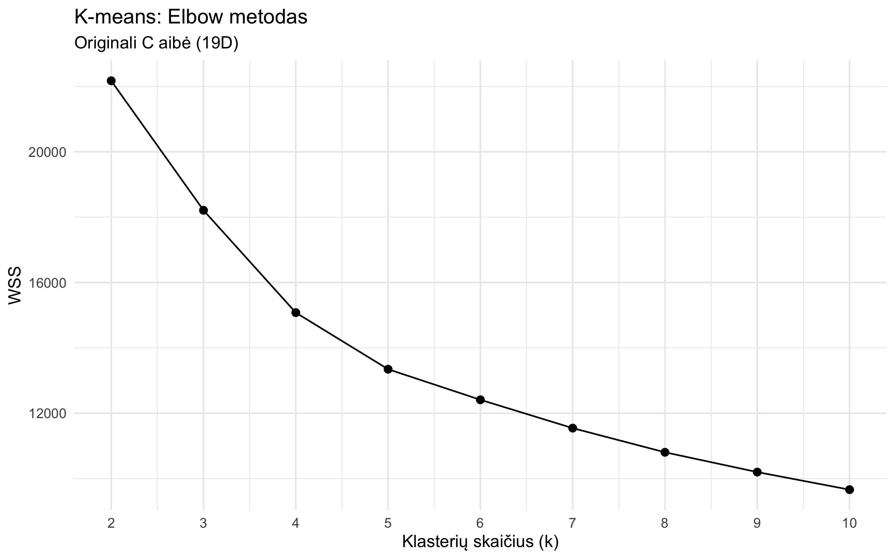

#### Silhouette metodas

Didžiausias vidutinis silueto koeficientas gautas, kai `k = 2` (0,3732). Didėjant `k`, silueto reikšmės nuosekliai mažėjo, todėl pagal šį metodą tinkamiausias klasterių skaičius yra 2.

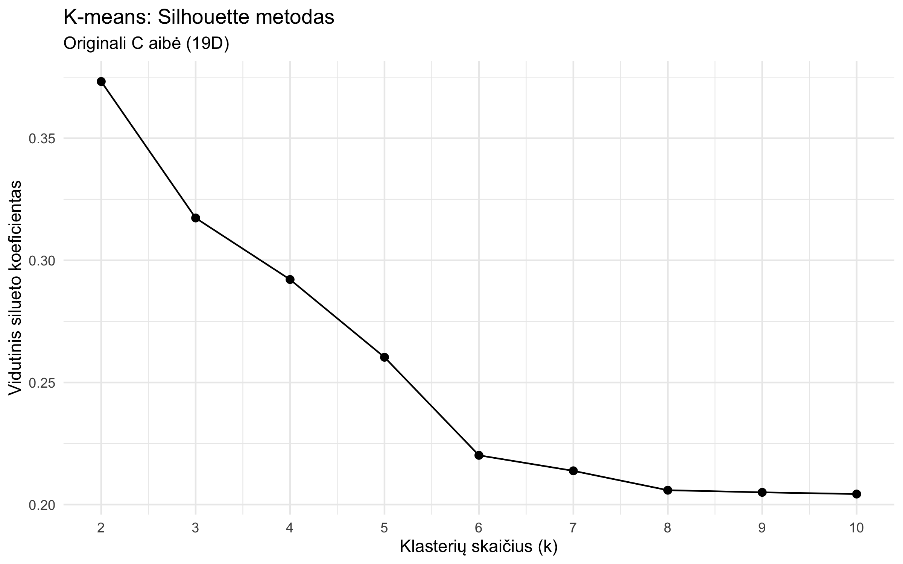

#### Parametrų eksperimentai

Papildomai atlikome 6 bandymus, keisdami klasterių skaičių `k`, pradinių centrų parinkimų skaičių `nstart` ir atsitiktinę sėklą (`seed`).

| k | nstart | seed | WSS | Silhouette |
|---|---:|---:|---:|---:|
| 2 | 25 | 42 | 22174,12 | 0,3732 |
| 3 | 25 | 42 | 18210,08 | 0,3174 |
| 4 | 25 | 42 | 15077,90 | 0,2921 |
| 5 | 25 | 42 | 13346,07 | 0,2603 |
| 2 | 10 | 42 | 22174,12 | 0,3732 |
| 2 | 25 | 123 | 22174,12 | 0,3732 |

Keičiant `nstart` ir `seed`, kai `k = 2`, WSS, Silhouette ir klasterių dydžiai nepasikeitė. Tai rodo, kad šių bandymų metu rezultatai pagal vertintus rodiklius buvo stabilūs.

**Pagrindiniam K-means klasterizavimui pasirinkome `k = 2`, `nstart = 25`, `seed = 42`**, nes šis derinys davė didžiausią Silhouette reikšmę iš patikrintų klasterių skaičių.

Eksperimentų rezultatai išsaugoti `rezultatai/kmeans_eksperimentai_originali.csv`, o Elbow ir Silhouette grafikai – `grafikai/` aplanke.

### 5. K-means klasterizavimas originalioje C aibėje (19D)

Pritaikėme K-means algoritmą su pasirinktais parametrais `k = 2`, `nstart = 25` ir `seed = 42`. Gauti du klasteriai:

| Rodiklis | 1 klasteris | 2 klasteris |
|---|---:|---:|
| Objektų skaičius | 2399 | 1529 |
| Karatų mediana | 0,41 | 1,20 |
| Kainos mediana | 1080 | 6720 |
| Tūrio mediana | 67,77 | 193,23 |
| Kainos už karatą mediana | 2805,36 | 5743,52 |

**1 klasteris** apima mažesnius ir pigesnius deimantus, o **2 klasteris** – didesnius ir brangesnius. Taigi K-means daugiausia atskyrė objektus pagal jų dydį ir kainą.

#### Klasterizavimo kokybė

Apskaičiavome tris vidinius klasterizavimo kokybės rodiklius:

| Rodiklis | Reikšmė |
|---|---:|
| Silhouette | 0,3732 |
| Calinski–Harabasz | 2725,921 |
| Davies–Bouldin | 1,1218 |

Silhouette reikšmė rodo, kad klasteriai atskirti vidutiniškai. Kitus rodiklius naudosime rezultatams skirtingose dimensijų erdvėse palyginti.

#### Klasterių vizualizacija

Kadangi originali C aibė turi 19 požymių, klasterizavimo rezultatus pavaizdavome dvimatėse PCA ir t-SNE projekcijose. Abiem atvejais klasteriai nustatyti originalioje 19D erdvėje, o dimensijos mažinimas naudotas tik vizualizavimui.

**PCA 2D vizualizacija**

**t-SNE 2D vizualizacija**

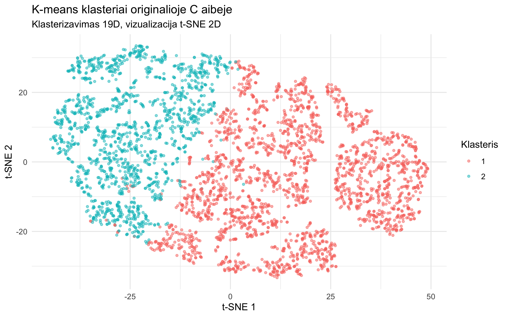

Abiejose projekcijose matomos dvi gana aiškios grupės, tačiau jų sandūroje yra persidengiančių objektų. t-SNE projekcijoje taip pat išryškėja mažesnės lokalios objektų grupės.

#### Klasterių požymių palyginimas

Deimantų svorio ir kainos pasiskirstymus palyginome naudodami dėžučių diagramas (boxplot).

**Deimantų svoris (carat)**

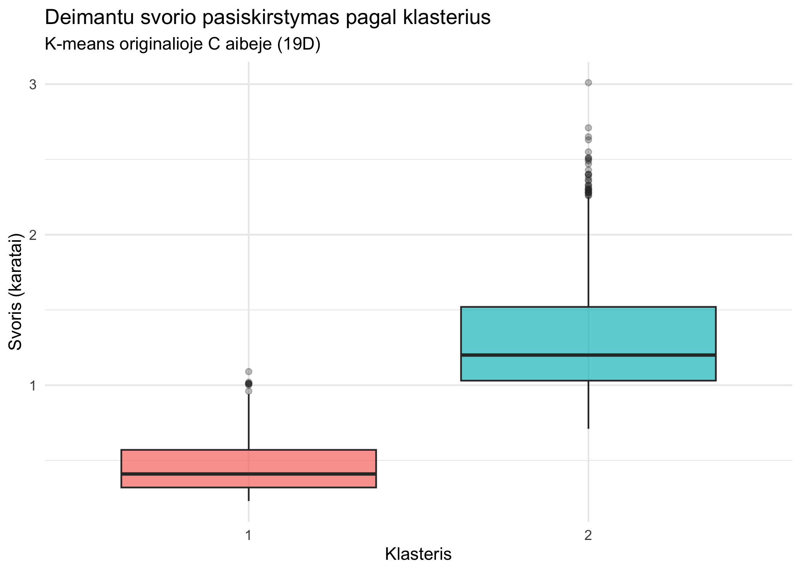

**Deimantų kaina (price)**

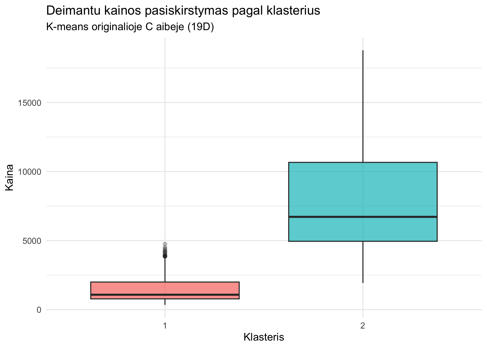

Grafikai parodo, kad antrajame klasteryje deimantai paprastai yra didesni ir brangesni, taip pat matoma didesnė jų kainų sklaida.

#### Klasterių sudėtis pagal klases

Palyginome klasterius su pradinėmis `Ideal` ir `Premium` klasėmis, kurios nebuvo naudojamos klasterizavimui.

| Klasė | 1 klasteris | 2 klasteris |
|---|---:|---:|
| Ideal | 58,36 % | 36,82 % |
| Premium | 41,64 % | 63,18 % |

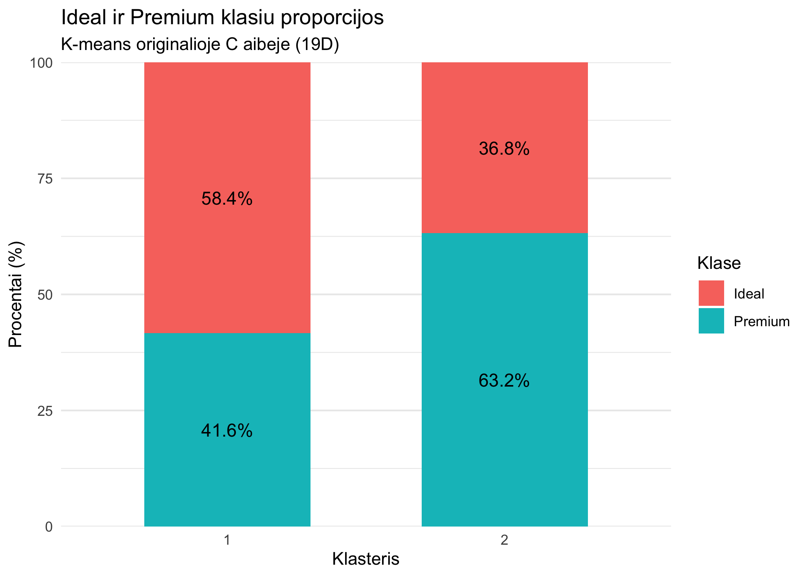

Pirmajame klasteryje daugiau `Ideal`, o antrajame – `Premium` klasės deimantų. Tačiau abi klasės pasitaiko abiejuose klasteriuose, todėl gautas suskirstymas labiau susijęs su deimantų dydžiu ir kaina nei su jų pradine klase.

### 6. K-means klasterizavimas PCA 5D aibėje

#### Parametrų parinkimas

Pritaikėme K-means algoritmą PCA metodu sumažintai aibei (3928 objektai, 5 komponentės). Klasterių skaičių iš naujo vertinome Elbow ir vidutinio silueto metodais, tikrindami `k = 2–10`.

**Elbow metodas**

WSS mažėjo didėjant klasterių skaičiui, tačiau maždaug nuo `k = 5` mažėjimas sulėtėjo.

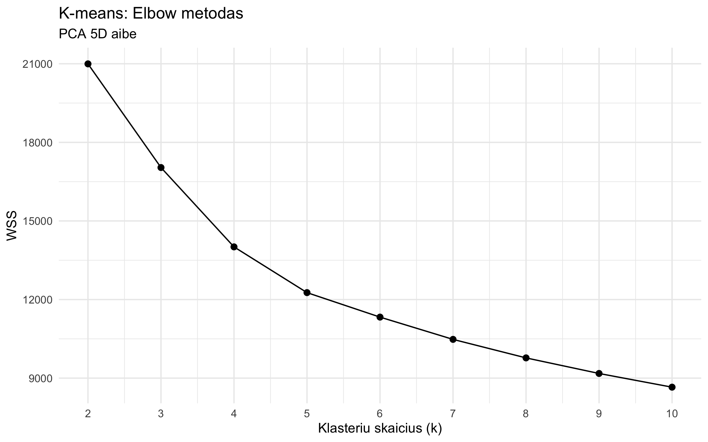

**Silhouette metodas**

Didžiausias vidutinis silueto koeficientas gautas, kai `k = 2` (0,3852). Didėjant klasterių skaičiui, silueto koeficientas mažėjo.

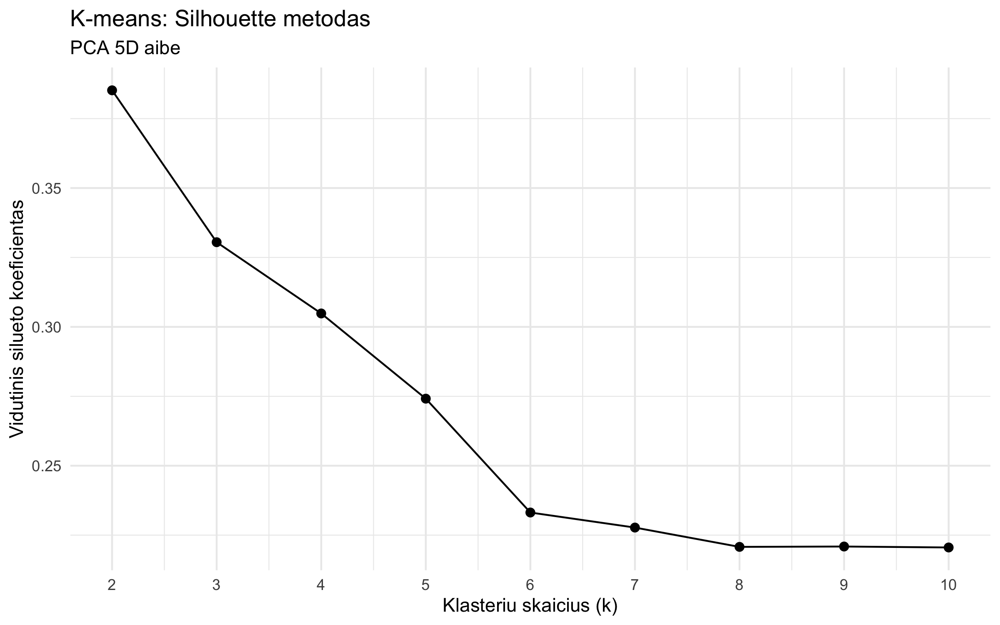

#### Parametrų eksperimentai

Atlikome 6 bandymus, keisdami `k`, `nstart` ir `seed`.

| k | nstart | seed | WSS | Silhouette |
|---|---:|---:|---:|---:|
| 2 | 25 | 42 | 20996,16 | 0,3852 |
| 3 | 25 | 42 | 17038,72 | 0,3305 |
| 4 | 25 | 42 | 14010,12 | 0,3048 |
| 5 | 25 | 42 | 12264,17 | 0,2741 |
| 2 | 10 | 42 | 20996,16 | 0,3852 |
| 2 | 25 | 123 | 20996,16 | 0,3852 |

Keičiant `nstart` ir `seed`, kai `k = 2`, WSS, Silhouette ir klasterių dydžiai nepasikeitė.

**Pasirinkome `k = 2`, `nstart = 25`, `seed = 42`**, nes gautas didžiausias vidutinis silueto koeficientas.

#### Klasterizavimo rezultatai

PCA 5D aibėje išskirti du klasteriai:

| Rodiklis | 1 klasteris | 2 klasteris |
|---|---:|---:|
| Objektų skaičius | 2403 | 1525 |
| Ideal (%) | 58,39 | 36,72 |
| Premium (%) | 41,61 | 63,28 |

Klasterių dydžiai ir klasių proporcijos labai panašūs į originalios 19D aibės rezultatus.

#### Klasterizavimo kokybė

Apskaičiavome tris vidinius klasterizavimo kokybės rodiklius ir palyginome juos su originalios C aibės rezultatais.

| Rodiklis | Originali C (19D) | PCA 5D |
|---|---:|---:|
| Silhouette ↑ | 0,3732 | **0,3852** |
| Calinski–Harabasz ↑ | 2725,921 | **2877,729** |
| Davies–Bouldin ↓ | 1,1218 | **1,0877** |

Sumažinus dimensiją nuo 19D iki 5D, visi trys kokybės rodikliai šiek tiek pagerėjo. Tačiau jie apskaičiuoti skirtingose erdvėse, todėl vien iš jų negalima spręsti, ar išliko tas pats objektų suskirstymas.

#### Klasterių vizualizacija

PCA 5D aibėje gautus K-means klasterius pavaizdavome dvimatėse PCA ir t-SNE projekcijose. Abiem atvejais klasterizavimas atliktas PCA 5D erdvėje, o 2D projekcijos naudotos tik rezultatams vizualizuoti.

**PCA 2D vizualizacija**

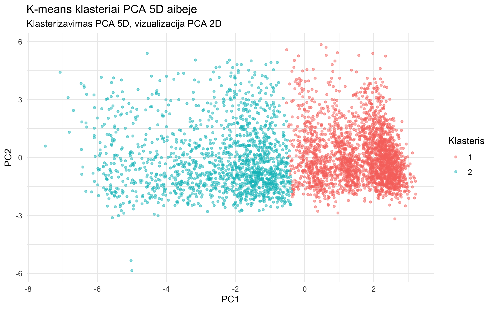

**t-SNE 2D vizualizacija**

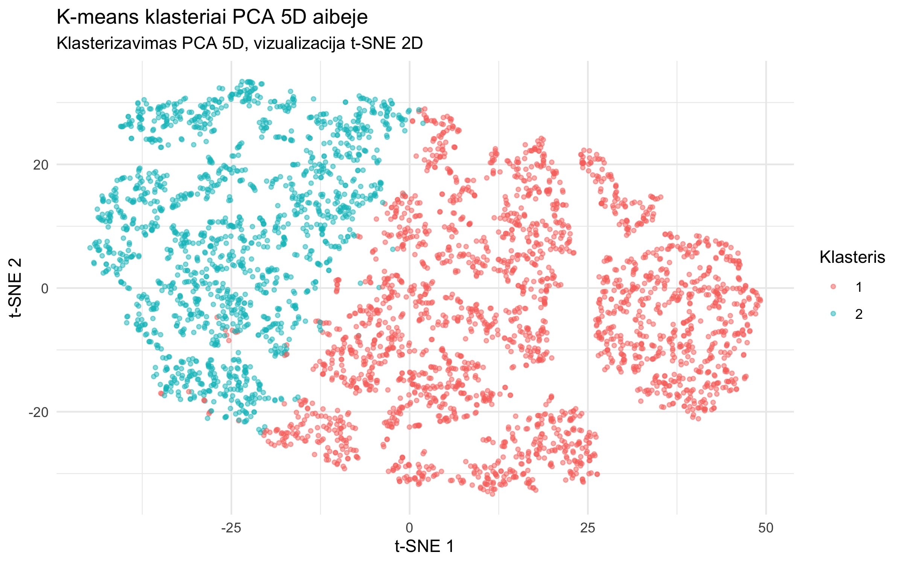

Abiejose projekcijose klasteriai gana aiškiai atsiskiria, nors jų sandūroje matomas nedidelis persidengimas. Vizualiai PCA 5D klasterizavimo rezultatai beveik nesiskiria nuo originalios C aibės rezultatų.

#### Klasterių požymių palyginimas

Klasterių charakteristikas įvertinome pagal originalius deimantų požymius, nes PCA komponentės tiesiogiai neatitinka pradinių matavimo vienetų.

**Deimantų svorio pasiskirstymas**

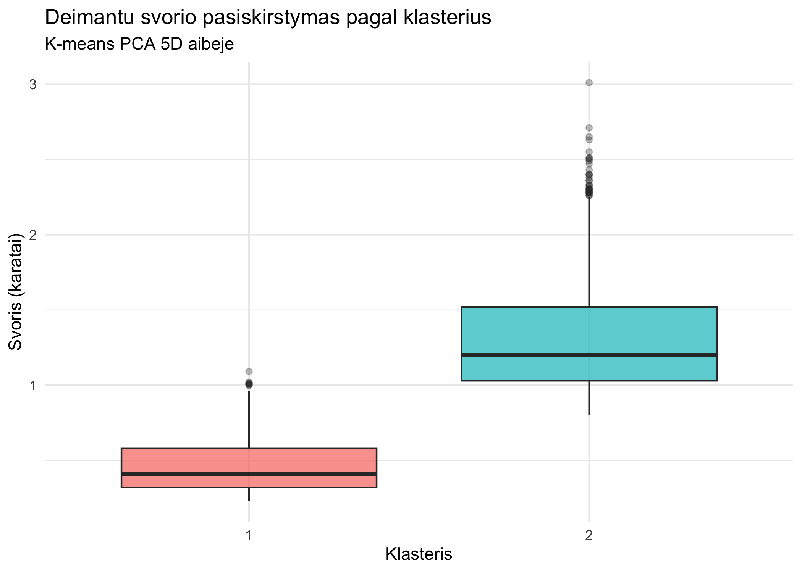

**Deimantų kainos pasiskirstymas**

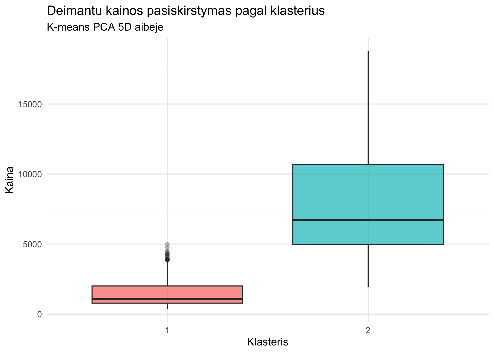

Abiejuose grafikuose matyti, kad pirmąjį klasterį daugiausia sudaro mažesni ir pigesni deimantai, o antrąjį – didesni ir brangesni. Antrajame klasteryje taip pat pastebima didesnė svorio ir kainos sklaida.

#### Klasterių sudėtis pagal klases

Klasterių pasiskirstymą papildomai įvertinome pagal pradines `Ideal` ir `Premium` klases.

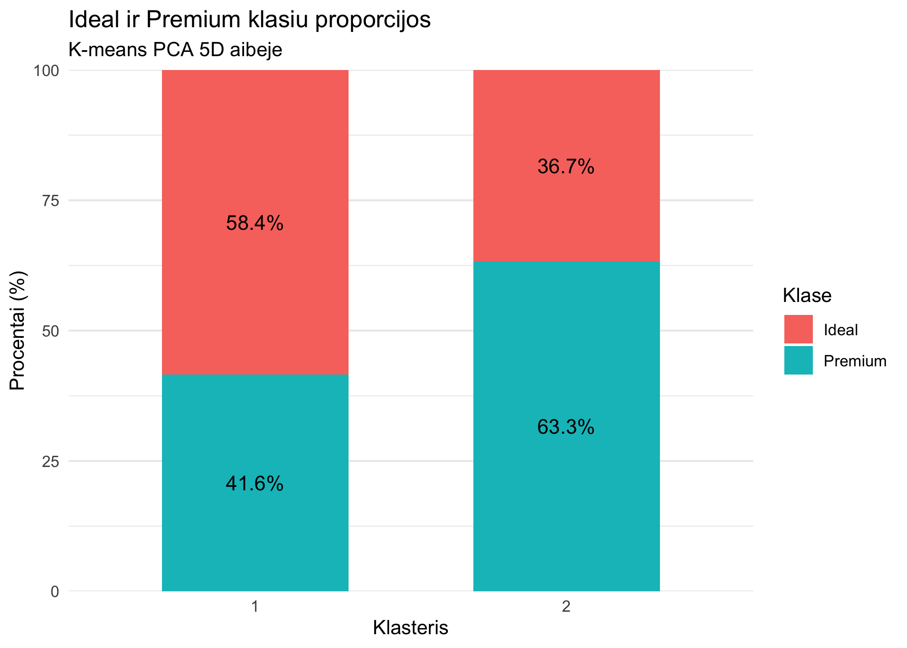

Pirmajame klasteryje `Ideal` sudaro 58,39 %, o antrajame `Premium` – 63,28 %. Abi klasės pasitaiko abiejuose klasteriuose, todėl suskirstymas labiau atspindi deimantų dydžio ir kainos skirtumus nei pradinę klasę.

#### Rezultatų išsaugojimas

Eksperimentų rezultatai išsaugoti `rezultatai/kmeans_eksperimentai_pca.csv`, kokybės rodikliai – `rezultatai/kmeans_kokybe_pca.csv`, o klasterių požymių medianos – `rezultatai/kmeans_pca_klasteriu_medianos.csv`.

Visi grafikai išsaugoti `grafikai/` aplanke.

### 7. K-means klasterizavimas t-SNE 2D aibėje

#### Parametrų parinkimas

Pritaikėme K-means algoritmą t-SNE metodu sumažintai aibei (3928 objektai, 2 dimensijos). Klasterių skaičių iš naujo vertinome Elbow ir vidutinio silueto metodais, tikrindami `k = 2–10`.

**Elbow metodas**

WSS mažėjo didėjant klasterių skaičiui. Ryškiausias mažėjimas pastebėtas esant mažesnėms `k` reikšmėms, o maždaug nuo `k = 5–6` kreivė pradėjo lėtėti.

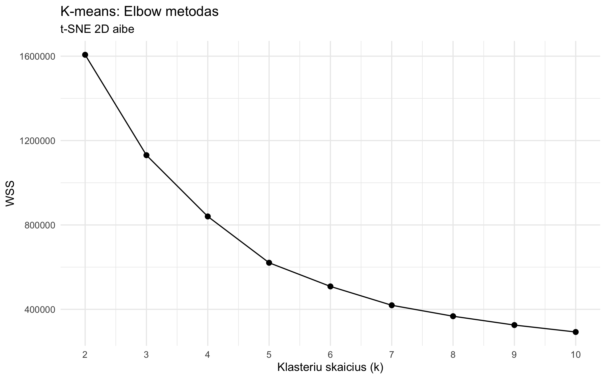

**Silhouette metodas**

Didžiausias vidutinis silueto koeficientas gautas, kai `k = 2` (0,4415). Esant didesniam klasterių skaičiui rodiklis svyravo, tačiau šios reikšmės neviršijo `k = 2` rezultato.

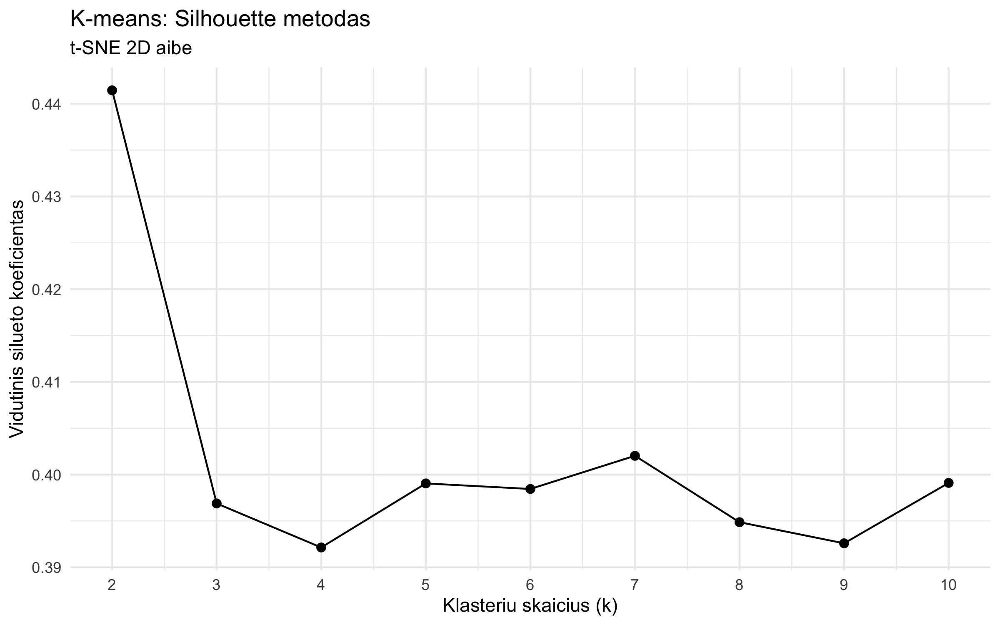

#### Parametrų eksperimentai

Atlikome 6 bandymus, keisdami `k`, `nstart` ir `seed`.

| k | nstart | seed | WSS | Silhouette |
|---|---:|---:|---:|---:|
| 2 | 25 | 42 | 1606573,4 | 0,4415 |
| 3 | 25 | 42 | 1130509,9 | 0,3969 |
| 4 | 25 | 42 | 840259,4 | 0,3921 |
| 5 | 25 | 42 | 620763,8 | 0,3990 |
| 2 | 10 | 42 | 1606573,4 | 0,4415 |
| 2 | 25 | 123 | 1606573,4 | 0,4415 |

Keičiant `nstart` ir `seed`, kai `k = 2`, WSS, Silhouette ir klasterių dydžiai nepasikeitė.

**Pasirinkome `k = 2`, `nstart = 25`, `seed = 42`**, nes gautas didžiausias vidutinis silueto koeficientas.

#### Klasterizavimo rezultatai

t-SNE 2D aibėje išskirti du klasteriai:

| Rodiklis | 1 klasteris | 2 klasteris |
|---|---:|---:|
| Objektų skaičius | 1856 | 2072 |
| Ideal (%) | 60,45 | 40,59 |
| Premium (%) | 39,55 | 59,41 |

Pirmajame klasteryje daugiau `Ideal`, o antrajame – `Premium` klasės deimantų. Tačiau abi klasės pasitaiko abiejuose klasteriuose.

#### Klasterizavimo kokybė

Apskaičiavome tris vidinius kokybės rodiklius ir palyginome juos su originalios C bei PCA 5D aibių rezultatais.

| Rodiklis | Originali C (19D) | PCA 5D | t-SNE 2D |
|---|---:|---:|---:|
| Silhouette ↑ | 0,3732 | 0,3852 | **0,4415** |
| Calinski–Harabasz ↑ | 2725,921 | 2877,729 | **4426,787** |
| Davies–Bouldin ↓ | 1,1218 | 1,0877 | **0,8825** |

Pagal visus tris rodiklius t-SNE 2D erdvėje gauti palankiausi rezultatai. Tačiau t-SNE pakeičia atstumus tarp objektų, todėl šie rodikliai neįrodo, kad originali duomenų struktūra išsaugota geriau.

#### Klasterių vizualizacija

t-SNE 2D aibėje gautus klasterius pavaizdavome tiek t-SNE 2D, tiek PCA 2D projekcijose. Abiem atvejais naudoti tie patys t-SNE erdvėje gauti K-means klasteriai, keičiamos tik jų atvaizdavimo koordinatės.

**t-SNE 2D vizualizacija**

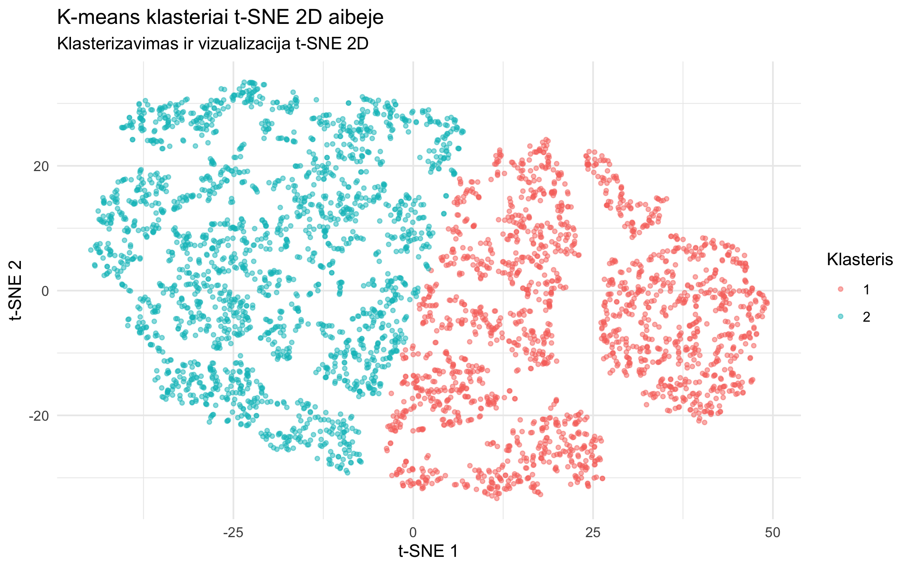

**PCA 2D vizualizacija**

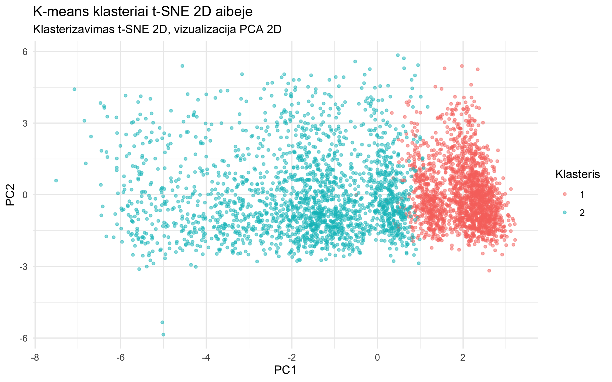

t-SNE projekcijoje klasteriai gana aiškiai atsiskiria, tačiau PCA projekcijoje jų riba labiau persidengia. Palyginti su originalios 19D ir PCA 5D aibių rezultatais, t-SNE erdvėje dalis objektų buvo priskirta kitaip.

#### Klasterių požymių palyginimas

Klasterius interpretavome pagal originalius deimantų požymius.

| Požymis (mediana) | 1 klasteris | 2 klasteris |
|---|---:|---:|
| Karatai | 0,37 | 1,06 |
| Kaina | 940 | 5410,5 |
| Tūrio rodiklis | 60,61 | 174,43 |
| Kaina už karatą | 2586,58 | 4871,71 |

**Deimantų svorio pasiskirstymas**

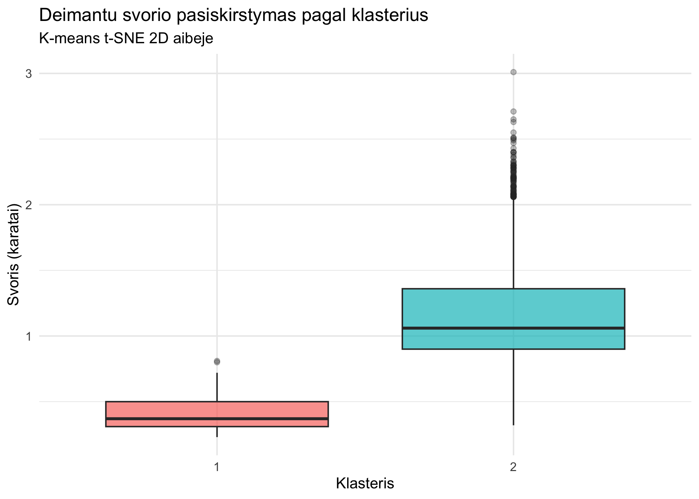

**Deimantų kainos pasiskirstymas**

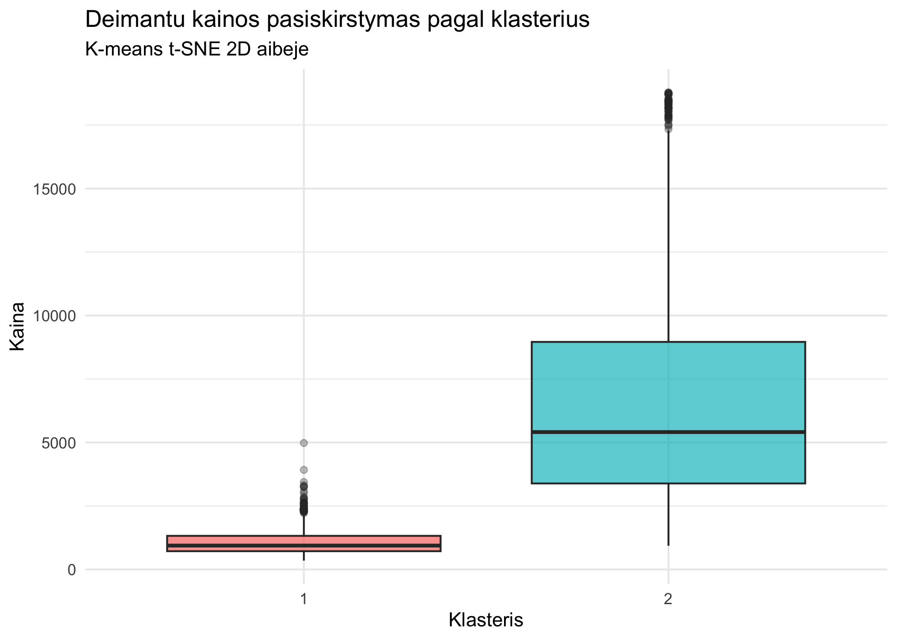

Pirmąjį klasterį daugiausia sudaro mažesni ir pigesni deimantai, o antrąjį – didesni ir brangesni. Antrajame klasteryje matoma didesnė svorio ir kainos sklaida.

#### Klasterių sudėtis pagal klases

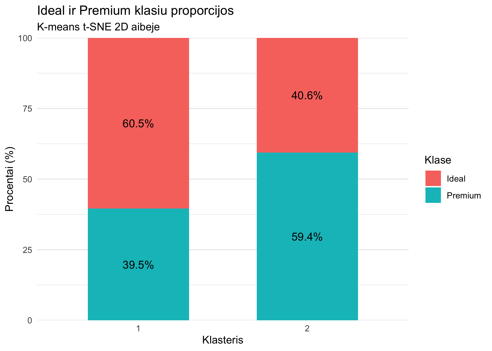

Pirmajame klasteryje `Ideal` sudaro 60,45 %, o antrajame `Premium` – 59,41 %. Taigi klasteriai nėra tapatūs pradinėms klasėms ir labiau atspindi deimantų dydžio bei kainos skirtumus.

#### Rezultatų išsaugojimas

Eksperimentų rezultatai išsaugoti `rezultatai/kmeans_eksperimentai_tsne.csv`, kokybės rodikliai – `rezultatai/kmeans_kokybe_tsne.csv`, o klasterių požymių medianos – `rezultatai/kmeans_tsne_klasteriu_medianos.csv`.

Visi grafikai išsaugoti `grafikai/` aplanke.

### 8. K-means klasterizavimo rezultatų palyginimas naudojant išorinius rodiklius

#### 8.1. Vertinimo tikslas

Siekiant įvertinti, kaip dimensijos mažinimas paveikė K-means klasterizavimo rezultatus, palyginome objektų priskyrimus klasteriams trijose duomenų erdvėse:

- **Originalioje C aibėje (19D)** – atskaitos rezultatas.
- **PCA sumažintoje aibėje (5D)** – globalus dimensijos mažinimo metodas.
- **t-SNE sumažintoje aibėje (2D)** – lokalus dimensijos mažinimo metodas.

Visose aibėse buvo tie patys 3928 objektai, o K-means algoritmui parinkti vienodi pagrindiniai parametrai: `k = 2`, `nstart = 25` ir `seed = 42`.

Objektai prieš palyginimą suderinti pagal jų identifikatorius (`id`), kad būtų lyginami tų pačių deimantų priskyrimai klasteriams.

#### 8.2. Naudoti išoriniai vertinimo rodikliai

Klasterizavimo rezultatų panašumui įvertinti apskaičiavome tris išorinius rodiklius.

**Adjusted Rand Index (ARI)** – vertina dviejų suskirstymų panašumą pagal objektų porų priskyrimus, atsižvelgdamas į galimą atsitiktinį sutapimą. Reikšmė `1` reiškia visišką suskirstymų sutapimą, o reikšmė apie `0` – panašumą, artimą atsitiktiniam.

**Normalized Mutual Information (NMI)** – vertina, kiek bendros informacijos turi du klasterizavimo rezultatai. Reikšmės kinta nuo `0` iki `1`, kur `1` reiškia visišką informacinį suskirstymų atitikimą. Naudojome normalizavimą pagal aritmetinį abiejų suskirstymų entropijų vidurkį.

**Jaccard indeksas** – vertina objektų porų, priskirtų tam pačiam klasteriui abiejuose suskirstymuose, sutapimą. Reikšmė `1` reiškia visišką porų sutapimą.

Šie rodikliai nepriklauso nuo klasterių numerių, todėl leidžia korektiškai palyginti suskirstymus net tada, kai klasterių numeracija skiriasi.

#### 8.3. Išorinių rodiklių rezultatai

| Palyginimas | ARI ↑ | NMI ↑ | Jaccard ↑ |
|---|---:|---:|---:|
| **Originali 19D ir PCA 5D** | **0,9959** | **0,9891** | **0,9961** |
| Originali 19D ir t-SNE 2D | 0,5218 | 0,5332 | 0,6220 |
| PCA 5D ir t-SNE 2D | 0,5204 | 0,5347 | 0,6212 |

Gauti rezultatai rodo, kad PCA 5D klasterizavimo rezultatai beveik visiškai sutampa su originalios 19D aibės rezultatais. Tuo tarpu t-SNE 2D erdvėje gautas suskirstymas pastebimai labiau skiriasi.

#### 8.4. Originalios 19D ir PCA 5D aibių palyginimas

Palyginus originalios ir PCA sumažintos aibės objektų priskyrimus, gauta tokia sutapimo lentelė:

| Originalios 19D aibės klasteris | PCA 5D: 1 klasteris | PCA 5D: 2 klasteris |
|---|---:|---:|
| 1 klasteris | 2399 | 0 |
| 2 klasteris | 4 | 1525 |

Iš 3928 objektų **3924 išliko tuose pačiuose klasteriuose**, o tik 4 objektai pakeitė klasterį.

Tai sudaro:

- **99,90 %** sutampančių objektų priskyrimų.
- **0,10 %** pasikeitusių priskyrimų.

Šį rezultatą patvirtina ir išoriniai rodikliai:

- ARI = 0,9959
- NMI = 0,9891
- Jaccard = 0,9961

Visos trys reikšmės labai artimos `1`, todėl galima teigti, kad **PCA sumažinimas nuo 19 iki 5 dimensijų beveik visiškai išsaugojo originalų K-means objektų suskirstymą**.

Tai ypač svarbu, nes PCA 5D aibė buvo sudaryta siekiant sumažinti požymių skaičių ir kartu išsaugoti ne mažiau kaip 95 % pradinės dispersijos.

#### 8.5. Originalios 19D ir t-SNE 2D aibių palyginimas

Palyginus originalios aibės ir t-SNE 2D klasterizavimo rezultatus, gauta tokia sutapimo lentelė:

| Originalios 19D aibės klasteris | t-SNE 2D: 1 klasteris | t-SNE 2D: 2 klasteris |
|---|---:|---:|
| 1 klasteris | 1855 | 544 |
| 2 klasteris | 1 | 1528 |

Matome, kad:

- 1855 pirmojo klasterio objektai išliko pirmajame klasteryje.
- 544 pirmojo klasterio objektai t-SNE erdvėje pateko į antrąjį klasterį.
- 1528 antrojo klasterio objektai išliko antrajame.
- 1 antrojo klasterio objektas pateko į pirmąjį.

Iš viso **545 objektai iš 3928 pakeitė klasterį**, o 3383 objektų priskyrimai sutapo.

Tai sudaro:

- **86,13 %** sutampančių objektų priskyrimų.
- **13,87 %** pasikeitusių priskyrimų.

Išoriniai rodikliai:

- ARI = 0,5218
- NMI = 0,5332
- Jaccard = 0,6220

Šios reikšmės gerokai mažesnės nei PCA atveju, todėl galima teigti, kad **t-SNE 2D dimensijos mažinimas pastebimai pakeitė pradinį K-means suskirstymą**.

Tai galima paaiškinti tuo, kad t-SNE pirmiausia siekia išsaugoti lokalias objektų kaimynystes, o ne visus globalius atstumus tarp objektų. Todėl dvimatėje erdvėje objektų tarpusavio išsidėstymas gali pasikeisti ir turėti įtakos K-means rezultatams.

#### 8.6. PCA 5D ir t-SNE 2D palyginimas

Palyginus abu dimensijos mažinimo metodus, gauti rodikliai:

| Rodiklis | Reikšmė |
|---|---:|
| ARI | 0,5204 |
| NMI | 0,5347 |
| Jaccard | 0,6212 |

Rezultatai labai panašūs į originalios 19D ir t-SNE 2D aibių palyginimą.

Tai rodo, kad PCA 5D suskirstymas išlieka artimas originaliam, o t-SNE 2D suformuoja labiau besiskiriantį objektų grupavimą.

#### 8.7. Vidinių ir išorinių rodiklių palyginimas

Norėdami įvertinti ne tik klasterių sutapimą, bet ir jų kokybę skirtingose erdvėse, palyginome anksčiau apskaičiuotus vidinius rodiklius.

| Rodiklis | Originali C (19D) | PCA 5D | t-SNE 2D |
|---|---:|---:|---:|
| Silhouette ↑ | 0,3732 | 0,3852 | **0,4415** |
| Calinski–Harabasz ↑ | 2725,921 | 2877,729 | **4426,787** |
| Davies–Bouldin ↓ | 1,1218 | 1,0877 | **0,8825** |
| ARI su originalia 19D ↑ | 1,0000 | **0,9959** | 0,5218 |
| NMI su originalia 19D ↑ | 1,0000 | **0,9891** | 0,5332 |
| Jaccard su originalia 19D ↑ | 1,0000 | **0,9961** | 0,6220 |

Pagal vidinius kokybės rodiklius geriausios reikšmės gautos t-SNE 2D erdvėje. Šioje erdvėje klasteriai atrodo geriau atskirti ir kompaktiškesni pagal joje apskaičiuotus atstumus.

Tačiau išoriniai rodikliai parodo kitokią situaciją: **PCA 5D beveik visiškai išsaugo originalius klasterius, o t-SNE 2D juos pakeičia labiau**.

Svarbu atsižvelgti į tai, kad vidiniai rodikliai buvo apskaičiuoti skirtingų dimensijų erdvėse. Ypač t-SNE atveju atstumų struktūra yra pakeista, todėl didesnės Silhouette ar Calinski–Harabasz reikšmės savaime neįrodo, kad geriau išsaugota originalių duomenų struktūra.

#### 8.8. Išvados

1. **PCA 5D beveik visiškai išsaugojo originalų K-means suskirstymą.** Tik 4 iš 3928 objektų pakeitė klasterį, o ARI siekė 0,9959.

2. **t-SNE 2D klasterizavimo rezultatai skyrėsi labiau.** Palyginti su originalia 19D aibe, pasikeitė 545 objektų priskyrimai, o ARI sumažėjo iki 0,5218.

3. **t-SNE 2D pasižymėjo palankiausiais vidiniais kokybės rodikliais**, tačiau tai nereiškia, kad originalus suskirstymas buvo išsaugotas geriausiai.

4. **PCA 5D šiuo atveju yra tinkamesnis metodas, jei siekiama sumažinti dimensiją ir išlaikyti originalią klasterių struktūrą.** Jis sumažino požymių skaičių nuo 19 iki 5 ir beveik nepakeitė objektų priskyrimų klasteriams.

5. **Vidiniai ir išoriniai rodikliai vertina skirtingus klasterizavimo aspektus.** Todėl norint įvertinti dimensijos mažinimo poveikį svarbu nagrinėti tiek klasterių kokybę sumažintoje erdvėje, tiek jų sutapimą su originalios aibės rezultatais.

#### 8.9. Rezultatų failai

Išorinių rodiklių rezultatai išsaugoti faile:

`rezultatai/kmeans_isoriniai_rodikliai.csv`

Skaičiavimai atlikti `kmeans.R` failo 31 skyriuje.

### 9. K-means klasterizavimo stabilumo tyrimas

#### 9.1. Tyrimo tikslas

Stabilumo tyrimo tikslas – nustatyti, ar K-means klasterizavimo rezultatai išlieka panašūs keičiant duomenų imties sudėtį.

Tyrimą atlikome **originalioje C aibėje (19D)**, naudodami anksčiau parinktą K-means modelį su parametrais `k = 2` ir `nstart = 25`.

Stabilumui vertinti naudojome pakartotinę atsitiktinę objektų atranką (*subsampling*). Kiekvieną kartą atrinkome 80 % pradinių objektų, iš naujo normavome duomenis ir atlikome klasterizavimą.

Stabilumą vertinome pagal ARI, NMI ir Jaccard indeksus, lygindami skirtingose imtyse gautus klasterių suskirstymus.

#### 9.2. Eksperimento metodika

Pradinę C aibę sudarė **3928 objektai ir 19 požymių**.

Kiekvienas stabilumo eksperimentas buvo vykdomas tokia seka:

1. Iš pradinės, dar nenormuotos C aibės atsitiktinai atrenkama 80 % objektų (3142 objektai).
2. Atrinktai imčiai atskirai atliekamas robustus normavimas, naudojant tos imties medianas ir tarpkvartilinius pločius (IQR).
3. Normuotai imčiai pritaikomas K-means algoritmas su `k = 2` ir `nstart = 25`.
4. Apskaičiuojami vidiniai kokybės rodikliai: Silhouette, Calinski–Harabasz ir Davies–Bouldin.
5. Išsaugomi objektų identifikatoriai (`id`) ir jų priskyrimai klasteriams.
6. Visos imtys palyginamos poromis, naudojant tik abiem imtims bendrus objektus.
7. Kiekvienai imčių porai apskaičiuojami ARI, NMI ir Jaccard indeksai.

**Svarbu:** duomenų normavimas atliktas tik po atsitiktinės imties atrankos. Taip užtikrinome, kad normavimo parametrai nebūtų apskaičiuoti naudojant į imtį nepatekusius objektus, ir išvengėme duomenų nutekėjimo.

Visuose eksperimentuose K-means inicializacijai naudota atsitiktinė sėkla `42`, o imčių atrankai – skirtingos sėklos nuo `0` iki `19`.

#### 9.3. Stabilumo vertinimas lyginant imčių poras

Skirtingos atsitiktinės imtys nebūtinai turi tuos pačius objektus, todėl jų klasterių priskyrimų negalima lyginti tiesiogiai pagal eilučių numerius.

Kiekvienai imčių porai pirmiausia nustatėme bendrus objektų identifikatorius (`id`). Tuomet ARI, NMI ir Jaccard skaičiavome tik tiems objektams, kurie pateko į abi lyginamas imtis.

Tokiu būdu užtikrinome, kad abu klasterių priskyrimų vektoriai apibūdintų tuos pačius objektus vienoda tvarka.

Atlikome **20 atsitiktinių imčių eksperimentų**, o jų stabilumą vertinome didindami nagrinėjamų imčių skaičių:

| Imčių skaičius (N) | Imčių porų skaičius |
|---:|---:|
| 5 | 10 |
| 10 | 45 |
| 15 | 105 |
| 20 | 190 |

Kiekvienam N apskaičiavome visų pirmųjų N imčių porų ARI, NMI ir Jaccard vidurkius bei standartinius nuokrypius.

#### 9.4. Išorinių stabilumo rodiklių rezultatai

| N | ARI vidurkis ± SD | NMI vidurkis ± SD | Jaccard vidurkis ± SD |
|---:|---:|---:|---:|
| 5 | 0,994760 ± 0,005882 | 0,987701 ± 0,013133 | 0,995051 ± 0,005546 |
| 10 | 0,993916 ± 0,005200 | 0,985419 ± 0,011434 | 0,994240 ± 0,004911 |
| 15 | 0,994114 ± 0,005537 | 0,985899 ± 0,011881 | 0,994433 ± 0,005216 |
| 20 | 0,994844 ± 0,004932 | 0,987323 ± 0,010678 | 0,995120 ± 0,004650 |

Gauti rezultatai rodo labai didelį K-means klasterizavimo stabilumą.

Visais nagrinėtais atvejais ARI vidurkis viršijo **0,9939**, o Jaccard vidurkis viršijo **0,9942**. Tai reiškia, kad skirtingose atsitiktinėse 80 % imtyse gauti klasterių priskyrimai beveik visiškai sutampa.

NMI reikšmės taip pat išliko labai aukštos – nuo 0,9854 iki 0,9877, todėl skirtingi klasterizavimo rezultatai pasižymi labai dideliu informaciniu panašumu.

Maži standartiniai nuokrypiai rodo, kad rezultatai tarp skirtingų imčių porų svyravo nedaug.

#### 9.5. Pakankamo imčių skaičiaus nustatymas

Siekiant nustatyti, kiek atsitiktinių imčių pakanka patikimam stabilumo įvertinimui, analizavome ARI vidurkio kitimą didinant imčių skaičių nuo 5 iki 20.

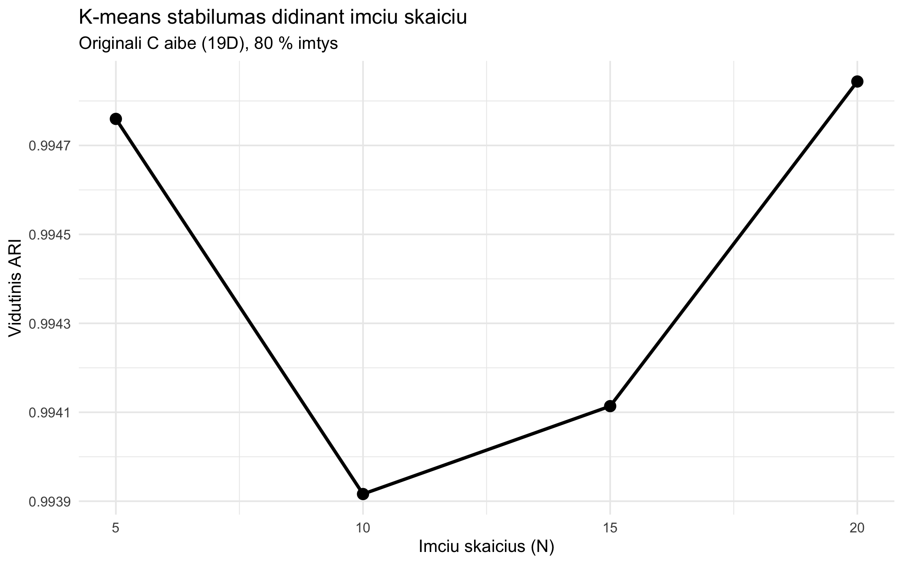

Grafike matome, kad:

- Kai `N = 5`, ARI vidurkis buvo 0,994760.
- Padidinus iki `N = 10`, ARI vidurkis sumažėjo iki 0,993916.
- Kai `N = 15`, jis siekė 0,994114.
- Kai `N = 20`, ARI vidurkis padidėjo iki 0,994844.

Nors grafike matomi nedideli svyravimai, jų absoliutus dydis yra labai mažas. Didžiausio ir mažiausio ARI vidurkių skirtumas siekia tik apie **0,00093**.

Lyginant `N = 10` ir `N = 20`, ARI vidurkis pasikeitė tik 0,00093.

Tai rodo, kad stabilumo įvertis praktiškai nusistovi jau naudojant 10 imčių, o papildomų imčių įtraukimas esminės įtakos rezultatui neturi.

**Todėl nustatėme, kad K-means stabilumui įvertinti pakanka N = 10 imčių**, kurios sudaro 45 tarpusavio palyginimus.

#### 9.6. ARI reikšmių sklaidos analizė

Norėdami išsamiau įvertinti rezultatų pastovumą, sudarėme ARI reikšmių boxplot grafiką, kai `N = 5, 10, 15 ir 20`.

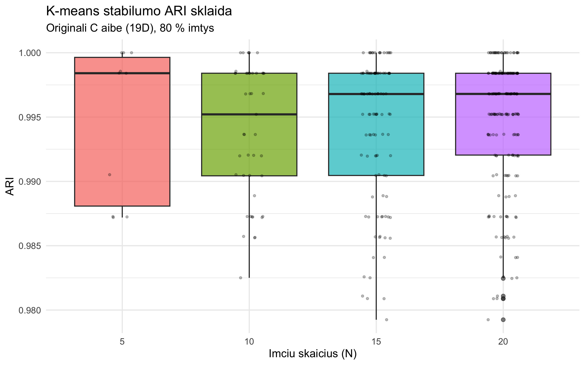

Grafikas rodo, kad:

- Visais atvejais ARI reikšmės yra labai aukštos, dauguma jų artimos 1.
- Esant `N = 5`, reikšmių sklaida didesnė dėl mažesnio palyginamų porų skaičiaus.
- Didinant imčių skaičių iki 10, 15 ir 20, ARI reikšmių pasiskirstymas išlieka panašus.
- Dalis imčių porų pasiekia ARI = 1, o tai reiškia visiškai sutampančius bendrų objektų suskirstymus.
- Net ir mažesnės ARI reikšmės išlieka aukštos, todėl klasterizavimas pasižymi dideliu pastovumu.

Didinant N, naudojamos ir ankstesniuose etapuose palygintos imčių poros, todėl boxplot grupės nėra nepriklausomos.

Bendrai ARI sklaidos analizė patvirtina, kad **atsitiktiniai objektų atrankos pokyčiai daro labai nedidelę įtaką K-means klasterizavimo rezultatams**.

#### 9.7. Vidinių klasterizavimo kokybės rodiklių stabilumas

Kiekvienoje atrinktoje 80 % imtyje papildomai apskaičiavome tris vidinius kokybės rodiklius:

- Silhouette – klasterių kompaktiškumui ir atskyrimui vertinti.
- Calinski–Harabasz – tarpklasterinės ir vidinės sklaidos santykiui vertinti.
- Davies–Bouldin – klasterių panašumui ir atskyrimui vertinti.

Gauti rezultatai:

| N | Silhouette vidurkis ± SD | Calinski–Harabasz vidurkis ± SD | Davies–Bouldin vidurkis ± SD |
|---:|---:|---:|---:|
| 5 | 0,373896 ± 0,002171 | 2198,988 ± 24,669 | 1,117819 ± 0,005136 |
| 10 | 0,373541 ± 0,001976 | 2194,711 ± 21,823 | 1,118495 ± 0,004395 |
| 15 | 0,373861 ± 0,001926 | 2196,170 ± 21,231 | 1,118285 ± 0,004339 |
| 20 | 0,373913 ± 0,001823 | 2195,189 ± 20,143 | 1,118518 ± 0,004184 |

**Silhouette.** Vidurkis visais atvejais išliko apie 0,374, o standartinis nuokrypis neviršijo 0,0022. Tai rodo, kad klasterių kompaktiškumas ir atskyrimas mažai priklauso nuo atrinktų objektų.

**Calinski–Harabasz.** Vidurkis svyravo apie 2195–2199. Didinant imčių skaičių, rodiklio vidurkis išliko panašus, o standartinis nuokrypis sumažėjo nuo 24,67 iki 20,14.

**Davies–Bouldin.** Vidurkis visais atvejais siekė apie 1,118, o standartinis nuokrypis buvo mažesnis nei 0,0052. Tai rodo mažus klasterių kompaktiškumo ir tarpusavio atskyrimo pokyčius.

Visų trijų vidinių rodiklių rezultatai patvirtina, kad keičiant imties sudėtį K-means klasterizavimo kokybė išlieka labai panaši.

#### 9.8. Palyginimas su pilnos aibės rezultatais

Anksčiau originalioje C aibėje, naudojant visus 3928 objektus, gavome:

| Rodiklis | Pilna C aibė (3928 objektai) | 80 % imtys (N = 10, vidurkis) |
|---|---:|---:|
| Silhouette | 0,373230 | 0,373541 |
| Calinski–Harabasz | 2725,921 | 2194,711 |
| Davies–Bouldin | 1,121817 | 1,118495 |

Silhouette ir Davies–Bouldin reikšmės beveik nepasikeitė, todėl galima teigti, kad klasterių vidinė kokybė išliko panaši.

Calinski–Harabasz rodiklio reikšmė 80 % imtyse buvo mažesnė, tačiau tai susiję ir su mažesniu objektų skaičiumi, nes šis rodiklis priklauso nuo imties dydžio. Todėl vien pagal tiesioginį šių reikšmių palyginimą negalima teigti, kad klasterizavimo kokybė suprastėjo.

#### 9.9. Stabilumo tyrimo išvados

1. **K-means klasterizavimas originalioje C aibėje yra labai stabilus.** Keičiant atsitiktinai atrinktų 80 % objektų imties sudėtį, klasterių priskyrimai beveik nesikeičia. Tai patvirtina ARI vidurkis, siekiantis apie 0,994.

2. **Stabilumo tyrimui pakanka 10 imčių.** Didinant imčių skaičių iki 15 ir 20, ARI vidurkis pasikeitė mažiau nei 0,001, todėl papildomi eksperimentai esminės įtakos stabilumo įvertinimui neturėjo.

3. **Išoriniai stabilumo rodikliai yra labai aukšti.** Kai N = 10, ARI siekė 0,9939, NMI – 0,9854, o Jaccard – 0,9942.

4. **Vidiniai kokybės rodikliai taip pat išliko stabilūs.** Silhouette vidurkis buvo apie 0,374, Calinski–Harabasz – apie 2195, o Davies–Bouldin – apie 1,118.

5. **Atskirai normuojant kiekvieną imtį išvengta duomenų nutekėjimo.** Kiekviename eksperimente normavimo parametrai apskaičiuoti tik iš atrinktų objektų.

Apibendrinant galima teigti, kad **pasirinktas K-means modelis (`k = 2`, `nstart = 25`) pasižymi labai dideliu stabilumu originalioje 19D erdvėje**. Gauti rezultatai yra patikimi imties sudėties pokyčių atžvilgiu, o klasterių struktūra išlieka beveik nepakitusi.

#### 9.10. Rezultatų failai

Visi stabilumo tyrimo rezultatai išsaugoti `rezultatai/` aplanke:

| Failas | Turinys |
|---|---|
| `kmeans_stabilumas_pagal_N.csv` | ARI, NMI ir Jaccard vidurkiai bei standartiniai nuokrypiai, kai N = 5, 10, 15 ir 20 |
| `kmeans_stabilumo_poros.csv` | Visų 190 imčių porų palyginimų rezultatai |
| `kmeans_stabilumo_vidiniai.csv` | Kiekvienos iš 20 imčių vidiniai kokybės rodikliai |
| `kmeans_stabilumo_vidiniai_pagal_N.csv` | Vidinių rodiklių suvestinė didinant imčių skaičių |

Grafikai išsaugoti `grafikai/` aplanke:

- `kmeans_stabilumas_pagal_N.png` – ARI vidurkio kitimas didinant imčių skaičių.
- `kmeans_stabilumo_ari_boxplot.png` – ARI reikšmių sklaida skirtingiems N.

Visi skaičiavimai atlikti `kmeans.R` failo 32 skyriuje.

### 9. K-means klasterizavimo stabilumo tyrimas

#### 9.1. Tyrimo tikslas

Stabilumo tyrimo tikslas – įvertinti, ar K-means klasterizavimo rezultatai išlieka panašūs keičiant duomenų imties sudėtį, ir nustatyti, kaip dimensijos mažinimas veikia klasterių stabilumą.

Stabilumą tyrėme trijose duomenų erdvėse:

- **Originali C aibė (19D)** – klasterizavimas be dimensijos mažinimo.
- **PCA 5D** – klasterizavimas sumažinus dimensiją pagrindinių komponenčių metodu.
- **t-SNE 2D** – klasterizavimas sumažinus dimensiją netiesiniu t-SNE metodu.

Visais atvejais naudojome anksčiau parinktus K-means parametrus: `k = 2` ir `nstart = 25`.

Stabilumui vertinti naudojome pakartotinę atsitiktinę objektų atranką (*subsampling*), o klasterizavimo rezultatus lyginome pagal ARI, NMI ir Jaccard indeksus.

#### 9.2. Stabilumo eksperimento metodika

Pradinę C aibę sudarė **3928 objektai ir 19 požymių**.

Kiekvieną stabilumo eksperimentą atlikome tokia tvarka:

1. Iš pradinės, dar nenormuotos C aibės atsitiktinai atrinkome 80 % objektų (3142 objektus).
2. Kiekvienai atrinktai imčiai atskirai atlikome robustų normavimą, naudojant tos imties medianas ir tarpkvartilinius pločius (IQR).
3. Priklausomai nuo tiriamos erdvės:
   - Originalioje 19D erdvėje dimensijos mažinimo neatlikome.
   - PCA 5D atveju iš naujo apskaičiavome PCA projekciją ir pasirinkome pirmąsias 5 pagrindines komponentes.
   - t-SNE 2D atveju iš naujo apskaičiavome dvimatę t-SNE projekciją.
4. Kiekvienoje erdvėje atlikome K-means klasterizavimą su `k = 2` ir `nstart = 25`.
5. Apskaičiavome vidinius kokybės rodiklius: Silhouette, Calinski–Harabasz ir Davies–Bouldin.
6. Išsaugojome objektų identifikatorius (`id`) ir jų priskyrimus klasteriams.
7. Visas imtis palyginome poromis, naudodami tik abiem imtims bendrus objektus.
8. Kiekvienai imčių porai apskaičiavome ARI, NMI ir Jaccard indeksus.

**Svarbu:** kiekvienoje imtyje normavimą ir dimensijos mažinimą atlikome iš naujo. Imčių atranka vyko prieš normavimą, todėl normavimo parametrai buvo apskaičiuoti tik iš atrinktų objektų.

Taip išvengėme duomenų nutekėjimo, kuris atsirastų naudojant visos aibės normavimo parametrus arba iš anksto apskaičiuotą PCA ar t-SNE projekciją.

Eksperimentų atkuriamumui užtikrinti naudojome skirtingas, bet fiksuotas atsitiktines sėklas. Imčių atrankai naudotos sėklos nuo `0` iki `19`, K-means inicializacijai – `42`, o t-SNE projekcijoms – atskiros fiksuotos sėklos.

#### 9.3. Imčių skaičius ir palyginimo principas

Pagal stabilumo vertinimo metodiką siekėme nustatyti pakankamą atsitiktinių imčių skaičių.

Originaliai 19D ir PCA 5D erdvėms atlikome po **20 eksperimentų**, stabilumo rodiklius vertindami didinant imčių skaičių:

| Imčių skaičius (N) | Palyginamų porų skaičius |
|---:|---:|
| 5 | 10 |
| 10 | 45 |
| 15 | 105 |
| 20 | 190 |

t-SNE 2D atveju atlikome **10 eksperimentų**, kurie sudarė 45 imčių poras.

Kiekvienai imčių porai pirmiausia nustatėme bendrus objektų identifikatorius (`id`). ARI, NMI ir Jaccard skaičiavome tik tiems objektams, kurie priklausė abiem lyginamoms imtims.

Taip užtikrinome, kad būtų lyginami tų pačių objektų klasterių priskyrimai, nepriklausomai nuo objektų eiliškumo skirtingose imtyse.

#### 9.4. Originalios 19D aibės stabilumo rezultatai

| N | ARI vidurkis ± SD | NMI vidurkis ± SD | Jaccard vidurkis ± SD |
|---:|---:|---:|---:|
| 5 | 0,994760 ± 0,005882 | 0,987701 ± 0,013133 | 0,995051 ± 0,005546 |
| 10 | 0,993916 ± 0,005200 | 0,985419 ± 0,011434 | 0,994240 ± 0,004911 |
| 15 | 0,994114 ± 0,005537 | 0,985899 ± 0,011881 | 0,994433 ± 0,005216 |
| 20 | 0,994844 ± 0,004932 | 0,987323 ± 0,010678 | 0,995120 ± 0,004650 |

Originalioje 19D erdvėje K-means klasterizavimas pasižymėjo labai dideliu stabilumu.

Visais atvejais ARI vidurkis viršijo 0,9939, o standartinis nuokrypis neviršijo 0,0059.

Tai rodo, kad atsitiktinai keičiant 80 % objektų imties sudėtį gaunami beveik vienodi klasterių suskirstymai.

#### 9.5. PCA 5D aibės stabilumo rezultatai

| N | ARI vidurkis ± SD | NMI vidurkis ± SD | Jaccard vidurkis ± SD |
|---:|---:|---:|---:|
| 5 | 0,994745 ± 0,006597 | 0,988028 ± 0,014723 | 0,995042 ± 0,006219 |
| 10 | 0,994056 ± 0,005846 | 0,985854 ± 0,012570 | 0,994379 ± 0,005511 |
| 15 | 0,994539 ± 0,005727 | 0,986797 ± 0,012075 | 0,994837 ± 0,005391 |
| 20 | 0,995254 ± 0,005144 | 0,988253 ± 0,010936 | 0,995511 ± 0,004846 |

PCA 5D stabilumo rezultatai beveik nesiskyrė nuo originalios 19D erdvės rezultatų.

Kai N = 10, ARI vidurkis siekė 0,9941, o standartinis nuokrypis – 0,0058.

Didinant imčių skaičių iki 20, ARI vidurkis padidėjo iki 0,9953, tačiau pokytis buvo labai nedidelis.

Tai rodo, kad **PCA sumažinimas iki 5 dimensijų nesumažino K-means klasterizavimo stabilumo**.

#### 9.6. t-SNE 2D aibės stabilumo rezultatai

t-SNE 2D stabilumą vertinome naudodami 10 atsitiktinių 80 % imčių.

| Rodiklis | Vidurkis | Standartinis nuokrypis |
|---|---:|---:|
| ARI | 0,817217 | 0,072071 |
| NMI | 0,751278 | 0,069320 |
| Jaccard | 0,834979 | 0,060050 |

Gauti rezultatai rodo, kad t-SNE 2D klasterizavimo stabilumas yra mažesnis nei originalioje 19D ar PCA 5D erdvėse.

ARI vidurkis siekė 0,8172, o jo standartinis nuokrypis – 0,0721.

Tai reiškia, kad skirtingose imtyse gauti klasteriai išlieka gana panašūs, tačiau jų priskyrimai kinta labiau nei kitose dviejose erdvėse.

Didesnis standartinis nuokrypis taip pat rodo, kad t-SNE rezultatai jautresni imties sudėčiai ir galimiems projekcijos pokyčiams.

#### 9.7. Stabilumo palyginimas tarp trijų erdvių

Norėdami objektyviai palyginti visų trijų erdvių stabilumą, naudojome vienodą imčių skaičių – **N = 10**.

| Rodiklis | Originali 19D | PCA 5D | t-SNE 2D |
|---|---:|---:|---:|
| ARI vidurkis | 0,9939 | **0,9941** | 0,8172 |
| ARI SD | 0,0052 | 0,0058 | 0,0721 |
| NMI vidurkis | 0,9854 | **0,9859** | 0,7513 |
| NMI SD | 0,0114 | 0,0126 | 0,0693 |
| Jaccard vidurkis | 0,9942 | **0,9944** | 0,8350 |
| Jaccard SD | 0,0049 | 0,0055 | 0,0601 |

PCA 5D ir originalios 19D aibių stabilumo rodikliai beveik sutampa.

Tuo tarpu t-SNE 2D ARI vidurkis mažesnis maždaug 0,177, o standartinis nuokrypis yra daugiau nei 12 kartų didesnis nei PCA 5D atveju.

Tai rodo, kad **PCA 5D išsaugojo originalios aibės klasterizavimo stabilumą, o t-SNE 2D rezultatai yra mažiau pastovūs**.

#### 9.8. ARI reikšmių sklaidos palyginimas

ARI reikšmių pasiskirstymui palyginti sudarėme boxplot grafiką visoms trims erdvėms, naudojant po 10 imčių ir 45 tarpusavio palyginimus.

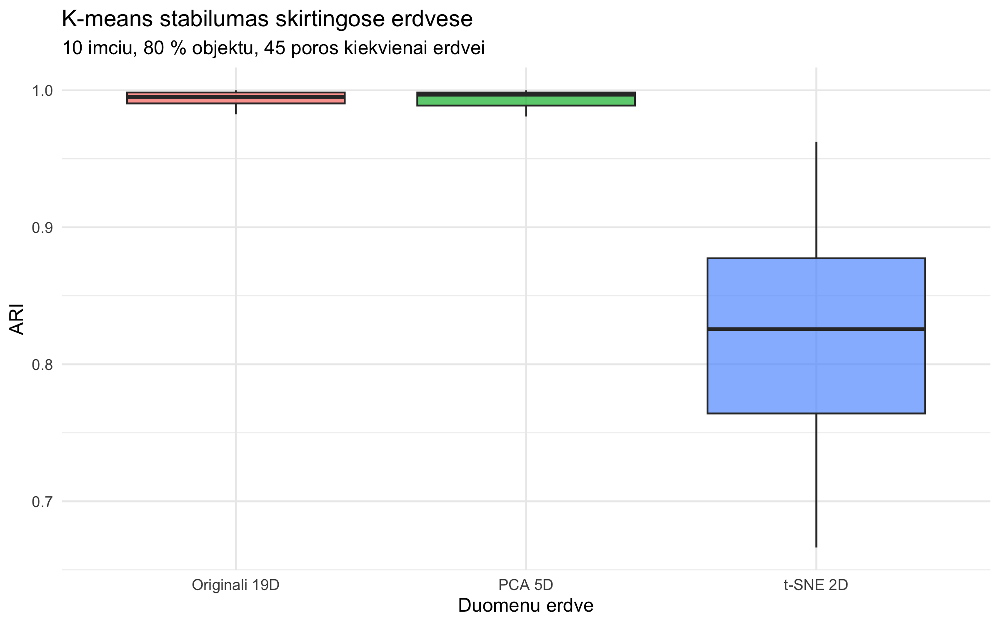

Grafike matome, kad:

- Originalios 19D ir PCA 5D erdvių ARI pasiskirstymai beveik sutampa.
- Abiejų erdvių ARI reikšmės yra arti 1 ir pasižymi labai maža sklaida.
- t-SNE 2D erdvės ARI reikšmės yra mažesnės ir labiau išsisklaidžiusios.
- t-SNE 2D ARI reikšmių diapazonas gerokai platesnis, todėl klasterių priskyrimai jautresni imties pokyčiams.

Grafikas patvirtina išorinių stabilumo rodiklių lentelėje nustatytas tendencijas.

#### 9.9. Pakankamo imčių skaičiaus nustatymas

Siekiant nustatyti, kiek imčių pakanka stabilumui įvertinti, analizavome ARI vidurkio kitimą didinant N nuo 5 iki 20.

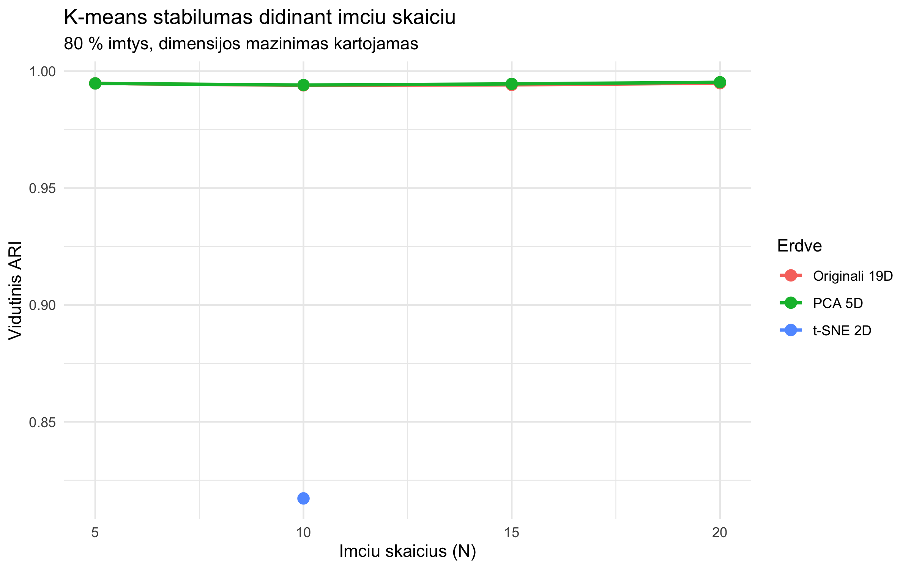

| N | Originali 19D ARI | PCA 5D ARI |
|---:|---:|---:|
| 5 | 0,994760 | 0,994745 |
| 10 | 0,993916 | 0,994056 |
| 15 | 0,994114 | 0,994539 |
| 20 | 0,994844 | 0,995254 |

Originalioje 19D ir PCA 5D erdvėse ARI vidurkis visais atvejais išliko apie 0,994–0,995.

Didinant imčių skaičių nuo 10 iki 20, ARI vidurkis originalioje erdvėje pasikeitė tik apie 0,00093, o PCA 5D erdvėje – apie 0,00120.

Tai rodo, kad stabilumo įverčiai praktiškai nusistovi jau naudojant 10 imčių.

**Todėl nustatėme, kad originaliai 19D ir PCA 5D erdvėms stabilumo įvertinimui pakanka N = 10 imčių.**

t-SNE 2D atveju pagal dėstytojos rekomendaciją atlikome 10 eksperimentų. Grafike t-SNE pavaizduotas tik ties N = 10, todėl jo ARI vidurkio kitimo didinant imčių skaičių nevertinome.

#### 9.10. Vidinių klasterizavimo kokybės rodiklių stabilumas

Kiekvienoje imtyje papildomai apskaičiavome tris vidinius kokybės rodiklius: Silhouette, Calinski–Harabasz ir Davies–Bouldin.

Visų trijų erdvių rezultatus palyginome naudodami pirmąsias 10 imčių.

| Rodiklis (vidurkis ± SD) | Originali 19D | PCA 5D | t-SNE 2D |
|---|---:|---:|---:|
| Silhouette ↑ | 0,3735 ± 0,0020 | 0,3854 ± 0,0021 | **0,4383 ± 0,0091** |
| Calinski–Harabasz ↑ | 2194,71 ± 21,82 | 2317,82 ± 23,46 | **3405,87 ± 210,78** |
| Davies–Bouldin ↓ | 1,1185 ± 0,0044 | 1,0844 ± 0,0044 | **0,8911 ± 0,0252** |

**Originali 19D.** Vidiniai rodikliai beveik nesikeitė tarp skirtingų imčių. Silhouette vidurkis siekė apie 0,374, o Davies–Bouldin – apie 1,118.

**PCA 5D.** Vidiniai rodikliai buvo šiek tiek palankesni nei originalioje aibėje, o jų standartiniai nuokrypiai išliko labai maži. Tai rodo, kad PCA sumažintoje erdvėje klasterizavimo kokybė yra pastovi.

**t-SNE 2D.** Vidiniai kokybės rodikliai buvo palankiausi, tačiau jų standartiniai nuokrypiai gerokai didesni. Pavyzdžiui, Calinski–Harabasz standartinis nuokrypis siekė 210,78, palyginti su 23,46 PCA 5D erdvėje.

Taigi t-SNE projekcijoje klasteriai atrodo geriau atskirti, tačiau jų kokybės rodikliai tarp skirtingų imčių svyruoja labiau.

Svarbu pabrėžti, kad t-SNE keičia objektų tarpusavio atstumus. Todėl palankesni vidiniai rodikliai t-SNE erdvėje savaime nereiškia, kad geriau išsaugoma originalių duomenų struktūra.

#### 9.11. Bendras klasterizavimo kokybės ir stabilumo įvertinimas

Sujungėme ankstesnio dimensijos mažinimo tyrimo rezultatus su stabilumo eksperimentais.

| Rodiklis | Originali 19D | PCA 5D | t-SNE 2D |
|---|---:|---:|---:|
| Silhouette (pilna aibė) | 0,3732 | 0,3852 | **0,4415** |
| ARI su originalia 19D | 1,0000 | **0,9959** | 0,5218 |
| Stabilumo ARI (N = 10) | 0,9939 | **0,9941** | 0,8172 |

Vertinant rezultatus svarbu atskirti du aspektus:

- **ARI su originalia aibe** parodo, kiek sumažintos dimensijos klasterizavimo rezultatai sutampa su originalios 19D aibės suskirstymu.
- **Stabilumo ARI** parodo, kiek panašūs klasterių priskyrimai gaunami kartojant visą duomenų apdorojimo ir klasterizavimo procesą su skirtingomis 80 % imtimis.

PCA 5D abiem aspektais pasižymėjo labai gerais rezultatais: beveik visiškai išsaugojo originalius klasterius ir išliko labai stabilus.

t-SNE 2D pasižymėjo palankesniais vidiniais kokybės rodikliais savo projekcijoje, tačiau jo klasterių priskyrimai labiau skyrėsi nuo originalių ir buvo mažiau stabilūs.

#### 9.12. Stabilumo tyrimo išvados

1. **Originalios 19D aibės K-means klasterizavimas yra labai stabilus.** Kai N = 10, ARI vidurkis siekė 0,9939, o standartinis nuokrypis – 0,0052.

2. **PCA 5D beveik visiškai išsaugojo originalios aibės stabilumą.** ARI vidurkis siekė 0,9941, o rezultatai beveik nesiskyrė nuo originalios 19D erdvės.

3. **t-SNE 2D klasterizavimo stabilumas buvo mažesnis.** ARI vidurkis siekė 0,8172, o standartinis nuokrypis – 0,0721, todėl klasterių priskyrimai labiau priklausė nuo imties sudėties ir projekcijos pokyčių.

4. **Originaliai 19D ir PCA 5D erdvėms pakanka 10 imčių**, nes didinant jų skaičių iki 15 ir 20 ARI vidurkiai pasikeitė labai nedaug.

5. **Vidiniai kokybės rodikliai originalioje ir PCA erdvėse išliko stabilūs.** t-SNE 2D rodikliai buvo palankesni savo projekcijoje, tačiau jų sklaida didesnė.

6. **PCA 5D yra tinkamiausias iš tirtų dimensijos mažinimo metodų K-means klasterizavimui**, jeigu tikslas – sumažinti požymių skaičių, išsaugoti originalią klasterių struktūrą ir gauti stabilius rezultatus.

Apibendrinant, stabilumo tyrimas parodė, kad **dimensijos mažinimas PCA metodu beveik nepakeitė K-means rezultatų pastovumo, o t-SNE metodu gauti suskirstymai buvo jautresni duomenų imties pokyčiams**.

#### 9.13. Rezultatų failai

Stabilumo tyrimo rezultatai išsaugoti `rezultatai/` aplanke:

| Failas | Turinys |
|---|---|
| `kmeans_stabilumas_pagal_N.csv` | Originalios 19D aibės stabilumas didinant imčių skaičių |
| `kmeans_stabilumo_poros.csv` | Originalios 19D aibės imčių porų palyginimai |
| `kmeans_stabilumo_vidiniai.csv` | Originalios 19D aibės vidiniai kokybės rodikliai |
| `kmeans_stabilumo_vidiniai_pagal_N.csv` | Originalios 19D aibės vidinių rodiklių suvestinė |
| `kmeans_stabilumas_visos_erdves.csv` | Visų trijų erdvių stabilumo palyginimas |
| `kmeans_stabilumo_poros_visos_erdves.csv` | Visų trijų erdvių imčių porų ARI, NMI ir Jaccard |
| `kmeans_stabilumo_vidiniai_visos_erdves.csv` | Visų trijų erdvių vidinių rodiklių suvestinė |
| `kmeans_stabilumo_dim_eksperimentai.csv` | PCA ir t-SNE stabilumo eksperimentų rezultatai |

Grafikai išsaugoti `grafikai/` aplanke:

- `kmeans_stabilumas_pagal_N.png` – originalios 19D aibės ARI vidurkio kitimas.
- `kmeans_stabilumo_ari_boxplot.png` – originalios 19D aibės ARI reikšmių sklaida.
- `kmeans_stabilumo_ari_visos_erdves.png` – visų trijų erdvių ARI sklaidos palyginimas.
- `kmeans_stabilumas_N_visos_erdves.png` – ARI vidurkio kitimas didinant N skirtingose erdvėse.

Skaičiavimai atlikti `kmeans.R` failo 32 ir 33 skyriuose.

## Hierarchinis klasterizavimas

Hierarchinį klasterizavimą atlikome tose pačiose trijose erdvėse kaip ir K-means: originalioje C aibėje (19D), PCA 5D ir t-SNE 2D. Visose aibėse yra tie patys 3928 objektai, suderinti pagal `id`. `id` ir `class` klasterizavimui nenaudoti. Kodas yra `hierarchinis.R` faile.

### 1. Parametrų parinkimas

Kiekvienoje erdvėje klasterizavimą kartojome iš naujo, lygindami 7 atstumo ir jungimo metodo derinius:

| Atstumas | Jungimo metodas |
|---|---|
| euclidean | single, complete, average, ward.D2 |
| manhattan | single, complete, average |

`ward.D2` taikytas tik su euklidiniu atstumu, nes Ward metodas apibrėžtas kvadratiniams euklidiniams atstumams.

Klasterių skaičių tikrinome nuo `k = 2` iki `k = 10` ir parinkome **pagal dendrogramą**, t. y. pagal didžiausią aukščio šuolį prieš apjungimą:

- Skirtingų konfigūracijų aukščiai turi skirtingas skales (manhattan aukščiai didesni nei euclidean, Ward didesni nei single), todėl šuolį **normalizavome** pagal didžiausią medžio aukštį (`santykinis_suolis`).
- Atmetėme `k`, kurio bent vienas klasteris sudaro mažiau nei **1 %** objektų. Dėl šio reikalavimo atkrito single ir average konfigūracijos, kurios atskiria po 1–2 išskirtis.
- Silhouette skaičiavome kiekvienos konfigūracijos geriausiam `k`.

Stipriai koreliuoti požymiai (`|r| ≥ 0,90`) nebuvo šalinami, kad hierarchinis klasterizavimas būtų lyginamas su K-means toje pačioje aibėje. Jų sąrašas išsaugotas `rezultatai/hierarchinis_stipriai_koreliuoti_pozymiai.csv`.

### 2. Klasterių skaičiaus parinkimas pagal dendrogramą

Visose trijose erdvėse didžiausią santykinį šuolį ir tinkamą klasterių dydį turėjo `euclidean_ward.D2` su `k = 2`:

| Erdvė | Konfigūracija | k | Santykinis šuolis | Mažiausias klasteris | Kitas didžiausias šuolis |
|---|---|---:|---:|---:|---|
| Originali C (19D) | euclidean_ward.D2 | 2 | 0,3505 | 29,56 % | k = 3: 0,2291 |
| PCA 5D | euclidean_ward.D2 | 2 | 0,5651 | 38,34 % | k = 5: 0,1126 |
| t-SNE 2D | euclidean_ward.D2 | 2 | 0,4045 | 30,83 % | k = 4: 0,2311 |

PCA ir t-SNE erdvėse `k = 2` šuolis aiškiai didesnis už kitus. Originalioje erdvėje `k = 3` šuolis taip pat pastebimas, tačiau `k = 2` išlieka didžiausias.

Kitos konfigūracijos originalioje erdvėje (geriausias leistinas k): `manhattan_complete` k = 2 (0,2878), `euclidean_complete` k = 3 (0,1824). Single ir average konfigūracijos neatitiko 1 % klasterio dydžio reikalavimo.

**Originali C (19D)**

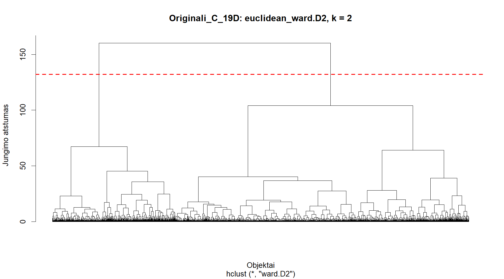

**PCA 5D**

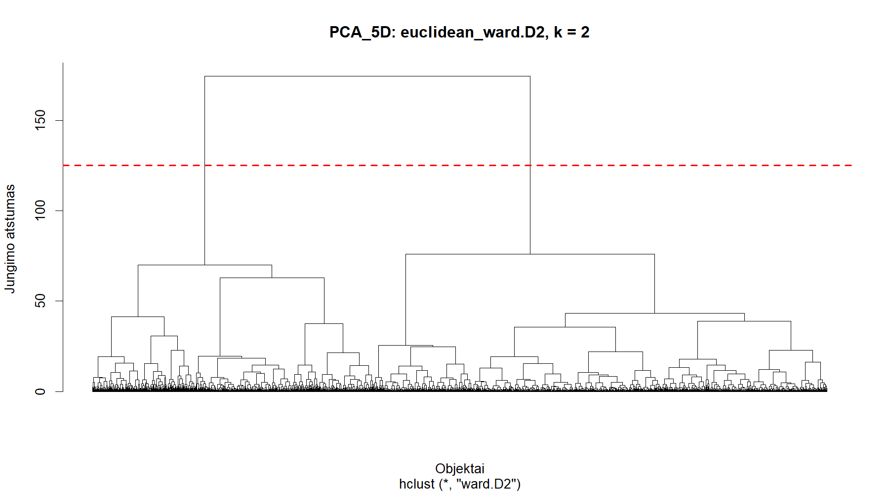

**t-SNE 2D**

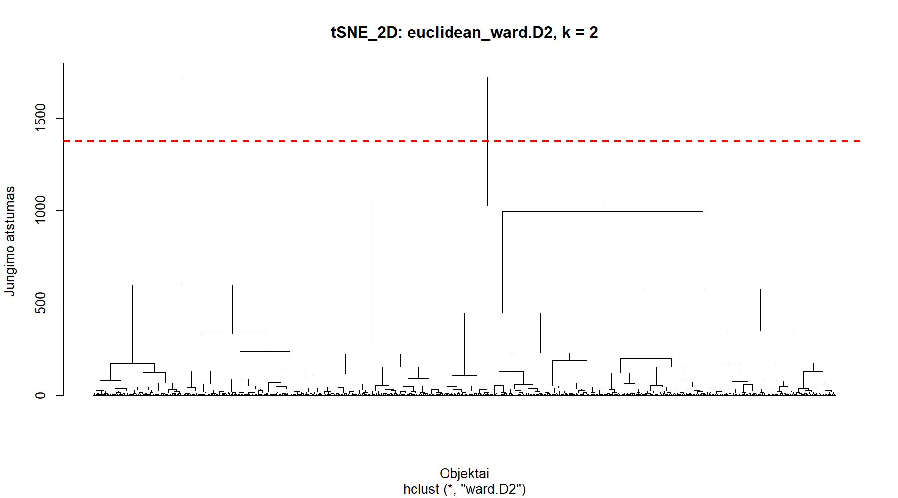

Raudona punktyrinė linija žymi pjovimo aukštį. Visų 7 konfigūracijų dendrogramos yra `grafikai/hierarchinis_dendrogramos.pdf` (PCA ir t-SNE – su priesagomis `_pca`, `_tsne`), o šuoliai – `rezultatai/hierarchinis_dendrogramos_suoliai.csv`.

### 3. Hierarchinis klasterizavimas originalioje C aibėje (19D)

Pasirinkta konfigūracija: `euclidean_ward.D2`, `k = 2`. Gauti du klasteriai:

| Rodiklis | 1 klasteris | 2 klasteris |
|---|---:|---:|
| Objektų skaičius | 2767 (70,4 %) | 1161 (29,6 %) |
| Karatų mediana | 0,50 | 1,23 |
| Kainos mediana | 1295 | 7903 |
| Tūrio (`volume_xyz`) mediana | 80,24 | 201,35 |
| Kainos už karatą mediana | 2926,67 | 6104,98 |
| Kainos už tūrį mediana | 17,84 | 37,64 |
| `depth` / `table` mediana | 61,5 / 57 | 62 / 58 |
| `length_width_ratio` mediana | 1,002 | 1,006 |

**1 klasteris** apima mažesnius ir pigesnius deimantus (apie 0,5 karato), o **2 klasteris** – didesnius ir brangesnius (apie 1,2 karato), kurių kaina vienam karatui maždaug dvigubai didesnė. Proporcijų požymiai (`depth`, `table`, `length_width_ratio`, `depth_ratio`, `table_depth_ratio`, `dimension_cv`) tarp klasterių beveik nesiskiria, todėl klasteriai skiria **dydį ir kainą, o ne formą**. Tai atitinka K-means rezultatą, nors klasterių dydžiai skiriasi (K-means: 2399 ir 1529 objektai).

Klasterių medianos originaliais vienetais išsaugotos `rezultatai/hierarchinis_klasteriu_medianos.csv`.

#### Klasterių sudėtis pagal klases

| Klasė | 1 klasteris | 2 klasteris |
|---|---:|---:|
| Ideal | 1474 (53,27 %) | 489 (42,12 %) |
| Premium | 1293 (46,73 %) | 672 (57,88 %) |

Abi klasės pasitaiko abiejuose klasteriuose, o bendras klasių santykis yra beveik 50 : 50. Todėl klasteriai nėra tapatūs `Ideal` ir `Premium`, o labiau atspindi dydžio ir kainos skirtumus.

#### Klasterių vizualizacija

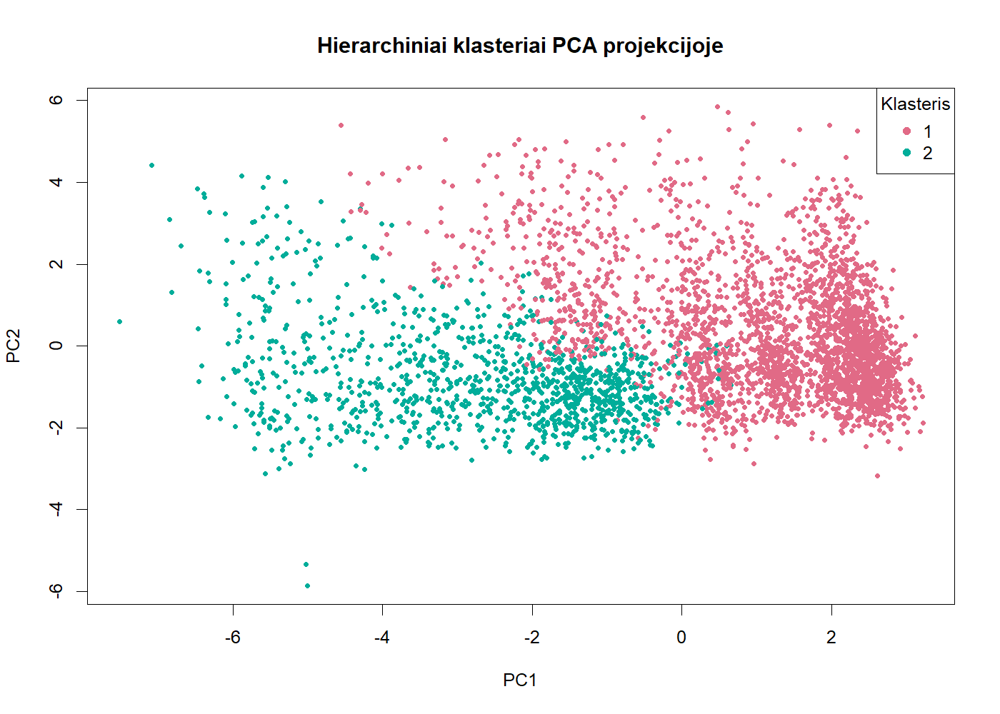

Originalioje 19D erdvėje gauti klasteriai pavaizduoti pirmųjų dviejų pagrindinių komponenčių projekcijoje. Projekcija naudota tik vizualizacijai.

### 4. Hierarchinis klasterizavimas PCA 5D ir t-SNE 2D aibėse

Abiejose sumažintose erdvėse parametrus parinkome iš naujo tuo pačiu principu (žr. 2 skyrių). Abiem atvejais gauta ta pati konfigūracija `euclidean_ward.D2` su `k = 2`, tačiau klasterių dydžiai skiriasi:

| Erdvė | 1 klasteris | 2 klasteris |
|---|---:|---:|
| Originali C (19D) | 2767 (70,4 %) | 1161 (29,6 %) |
| PCA 5D | 1506 (38,3 %) | 2422 (61,7 %) |
| t-SNE 2D | 2717 (69,2 %) | 1211 (30,8 %) |

Klasterių numeriai skirtingose erdvėse yra savavališki, todėl dydžius reikia lyginti kaip dvi grupes, o ne pagal numerį. t-SNE 2D dydžiai beveik sutampa su originaliais (70 % ir 30 %), o PCA 5D skirstymas kitoks (apie 38 % ir 62 %).

### 5. Vidiniai kokybės rodikliai

| Rodiklis | Originali C (19D) | PCA 5D | t-SNE 2D |
|---|---:|---:|---:|
| Silhouette ↑ | 0,3344 | **0,3816** | 0,3750 |
| Calinski–Harabasz ↑ | 2037,73 | 2828,64 | **3017,31** |
| Davies–Bouldin ↓ | 1,1945 | 1,0946 | **0,8997** |

Originali C aibė pagal visus tris rodiklius turi silpniausias reikšmes. Silhouette didžiausias PCA 5D erdvėje, o Calinski–Harabasz ir Davies–Bouldin – t-SNE 2D erdvėje. Tačiau vidiniai rodikliai skaičiuoti skirtingose erdvėse, o t-SNE atveju atstumų struktūra pakeista, todėl vien jų negalima laikyti įrodymu, kad originali struktūra išsaugota geriau.

### 6. Rezultatų palyginimas naudojant išorinius rodiklius

Klasterių priskyrimus trijose erdvėse palyginome pagal ARI, NMI ir Jaccard indeksus.

| Palyginimas | ARI ↑ | NMI ↑ | Jaccard ↑ |
|---|---:|---:|---:|
| Originali 19D ir PCA 5D | 0,5912 | 0,5059 | 0,6915 |
| Originali 19D ir t-SNE 2D | **0,8340** | **0,7233** | **0,8692** |
| PCA 5D ir t-SNE 2D | 0,6601 | 0,5759 | 0,7343 |

Hierarchinio klasterizavimo atveju t-SNE 2D suskirstymas yra artimesnis originaliam nei PCA 5D (ARI 0,834 prieš 0,591). Tai priešinga K-means rezultatui, kur PCA beveik visiškai sutapo su originaliu (ARI 0,9959). Pagal ARI ir NMI išlieka tik vidutinis sutapimas tarp PCA ir originalaus suskirstymo, o pagal Jaccard – šiek tiek aukštesnis.

Sutampančių objektų lentelės išsaugotos:

- `rezultatai/hierarchinis_sutampantys_taskai_originali_pca.csv`
- `rezultatai/hierarchinis_sutampantys_taskai_originali_tsne.csv`
- `rezultatai/hierarchinis_sutampantys_taskai_pca_tsne.csv`

Atsiskyrėlių (klasterių < 1 %) pasirinktuose `k` nėra, nes jie buvo atmesti pačiame `k` parinkimo etape, todėl `hierarchinis_mazu_klasteriu_id.csv` tuščias.

### 7. Hierarchinio klasterizavimo stabilumo tyrimas

Stabilumą vertinome pagal tą pačią metodiką kaip K-means: **N = 10** atsitiktinių 80 % imčių (imčių sėklos nuo `42` iki `51`). Kiekvienoje imtyje:

1. Iš nenormuotos C aibės atrinkome 80 % objektų (3142).
2. Normavome robust scaling (mediana ir IQR) tik tos imties duomenimis.
3. PCA 5D atveju iš naujo skaičiavome PCA ir ėmėme pirmas 5 komponentes. t-SNE 2D atveju iš naujo skaičiavome t-SNE projekciją.
4. Atlikome hierarchinį klasterizavimą su pasirinkta konfigūracija (`euclidean_ward.D2`, `k = 2`).
5. Imtis palyginome poromis (45 poros) tik bendriems objektams, pagal ARI, NMI ir Jaccard.

#### Išoriniai stabilumo rodikliai (vidurkis ± SD)

| Rodiklis | Originali 19D | PCA 5D | t-SNE 2D |
|---|---:|---:|---:|
| ARI | 0,7132 ± 0,0982 | 0,6960 ± 0,1346 | 0,4260 ± 0,2336 |
| NMI | 0,6190 ± 0,0967 | 0,6086 ± 0,1302 | 0,4470 ± 0,1524 |
| Jaccard | 0,7617 ± 0,0726 | 0,7590 ± 0,0936 | 0,5931 ± 0,1304 |

#### ARI sklaida

**Originali 19D**

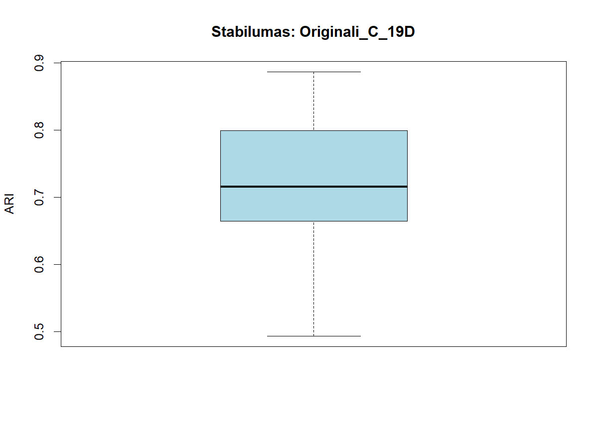

**PCA 5D**

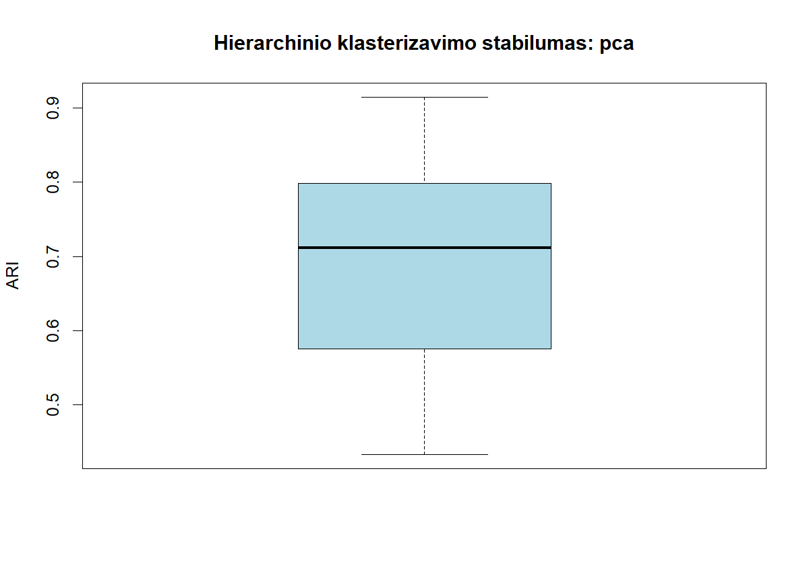

**t-SNE 2D**

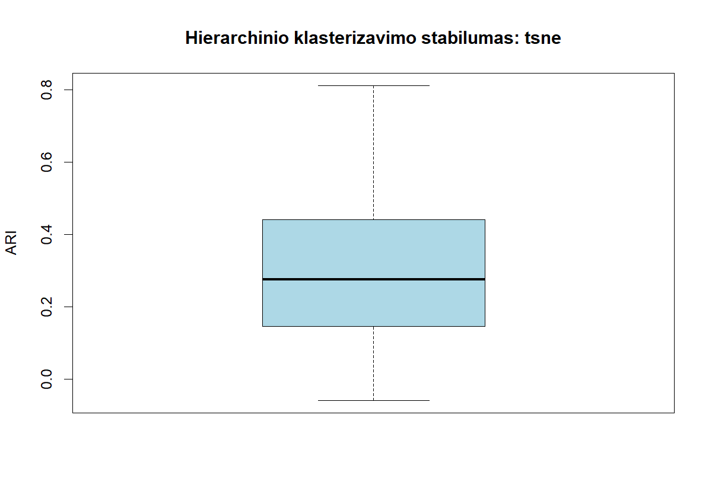

#### Vidinių rodiklių stabilumas (vidurkis ± SD)

| Rodiklis | Originali 19D | PCA 5D | t-SNE 2D |
|---|---:|---:|---:|
| Silhouette | 0,3478 ± 0,0089 | 0,3634 ± 0,0157 | 0,3895 ± 0,0266 |
| Calinski–Harabasz | 1937,16 ± 83,77 | 2048,49 ± 219,59 | 2618,74 ± 385,77 |
| Davies–Bouldin | 1,1773 ± 0,0201 | 1,1334 ± 0,0335 | 0,9362 ± 0,0553 |

Silhouette, Calinski–Harabasz ir Davies–Bouldin 80 % imtyse šiek tiek skiriasi nuo pilnos aibės reikšmių (5 skyrius), nes imtys mažesnės, o Calinski–Harabasz taip pat priklauso nuo objektų skaičiaus. Tačiau abiejų rinkinių tendencija ta pati: originali erdvė silpniausia, t-SNE turi didžiausią sklaidą.

### 7.1. Dimensijos mažinimo efektyvumo vertinimas

Dimensijos mažinimas klasterizavime laikomas efektyviu, kai vidiniai matai pagerėja, o išoriniai rodikliai su originalia erdve išlieka aukšti (arčiau 1). Gautus rezultatus palyginome su šiuo kriterijumi:

| Erdvė | Vidiniai matai (Silhouette ↑, CH ↑, DB ↓) | Išoriniai matai su originalia (ARI ↑) | Stabilumas (ARI ↑) | Vertinimas |
|---|---|---:|---:|---|
| PCA 5D | pagerėjo pagal visus tris (0,3344 → 0,3816; 2037,73 → 2828,64; 1,1945 → 1,0946) | 0,5912 | 0,6960 | vidiniai matai geresni, tačiau suskirstymas gerokai pasikeitė |
| t-SNE 2D | pagerėjo pagal visus tris (→ 0,3750; 3017,31; 0,8997) | 0,8340 | 0,4260 | vidiniai matai ir sutapimas geri, tačiau stabilumas žemas |

Nė viena sumažinta erdvė neatitinka kriterijaus visais aspektais. PCA 5D pagerino vidinius matus, bet pakeitė suskirstymą, o t-SNE 2D išlaikė suskirstymą artimiausią originaliam, bet buvo nestabilus. Be to, vidiniai matai skaičiuoti skirtingose erdvėse, todėl jų pagerėjimas pats savaime neįrodo geresnės klasterizacijos.

### 8. Hierarchinio klasterizavimo išvados

1. **Visose trijose erdvėse dendrograma rodo `k = 2`.** Šuolis ypač ryškus PCA 5D (0,565) ir t-SNE 2D (0,404) erdvėse. Originalioje erdvėje `k = 3` šuolis (0,229) yra antras.
2. **Klasteriai atskiria deimanto dydį ir kainą.** Antrame klasteryje karatų mediana apie 2,5 karto, o kainos mediana apie 6 kartus didesnė, tuo tarpu proporcijų požymiai beveik nesiskiria. Klasės `Ideal` ir `Premium` pasiskirsčiusios abiejuose klasteriuose.
3. **Dimensijos mažinimo poveikis.** Hierarchinio klasterizavimo rezultatai po dimensijos mažinimo pasikeitė labiau nei K-means. Originalus ir PCA 5D suskirstymai sutampa tik vidutiniškai (ARI 0,591), o su t-SNE 2D sutampa geriau (ARI 0,834). Vidiniai rodikliai sumažintose erdvėse palankesni, tačiau jie skaičiuoti skirtingose erdvėse, todėl vien jais negalima teigti, kad struktūra išsaugota geriau.
4. **Stabilumas.** Hierarchinis klasterizavimas yra mažiau stabilus nei K-means. Originalioje 19D ir PCA 5D erdvėse ARI vidurkis siekia apie 0,70–0,71 (K-means ~0,99), o t-SNE 2D – tik 0,426 su dideliu nuokrypiu (± 0,234; K-means 0,817). Tai rodo, kad dviejų klasterių riba jautri imties sudėčiai, ypač t-SNE projekcijoje, kuri kiekvienoje imtyje perskaičiuojama iš naujo.
5. **Palyginimas su K-means.** Abu metodai randa tą pačią dydžio ir kainos struktūrą, tačiau K-means yra stabilesnis ir mažiau jautrus dimensijos mažinimui. Hierarchinis Ward klasterizavimas suteikia aiškią dendrogramą ir daugiau objektų priskiria pirmam klasteriui (2767 prieš 2399).

Visi skaičiavimai atlikti `hierarchinis.R` faile.

## DBSCAN klasterizavimas

### DBSCAN originalioje C aibėje (19D)

#### Parametrų parinkimas

DBSCAN taikytas originalios C aibės 3928 objektams pagal
19 robustiniu būdu normuotų skaitinių požymių. Naudotas
Euklido atstumas. Objektų identifikatoriai (`id`) ir klasių
žymės (`class`) į klasterizavimą neįtraukti.

Patikrinta, kad objektų identifikatoriai yra unikalūs,
o požymių matricoje nėra trūkstamų ar nebaigtinių reikšmių.

Parametro `eps` parinkimui sudarytos surikiuotų atstumų iki
k-ojo artimiausio kaimyno kreivės, kai `minPts = 10, 20, 38`.
Naudota `k = minPts − 1`, nes DBSCAN į `minPts` įskaičiuoja
ir patį nagrinėjamą objektą. Reikšmė `minPts = 38` atitinka
dvigubo požymių skaičiaus orientyrą, o mažesnės reikšmės
įtrauktos parametrų jautrumui įvertinti.
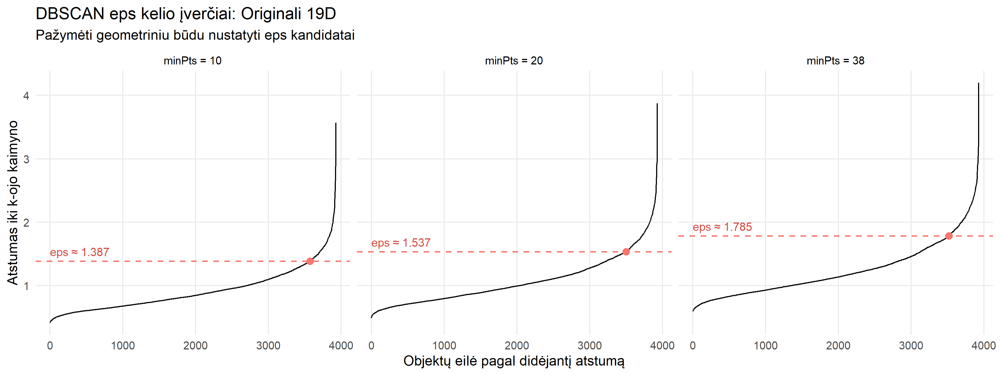

Visose trijose kreivėse matomas palaipsnis užlinkimas ir
staigus atstumų augimas pabaigoje. Toliau `eps` pasirinkimas
vertinamas taikant geometrinį kelio įvertį ir išbandant
skirtingus `eps` bei `minPts` derinius.

#### Parametrų jautrumo tyrimas

Pirmiausia atlikta 15 pradinių `eps` ir `minPts` derinių
bandymų. Tuomet jautrumas detaliau ištirtas naudojant
`minPts = 10, 20, 38` ir keičiant `eps` nuo 0,80 iki 1,60
žingsniu 0,05. Detaliajame tyrime atliktas 51 bandymas.

Kiekvienam deriniui užregistruotas klasterių skaičius,
jų dydžiai ir triukšmui priskirtų objektų dalis.

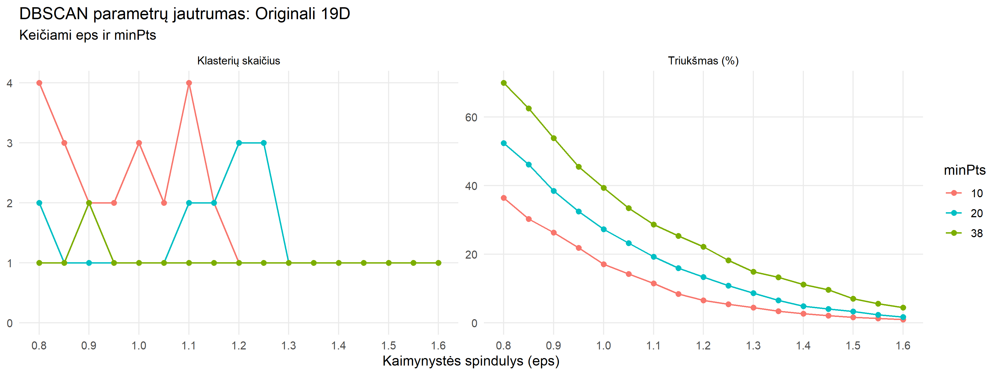

Didėjant `eps`, triukšmo dalis mažėjo. Esant tam pačiam
`eps`, didesnė `minPts` reikšmė lėmė didesnę triukšmo dalį,
nes tankiai sričiai nustatyti reikėjo daugiau objektų.

Klasterių skaičius kito netolygiai: didinant spindulį,
anksčiau triukšmui priskirti objektai gali sudaryti naujas
grupes, o esami klasteriai gali susijungti. Kai `eps ≥ 1,30`,
visoms trims tirtoms `minPts` reikšmėms gautas vienas klasteris.

| eps | minPts | Klasterių dydžiai | Triukšmas (%) |
|---:|---:|---|---:|
| 0,80 | 20 | 1698; 173 | 52,37 |
| 0,95 | 10 | 3060; 10 | 21,84 |
| 1,10 | 10 | 3420; 41; 10; 8 | 11,43 |
| 1,25 | 20 | 3463; 22; 18 | 10,82 |

Pateikti pavyzdžiai rodo, kad kelių klasterių variantuose
dominuoja vienas didelis klasteris, o kitos grupės yra
gerokai mažesnės. Todėl galutinis parametrų pasirinkimas
bus vertinamas kartu su klasterių kokybe, objektų aprėptimi
ir susidariusių grupių charakteristikomis.

Pradiniai bandymai išsaugoti
`rezultatai/dbscan_parametrai_originali.csv`,
o detalus jautrumo tyrimas –
`rezultatai/dbscan_parametru_jautrumas_originali.csv`.

#### Silueto ir klasterių dydžių vertinimas

Vidutinis silueto koeficientas apskaičiuotas originalioje
19D erdvėje tik klasteriams priskirtiems objektams,
neįtraukiant triukšmo. Variantams su vienu klasteriu
siluetas neapibrėžtas.

Atrinkti keli parametrų deriniai palyginimui:

| eps | minPts | Klasterių sk. | Vertinta objektų (%) | Silhouette ↑ | Didžiausio klasterio dalis (%)* | Mažiausias klasteris |
|---:|---:|---:|---:|---:|---:|---:|
| 0,95 | 10 | 2 | 78,16 | 0,4764 | 99,67 | 10 |
| 1,05 | 10 | 2 | 85,82 | 0,4275 | 99,14 | 29 |
| 1,15 | 10 | 2 | 91,62 | 0,4269 | 99,58 | 15 |
| 0,80 | 20 | 2 | 47,63 | 0,3905 | 90,75 | 173 |
| 1,10 | 10 | 4 | 88,57 | 0,3670 | 98,30 | 8 |

*Didžiausio klasterio dalis apskaičiuota tarp klasteriams
priskirtų objektų, neįtraukiant triukšmo.

Didžiausias siluetas (0,4764) gautas, kai `eps = 0,95`
ir `minPts = 10`. Tačiau šiuo atveju klasterius sudarė
3060 ir 10 objektų, o 21,84 % aibės priskirta triukšmui.
Todėl aukščiausia silueto reikšmė savaime neparodo,
kad gautas prasmingiausias visos aibės suskirstymas.

Kai `eps = 1,15` ir `minPts = 10`, klasteriams priskirta
didesnė objektų dalis – 91,62 %, tačiau ir šiame variante
dominavo vienas didelis klasteris. Galutinis parametrų
pasirinkimas bus grindžiamas ne vien siluetu, bet ir
objektų aprėptimi, grupių charakteristikomis bei jautrumu
parametrų pokyčiams.

Visų bandymų rezultatai išsaugoti
`rezultatai/dbscan_kokybe_parametru_originali.csv`.

#### Mažųjų grupių jautrumas eps

Naudojant `minPts = 10`, palyginta mažųjų grupių sudėtis,
keičiant `eps` nuo 0,90 iki 1,15 žingsniu 0,05.
Kiekviename bandyme atmestas didžiausias klasteris,
o likusių klasterių objektai sujungti į vieną rinkinį.

Šių objektų rinkinių sutapimas vertintas Jaccard indeksu.
Tai mažųjų grupių objektų rinkinių palyginimas, o ne
viso klasterizavimo suskirstymo panašumo rodiklis.

Gretimų eps reikšmių palyginimas:

| eps A | eps B | Mažųjų grupių objektai A | Mažųjų grupių objektai B | Bendri objektai | Jaccard |
|---:|---:|---:|---:|---:|---:|
| 0,90 | 0,95 | 21 | 10 | 0 | 0,0000 |
| 0,95 | 1,00 | 10 | 21 | 10 | 0,4762 |
| 1,00 | 1,05 | 21 | 29 | 15 | 0,4286 |
| 1,05 | 1,10 | 29 | 59 | 29 | 0,4915 |
| 1,10 | 1,15 | 59 | 15 | 0 | 0,0000 |

Visų tirtų porų Jaccard indeksas svyravo nuo 0 iki 0,4915.
Kai kuriais atvejais visi ankstesni mažųjų grupių objektai
išliko mažosiose grupėse, tačiau jų rinkinys pasipildė.
Kitais atvejais mažųjų grupių objektų rinkiniai nesutapo.

Objektų perėjimų analizė parodė, kad padidinus `eps`
nuo 0,90 iki 0,95, visi 21 ankstesnės mažosios grupės
objektai prisijungė prie didžiojo klasterio. Padidinus
`eps` nuo 1,10 iki 1,15, prie didžiojo klasterio prisijungė
visi 59 ankstesnių mažųjų grupių objektai. Ties `eps = 1,15`
išskirtą 15 objektų grupę sudarė kiti deimantai.

Taigi panašus klasterių skaičius skirtinguose bandymuose
negarantuoja, kad mažosiose grupėse išlieka tie patys
objektai. Šis tyrimas vertina jautrumą parametrui `eps`;
stabilumas su atsitiktinėmis 80 % imtimis bus tiriamas
atskirai.

Rezultatai išsaugoti:
- `rezultatai/dbscan_mazuju_klasteriu_persidengimas_originali.csv`
- `rezultatai/dbscan_objektu_perejimai_originali.csv`

#### Kandidatų klasterių ir triukšmo charakteristikos

Detaliau išanalizuoti keturi parametrų deriniai:
`eps = 0,80, minPts = 20` ir
`eps = 0,95; 1,10; 1,15, minPts = 10`.

Objektai su originalių matavimo vienetų duomenimis
suderinti pagal `id`. Kiekvienai grupei apskaičiuotos
19 požymių medianos, pirmieji ir tretieji kvartiliai
bei pradinių klasių proporcijos. Klasių žymės naudotos
tik rezultatų interpretacijai.

Didžiausią siluetą turinčio kandidato
(`eps = 0,95`, `minPts = 10`) charakteristikos:

| Grupė | Objektų sk. | Svorio mediana (ct) | Kainos mediana | Ideal (%) | Premium (%) |
|---|---:|---:|---:|---:|---:|
| K1 | 3060 | 0,530 | 1657,5 | 55,56 | 44,44 |
| K2 | 10 | 2,055 | 15108,5 | 0,00 | 100,00 |
| Triukšmas | 858 | 1,330 | 9021,5 | 30,65 | 69,35 |

Didįjį klasterį sudarė mažesni ir pigesni deimantai,
o mažąjį – 10 stambesnių ir brangesnių Premium klasės
deimantų. Triukšmo objektų svorio ir kainos medianos
taip pat buvo didesnės negu didžiojo klasterio.
Triukšmas nėra atskiras DBSCAN klasteris – tai pasirinktomis
parametrų sąlygomis klasteriams nepriskirti objektai.

Kai `eps = 1,10` ir `minPts = 10`, susidarė trys mažosios
grupės, kurių svorio medianos siekė apie 2 ct. Jos skyrėsi
kitomis savybėmis ir klasių sudėtimi:

| Grupė | Objektų sk. | Svorio mediana (ct) | Kainos mediana | depth mediana | Premium (%) |
|---|---:|---:|---:|---:|---:|
| K2 | 41 | 2,050 | 14948 | 61,10 | 92,68 |
| K3 | 10 | 2,045 | 13849 | 62,65 | 90,00 |
| K4 | 8 | 2,015 | 18026 | 62,00 | 12,50 |

K4 grupė pasižymėjo didžiausia kainos mediana tarp šių
trijų mažųjų grupių, o 7 iš 8 jos objektų priklausė
Ideal klasei. Taigi mažosios grupės skyrėsi ne vien dydžiu.

Kai `eps = 0,80` ir `minPts = 20`, mažesnio 173 objektų
klasterio svorio mediana buvo 1,08 ct, kainos – 4960.
Šis variantas išskyrė kitokio dydžio grupę, tačiau
52,37 % visos aibės liko triukšme.

Klasterių charakteristikos priklauso nuo parametrų,
todėl jos vertinamos kartu su ankstesniais mažųjų grupių
sudėties jautrumo rezultatais. Klasterių numeriai galioja
tik konkrečiam bandymui ir savaime nereiškia tų pačių
objektų kituose bandymuose.

Rezultatai išsaugoti:
- `rezultatai/dbscan_kandidatu_statistikos_originali.csv`
- `rezultatai/dbscan_kandidatu_klases_originali.csv`

#### Kandidatų vizualizacija

Originalioje 19D erdvėje gauti DBSCAN klasteriai
pavaizduoti bendroje t-SNE 2D projekcijoje. Visose
keturiose panelėse naudojamos tos pačios objektų
koordinatės, o spalvos žymi konkretaus parametrų
derinio klasterius. Pilkai pažymėti triukšmo objektai.

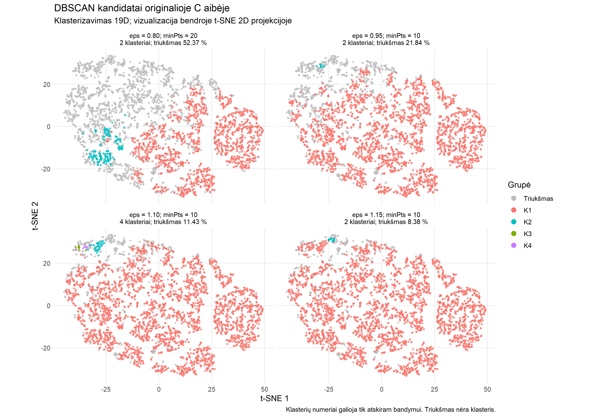

Kai `eps = 0,80` ir `minPts = 20`, triukšmui priskirta
52,37 % objektų. Kituose pateiktuose variantuose
dominuoja vienas didelis klasteris, o mažosios grupės
matomos projekcijos viršutinėje kairėje dalyje.

Didėjant `eps`, kai `minPts = 10`, triukšmo dalis mažėja,
o didysis klasteris apima daugiau objektų. Mažųjų grupių
sudėtis taip pat kinta, kaip parodė objektų perėjimų analizė.

Vienam klasteriui priklausantys objektai t-SNE projekcijoje
gali atrodyti suskaidyti į atskiras saleles, nes klasterizavimas
atliktas 19D erdvėje, o projekcija pakeičia atstumus ir tankį.
Todėl klasterių atskyrimas nevertinamas vien pagal matomus
tarpus grafike. Klasterių numeriai galioja tik atskiram bandymui.

#### Vidinių kokybės rodiklių palyginimas

Keturiems kandidatams apskaičiuoti Silhouette,
Calinski–Harabasz (CH) ir Davies–Bouldin (DB) rodikliai.
Skaičiavimai atlikti originalioje 19D erdvėje,
neįtraukiant triukšmo objektų.

| eps | minPts | Klasterių sk. | Vertinta objektų (%) | Silhouette ↑ | CH ↑ | DB ↓ |
|---:|---:|---:|---:|---:|---:|---:|
| 0,80 | 20 | 2 | 47,63 | 0,39055 | 631,769 | 0,82828 |
| 0,95 | 10 | 2 | 78,16 | 0,47638 | 67,575 | 0,47465 |
| 1,10 | 10 | 4 | 88,57 | 0,36705 | 100,014 | 0,79465 |
| 1,15 | 10 | 2 | 91,62 | 0,42694 | 78,601 | 0,56661 |

Didžiausias Silhouette ir mažiausias DB gauti su
`eps = 0,95`, `minPts = 10`. Tačiau šiuo atveju
klasterius sudarė 3060 ir 10 objektų, o 21,84 %
aibės liko triukšme.

Didžiausias CH gautas su `eps = 0,80`, `minPts = 20`,
tačiau rodikliai įvertino tik 47,63 % visų objektų.
Didžiausia aprėptis tarp šių kandidatų gauta su
`eps = 1,15`, `minPts = 10` – 91,62 %.

Rodikliai neišskyrė vieno pagal visus kriterijus
geriausio kandidato. Kadangi skirtinguose bandymuose
vertinti nevienodi objektų poaibiai, rodikliai
interpretuojami kartu su aprėptimi, klasterių dydžiais,
charakteristikomis ir parametrų jautrumu.

Rezultatai išsaugoti
`rezultatai/dbscan_kandidatu_kokybe_originali.csv`.

#### Geometrinis kelio įvertis ir atskaitos pasirinkimas

Kaimynų atstumų kreivių kelio taškai įvertinti geometriniu
būdu. Abi kreivės ašys normalizuotos į intervalą [0, 1].
Pasirinktas didžiausio nuotolio žemiau kreivės galus
jungiančios tiesės taškas. Šis metodas pateikia eps
kandidatą, tačiau negarantuoja optimalaus suskirstymo.

| minPts | eps kelio įvertis | Klasterių sk. | Klasterio dydis | Triukšmo objektai | Triukšmas (%) |
|---:|---:|---:|---:|---:|---:|
| 10 | 1,3872 | 1 | 3819 | 109 | 2,77 |
| 20 | 1,5370 | 1 | 3825 | 103 | 2,62 |
| 38 | 1,7855 | 1 | 3865 | 63 | 1,60 |

Visais trimis atvejais gautas vienas klasteris ir nedidelė
triukšmo dalis. Kartu su parametrų jautrumo tyrimu tai rodo,
kad šiais tankio masteliais DBSCAN neišskiria kelių didelių
atskirų grupių originalioje 19D erdvėje.

Tolesniam palyginimui su sumažintomis erdvėmis pasirinkta
atskaita: `minPts = 38` ir atitinkamas tikslus geometrinis
`eps` įvertis (apie 1,7855). Reikšmė 38 pasirinkta pagal
dvigubo dimensijų skaičiaus orientyrą. Tai metodinė
atskaita, o ne įrodytas optimalus parametrų derinys.

Šiame variante klasteriui priskirti 3865 objektai,
triukšmui – 63. Atmetus triukšmą lieka vienas klasteris,
todėl Silhouette, CH ir DB rodikliai neapibrėžti.
Anksčiau nagrinėti kelių klasterių variantai paliekami
parametrų jautrumui ir mažųjų grupių savybėms aprašyti.

Rezultatai išsaugoti
`rezultatai/dbscan_kelio_ivertis_originali.csv`.

### DBSCAN PCA 5D erdvėje

#### Duomenys ir parametrų parinkimas

DBSCAN taikytas tiems patiems 3928 objektams pagal penkias
PCA komponentes (`PC1–PC5`). Objektai suderinti su originalia
C aibe pagal `id`, patikrintos klasių žymės ir koordinačių
baigtinumas. Identifikatoriai ir klasės klasterizavimui
nenaudoti. PCA koordinatės papildomai nenormuotos.

Naudotas Euklido atstumas. Ištirtos `minPts = 5, 10, 20, 38`
reikšmės. Reikšmė 10 atitinka dvigubą PCA dimensijų skaičių,
o kitos reikšmės įtrauktos jautrumui įvertinti.

Kiekvienai minPts reikšmei sudaryta surikiuotų atstumų iki
k-ojo kaimyno kreivė, naudojant `k = minPts − 1`.
Geometrinis kelio įvertis apskaičiuotas tokiu pačiu būdu
kaip originalioje 19D erdvėje.

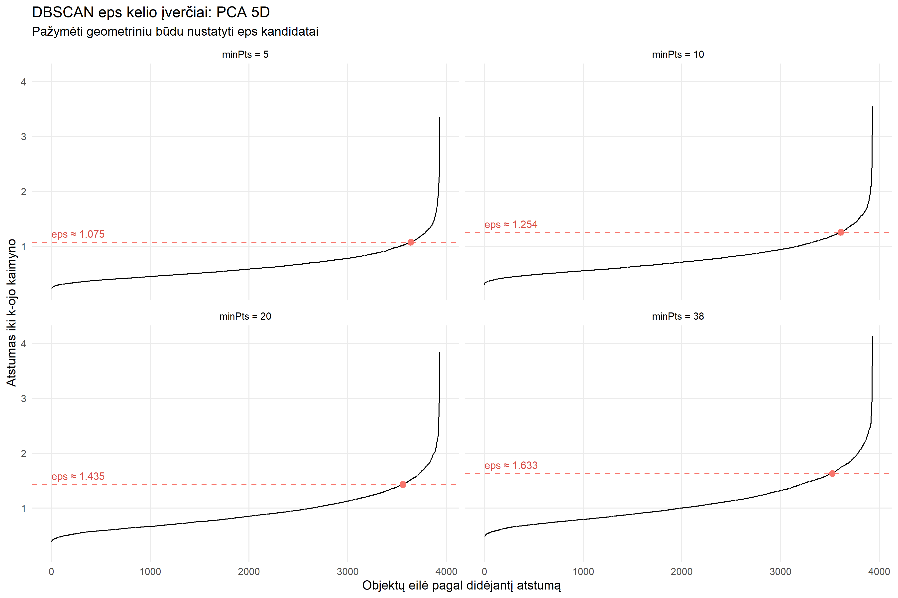

| minPts | eps kelio įvertis | Klasterių sk. | Klasterių dydžiai | Triukšmas (%) |
|---:|---:|---:|---|---:|
| 5 | 1,0751 | 4 | 3794; 5; 5; 5 | 3,03 |
| 10 | 1,2538 | 1 | 3835 | 2,37 |
| 20 | 1,4346 | 1 | 3845 | 2,11 |
| 38 | 1,6329 | 1 | 3859 | 1,76 |

Kai `minPts = 5`, ties geometriniu kelio įverčiu išskirtas
vienas didelis klasteris ir trys mažos grupės po 5 objektus.
Kai `minPts = 10, 20, 38`, ties atitinkamais kelio įverčiais
gautas vienas klasteris.

Šiuose bandymuose kartu keitėsi minPts ir eps, todėl
atskiras parametrų poveikis toliau vertinamas parametrų
jautrumo tyrime. Kelio įverčiai laikomi eps kandidatais,
o ne savaime optimaliais parametrų pasirinkimais.

Rezultatai išsaugoti
`rezultatai/dbscan_kelio_ivertis_pca.csv`.

#### Parametrų jautrumo tyrimas

PCA 5D erdvėje atlikti 104 parametrų bandymai.
Kiekvienai `minPts = 5, 10, 20, 38` reikšmei
`eps` keistas nuo 0,60 iki 1,80 žingsniu 0,05.
Papildomai įtraukti keturi tikslūs geometriniai
kelio įverčiai.

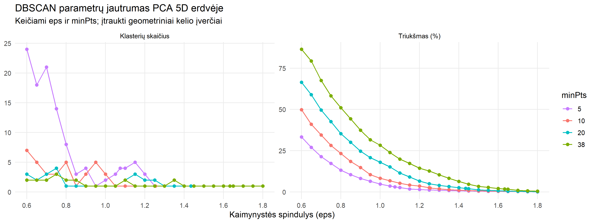

Didėjant eps, triukšmo dalis mažėjo. Esant tam pačiam
eps, didesnės minPts reikšmės lėmė didesnę triukšmo dalį.
Klasterių skaičius kito netolygiai, nes didinant spindulį
gali susidaryti naujos grupės ir susijungti esamos.

Daugiausia klasterių (24) gauta, kai `eps = 0,60`
ir `minPts = 5`. Šiame variante vieną klasterį sudarė
2473 objektai, o kitos grupės buvo gerokai mažesnės.

Kelių pasirinktų bandymų rezultatai:

| eps | minPts | Klasterių sk. | Klasterių dydžiai | Triukšmas (%) |
|---:|---:|---:|---|---:|
| 1,00 | 10 | 3 | 3494; 17; 93 | 8,25 |
| 1,15 | 20 | 3 | 3505; 37; 28 | 9,11 |
| 1,35 | 38 | 2 | 3578; 26 | 8,25 |

Šiuose variantuose dominavo vienas didelis klasteris,
o likusios grupės buvo mažos. Visoms keturioms tirtoms
minPts reikšmėms, kai `eps ≥ 1,40`, gautas vienas klasteris.

Parametrų jautrumo rezultatai toliau vertinami kartu
su siluetu, objektų aprėptimi ir klasterių charakteristikomis.

Visi bandymai išsaugoti
`rezultatai/dbscan_parametru_jautrumas_pca.csv`.

#### Silueto ir klasterių dydžių vertinimas

Siluetas apskaičiuotas PCA 5D erdvėje tik klasteriams
priskirtiems objektams, neįtraukiant triukšmo.
Kiekvienai minPts reikšmei atrinktas didžiausią
siluetą turintis parametrų derinys.

| eps | minPts | Klasterių dydžiai | Vertinta objektų (%) | Silhouette ↑ |
|---:|---:|---|---:|---:|
| 0,85 | 5 | 3450; 18; 48 | 89,51 | 0,39239 |
| 0,90 | 10 | 3309; 27; 13 | 85,26 | 0,42056 |
| 0,65 | 20 | 1539; 72 | 41,01 | 0,44452 |
| 1,35 | 38 | 3578; 26 | 91,75 | 0,42419 |

Didžiausias siluetas (0,44452) gautas su `eps = 0,65`
ir `minPts = 20`, tačiau vertinta tik 41,01 % aibės,
o likę 58,99 % objektų priskirti triukšmui.

Tarp pateiktų kandidatų didžiausia aprėptis (91,75 %)
gauta su `eps = 1,35` ir `minPts = 38`. Tačiau šiame
variante išskirti labai nevienodo dydžio klasteriai –
3578 ir 26 objektų.

Visuose keturiuose kandidatuose didžiausias klasteris
apėmė daugiau nei 95 % klasteriams priskirtų objektų.
Todėl siluetas vertinamas kartu su objektų aprėptimi,
klasterių dydžiais ir jų charakteristikomis.
Šie variantai kol kas laikomi kandidatais,
o ne galutiniais parametrų pasirinkimais.

Visų bandymų rezultatai išsaugoti
`rezultatai/dbscan_kokybe_parametru_pca.csv`.

#### Kandidatų klasterių ir triukšmo charakteristikos

Išanalizuoti keturi didžiausio silueto kandidatai pagal
kiekvieną minPts reikšmę ir papildomas variantas
`eps = 1,00`, `minPts = 10`, apimantis 91,75 % objektų.

Klasterizavimas atliktas PCA 5D erdvėje, o grupių
charakteristikos apskaičiuotos pagal 19 pradinių požymių
originaliais matavimo vienetais. Objektai suderinti pagal
`id`. Klasių žymės naudotos tik interpretacijai.

Varianto `eps = 1,00`, `minPts = 10` charakteristikos:

| Grupė | Objektų sk. | Svorio mediana (ct) | Kainos mediana | depth mediana | Premium (%) |
|---|---:|---:|---:|---:|---:|
| K1 | 3494 | 0,57 | 1933 | 61,70 | 47,25 |
| K2 | 17 | 2,07 | 14024 | 59,60 | 100,00 |
| K3 | 93 | 2,06 | 15231 | 61,70 | 66,67 |
| Triukšmas | 324 | 1,50 | 10471,5 | 60,75 | 72,53 |

Didįjį klasterį sudarė mažesni ir pigesni deimantai.
Abiejų mažųjų klasterių svorio medianos buvo apie 2 ct,
tačiau skyrėsi jų proporcijos, kainos ir klasių sudėtis.
K2 sudarė vien Premium deimantai, o K3 buvo abiejų klasių
objektų. Triukšmo objektų svorio ir kainos medianos
taip pat buvo didesnės nei didžiojo klasterio.

Kituose kandidatuose mažosios grupės taip pat apėmė
stambesnius ir brangesnius deimantus nei atitinkamo
bandymo didysis klasteris. Tačiau jų charakteristikos
nebuvo vienodos: kai `eps = 0,65`, `minPts = 20`,
mažojo klasterio svorio mediana buvo 1,055 ct,
o kai `eps = 1,35`, `minPts = 38` – 2,25 ct.

Todėl grupių charakteristikos vertinamos kartu su
parametrais ir objektų aprėptimi. Klasterių numeriai
galioja tik konkrečiam bandymui, o triukšmas nėra
atskiras klasteris.

Rezultatai išsaugoti:
- `rezultatai/dbscan_kandidatu_statistikos_pca.csv`
- `rezultatai/dbscan_kandidatu_klases_pca.csv`

#### Kandidatų vizualizacija

PCA 5D erdvėje gauti DBSCAN klasteriai pavaizduoti
bendroje t-SNE 2D projekcijoje. Visose šešiose panelėse
naudojamos tos pačios koordinatės; keičiasi tik objektų
priskyrimai pagal pasirinktus DBSCAN parametrus.
Pilkai pažymėti triukšmo objektai.

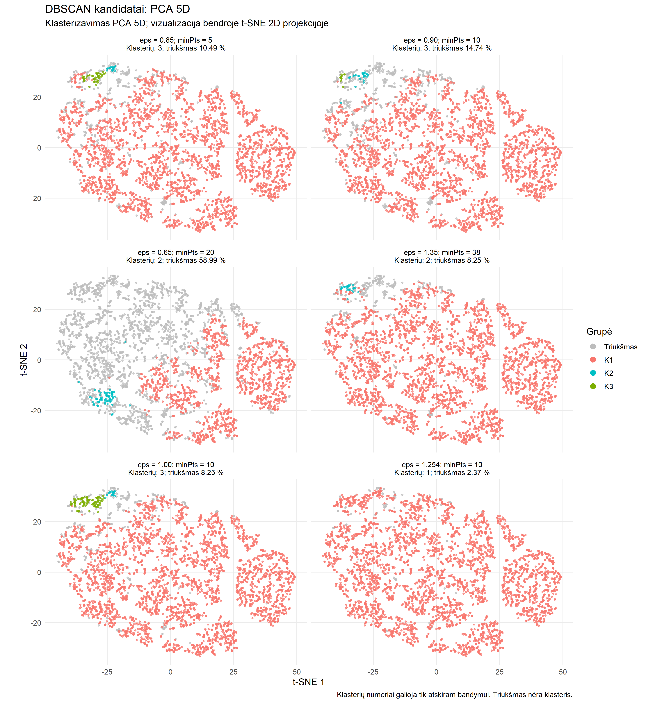

Daugumoje kandidatų dominuoja vienas didelis klasteris,
o mažosios grupės matomos projekcijos viršutinėje kairėje
dalyje. Išimtis pagal išsidėstymą yra `eps = 0,65`,
`minPts = 20` variantas: mažoji grupė matoma apatinėje
kairėje dalyje, o 58,99 % objektų lieka triukšme.

Kai `minPts = 10`, padidinus eps nuo 0,90 iki 1,00,
triukšmo dalis sumažėja nuo 14,74 % iki 8,25 %.
Ties geometriniu kelio įverčiu (`eps ≈ 1,254`)
gaunamas vienas 3835 objektų klasteris ir
93 triukšmo objektai (2,37 %).

Klasterizavimas atliktas PCA 5D erdvėje, todėl t-SNE
projekcijoje matomi tarpai savaime nereiškia atskirų
DBSCAN klasterių. Klasterių numeriai galioja tik
konkrečiam bandymui.

#### Vidiniai kokybės rodikliai ir PCA atskaita

Silhouette, Calinski–Harabasz (CH) ir Davies–Bouldin (DB)
rodikliai apskaičiuoti PCA 5D erdvėje tik klasteriams
priskirtiems objektams, neįtraukiant triukšmo.

| eps | minPts | Klasterių sk. | Vertinta objektų (%) | Silhouette ↑ | CH ↑ | DB ↓ |
|---:|---:|---:|---:|---:|---:|---:|
| 0,8500 | 5 | 3 | 89,51 | 0,39239 | 172,29 | 0,71746 |
| 0,9000 | 10 | 3 | 85,26 | 0,42056 | 120,20 | 0,68195 |
| 0,6500 | 20 | 2 | 41,01 | 0,44452 | 355,00 | 0,63652 |
| 1,3500 | 38 | 2 | 91,75 | 0,42419 | 143,93 | 0,55197 |
| 1,0000 | 10 | 3 | 91,75 | 0,39257 | 283,20 | 0,67267 |
| 1,2538 | 10 | 1 | 97,63 | NA | NA | NA |

Didžiausias Silhouette ir CH gauti su `eps = 0,65`,
`minPts = 20`, tačiau šiame variante 58,99 % objektų
liko triukšme. Mažiausias DB gautas su `eps = 1,35`,
`minPts = 38`, kai klasterius sudarė 3578 ir 26 objektai.

Rodikliai vertinami kartu su objektų aprėptimi ir
klasterių dydžiais, nes skirtinguose variantuose
į skaičiavimus pateko nevienodi objektų poaibiai.

PCA atskaitai taikoma tokia pati parametrų parinkimo
taisyklė kaip originalioje erdvėje: dvigubas dimensijų
skaičius (`minPts = 10`) ir atitinkamas tikslus geometrinis
kelio eps įvertis (apie 1,2538).

Šiame variante gautas vienas 3835 objektų klasteris
ir 93 triukšmo objektai (2,37 %). Atmetus triukšmą
lieka vienas klasteris, todėl vidiniai rodikliai
neapibrėžti. Tai metodinė atskaita tolesniam palyginimui,
o ne pagal kokybės rodiklius nustatytas geriausias variantas.

Rezultatai išsaugoti
`rezultatai/dbscan_kandidatu_kokybe_pca.csv`.

### DBSCAN t-SNE 2D erdvėje

#### Duomenys ir parametrų parinkimas

DBSCAN taikytas tiems patiems 3928 objektams pagal
t-SNE projekcijos koordinates `TSNE1` ir `TSNE2`.
Naudotas Euklido atstumas. Koordinatės papildomai
nenormuotos, o identifikatoriai ir klasių žymės
į klasterizavimą neįtraukti.

Ištirtos `minPts = 4, 5, 10, 20` reikšmės.
Reikšmė 4 atitinka dvigubą dimensijų skaičių,
o kitos reikšmės skirtos jautrumui įvertinti.

Kiekvienai minPts reikšmei eps kandidatas nustatytas
geometriniu kaimynų atstumų kreivės kelio metodu,
naudojant `k = minPts − 1`.

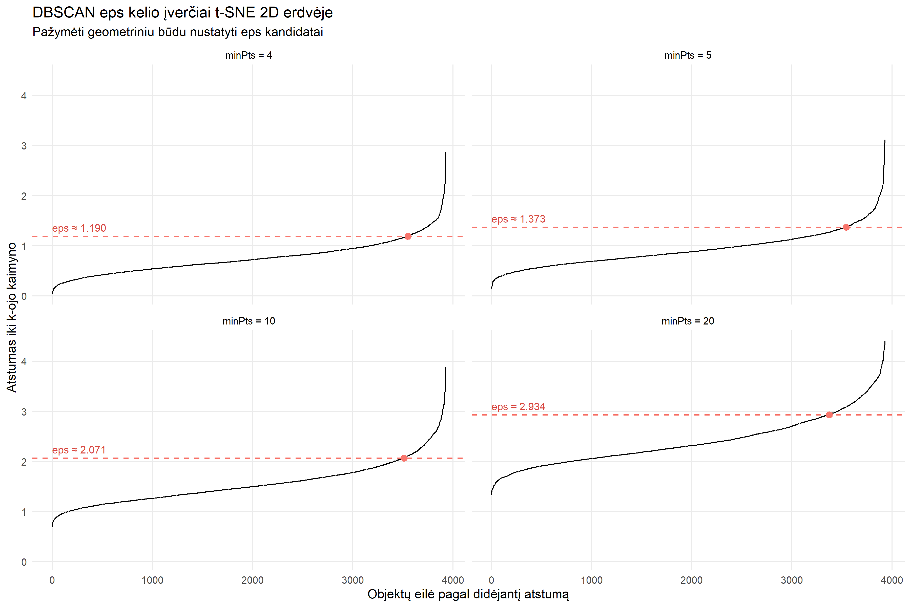

| minPts | eps kelio įvertis | Klasterių sk. | Didžiausias klasteris | Triukšmas (%) |
|---:|---:|---:|---:|---:|
| 4 | 1,1900 | 114 | 189 | 3,82 |
| 5 | 1,3729 | 65 | 326 | 2,85 |
| 10 | 2,0711 | 14 | 1230 | 1,37 |
| 20 | 2,9336 | 7 | 2285 | 0,89 |

Ties geometriniais kelio įverčiais gauta nuo 7 iki
114 klasterių. Šiuose bandymuose kartu keitėsi
minPts ir eps, todėl atskiras jų poveikis bus
vertinamas parametrų jautrumo tyrime.

Pagal dvigubo dimensijų skaičiaus ir geometrinio
kelio taisyklę t-SNE atskaitai pasirinktas derinys
`minPts = 4`, `eps ≈ 1,1900`. Jis išskyrė
114 klasterių ir 150 triukšmo objektų.

Šis suskaidymas savaime nereiškia, kad pradinėje
19D erdvėje egzistuoja 114 atskirų tankių grupių:
t-SNE pakeičia objektų atstumus ir tankį.
Rezultatas bus vertinamas kartu su parametrų
jautrumu ir suskirstymų palyginimu.

Rezultatai išsaugoti
`rezultatai/dbscan_kelio_ivertis_tsne.csv`.
Atskaitos objektų priskyrimai išsaugoti
`rezultatai/dbscan_tsne_klasteriai.csv`,
kokybės suvestinė –
`rezultatai/dbscan_kokybe_tsne.csv`.

#### Parametrų jautrumo tyrimas

t-SNE 2D erdvėje atlikti 104 parametrų bandymai.
Kiekvienai `minPts = 4, 5, 10, 20` reikšmei
eps keistas nuo 0,80 iki 4,40 žingsniu 0,15.
Papildomai įtraukti keturi tikslūs geometriniai
kelio įverčiai.

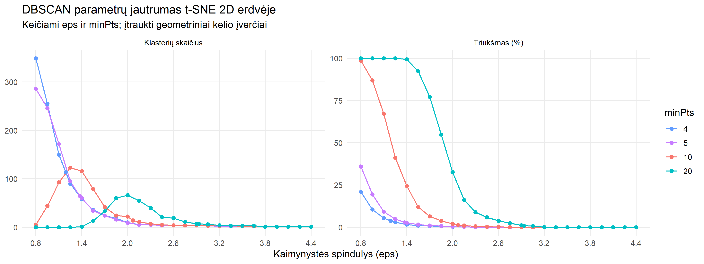

Didėjant eps, triukšmo dalis mažėjo. Kai eps mažas,
rezultatas stipriai priklausė nuo minPts: pavyzdžiui,
ties `eps = 0,80`, `minPts = 4` gauti 349 klasteriai
ir 20,90 % triukšmo, o kai `minPts = 20`,
visi objektai priskirti triukšmui.

Klasterių skaičius kito netolygiai: didinant eps,
iš anksčiau triukšmui priskirtų objektų galėjo
susiformuoti grupės, o vėliau jos jungėsi.

Kai `minPts = 4`, gauti šie variantai:

| eps | Klasterių sk. | Klasterių dydžiai | Triukšmas (%) |
|---:|---:|---|---:|
| 1,1900* | 114 | Didžiausias – 189 | 3,82 |
| 3,05 | 3 | 2869; 749; 310 | 0,00 |
| 3,20 | 2 | 3179; 749 | 0,00 |

*Lentelėje suapvalintas geometrinis kelio įvertis;
skaičiavimuose naudota tiksli reikšmė.

Visoms keturioms tirtoms minPts reikšmėms,
kai `eps ≥ 3,80`, gautas vienas klasteris.

Dviejų ir trijų klasterių variantai toliau nagrinėjami
kaip papildomi parametrų jautrumo pavyzdžiai.
Jie nepasirenkami vien dėl sutapimo su pradinių
klasių ar K-means klasterių skaičiumi.

Visi bandymai išsaugoti
`rezultatai/dbscan_parametru_jautrumas_tsne.csv`.

#### Kandidatų kokybė ir klasių sudėtis

Palyginti keturi t-SNE 2D erdvės kandidatai: geometriniai
kelio įverčiai su `minPts = 4` ir `minPts = 10` bei
papildomi trijų ir dviejų klasterių variantai.

Vidiniai rodikliai apskaičiuoti t-SNE 2D erdvėje,
neįtraukiant triukšmo objektų.

| Variantas | eps | minPts | Klasterių sk. | Vertinta objektų (%) | Silhouette ↑ | CH ↑ | DB ↓ |
|---|---:|---:|---:|---:|---:|---:|---:|
| Kelio įvertis | 1,1900 | 4 | 114 | 96,18 | 0,12681 | 2109,8 | 0,88403 |
| Kelio įvertis | 2,0711 | 10 | 14 | 98,63 | 0,11325 | 1283,5 | 1,00875 |
| Trys klasteriai | 3,05 | 4 | 3 | 100,00 | 0,30088 | 1910,0 | 0,72758 |
| Du klasteriai | 3,20 | 4 | 2 | 100,00 | 0,35283 | 2203,0 | 0,77497 |

Tarp šių kandidatų dviejų klasterių variantas turėjo
didžiausią Silhouette ir CH, o trijų klasterių variantas –
mažiausią DB. Abiem atvejais visi 3928 objektai priskirti
klasteriams. Geometriniai kelio įverčiai išskyrė daugiau
grupių, tačiau jų vidutinis siluetas buvo mažesnis.

Papildomų variantų klasių sudėtis:

| Variantas | Klasteris | Objektų sk. | Ideal (%) | Premium (%) |
|---|---|---:|---:|---:|
| Trys klasteriai | K1 | 2869 | 41,97 | 58,03 |
| Trys klasteriai | K2 | 310 | 69,35 | 30,65 |
| Trys klasteriai | K3 | 749 | 72,63 | 27,37 |
| Du klasteriai | K1 | 3179 | 44,64 | 55,36 |
| Du klasteriai | K2 | 749 | 72,63 | 27,37 |

Abiejų pradinių klasių objektai pasitaikė visuose
pateiktuose klasteriuose. Todėl net dviejų klasterių
variantas nėra tapatus Ideal ir Premium klasėms.
Klasių žymės naudotos tik rezultatų interpretacijai.

Palankesni vidiniai rodikliai t-SNE erdvėje savaime
neįrodo, kad geriau išsaugota pradinė 19D struktūra.
Tai bus vertinama lyginant objektų priskyrimus
ir tiriant stabilumą.

Rezultatai išsaugoti:
- `rezultatai/dbscan_kandidatu_kokybe_tsne.csv`
- `rezultatai/dbscan_kandidatu_klases_tsne.csv`

#### Dviejų ir trijų klasterių vizualizacija

Palyginti du DBSCAN variantai t-SNE 2D erdvėje:
`eps = 3,05` ir `eps = 3,20`, abiem atvejais
naudojant `minPts = 4`. Visi 3928 objektai priskirti
klasteriams, triukšmo nebuvo.

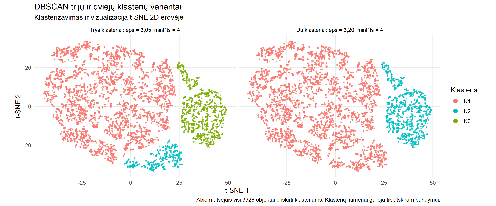

Padidinus eps nuo 3,05 iki 3,20, projekcijos apačioje
esantis 310 objektų klasteris susijungė su 2869 objektų
klasteriu. Susidarė vienas 3179 objektų klasteris.
Dešinėje esanti 749 objektų grupė išliko nepakitusi.

Objektų priskyrimai palyginti pagal ID:

| Klasteris, kai eps = 3,05 | K1, kai eps = 3,20 | K2, kai eps = 3,20 |
|---|---:|---:|
| K1 | 2869 | 0 |
| K2 | 310 | 0 |
| K3 | 0 | 749 |

Taigi klasterių skaičiaus sumažėjimą nuo trijų iki dviejų
lėmė dviejų grupių susijungimas. Nepakitęs 749 objektų
klasteris pakeitė numerį iš K3 į K2, todėl paveiksle
pasikeitė ir jo spalva.

Perėjimų lentelė išsaugota
`rezultatai/dbscan_tsne_du_ir_trys_perejimai.csv`.

#### Klasterių charakteristikos originaliais vienetais

Keturių t-SNE kandidatų grupėms apskaičiuotos
19 pradinių požymių medianos ir kvartiliai.
Objektai su originalių matavimo vienetų duomenimis
suderinti pagal ID. Triukšmo statistikos apskaičiuotos
atskirai nuo klasterių.

Dviejų ir trijų klasterių variantų pagrindinės
charakteristikos:

| Variantas | Klasteris | Objektų sk. | Svorio mediana (ct) | Kainos mediana | depth mediana | table mediana |
|---|---|---:|---:|---:|---:|---:|
| Trys klasteriai | K1 | 2869 | 0,95 | 3871 | 61,6 | 58 |
| Trys klasteriai | K2 | 310 | 0,35 | 969 | 62,3 | 56 |
| Trys klasteriai | K3 | 749 | 0,33 | 739 | 61,7 | 56 |
| Du klasteriai | K1 | 3179 | 0,82 | 3275 | 61,7 | 58 |
| Du klasteriai | K2 | 749 | 0,33 | 739 | 61,7 | 56 |

Dviejų klasterių variante K2 deimantų svorio ir kainos
medianos buvo mažesnės nei K1. K2 taip pat turėjo
mažesnę kainos už karatą medianą: 2193,75,
palyginti su 4032,04 K1 klasteryje.

Trijų klasterių variante K2 ir K3 svorio medianos
buvo panašios, tačiau skyrėsi kainos ir depth medianos.
Taigi šios grupės skyrėsi ne vien deimantų dydžiu.

Padidinus eps nuo 3,05 iki 3,20, 310 objektų K2 grupė
susijungė su didžiuoju klasteriu. 749 objektų grupė
išliko nepakitusi ir dviejų klasterių variante
buvo pažymėta K2.

Geometrinio kelio atskaitoje išskirta 114 klasterių.
Jų svorio medianos svyravo nuo 0,30 iki 2,08 ct.
Išsamios visų grupių statistikos paliktos rezultatų
faile, o tekste pateikti papildomų dviejų ir trijų
klasterių variantų profiliai.

Statistikos išsaugotos
`rezultatai/dbscan_kandidatu_statistikos_tsne.csv`.

### DBSCAN rezultatų palyginimas tarp erdvių

#### Suskirstymų panašumas

Palyginti tų pačių 3928 objektų DBSCAN atskaitos
suskirstymai originalioje 19D, PCA 5D ir t-SNE 2D erdvėse.
Objektai suderinti pagal ID.

Kiekvienoje erdvėje naudota ta pati parametrų parinkimo
taisyklė: dvigubas dimensijų skaičius ir atitinkamas
geometrinis eps kelio įvertis. Tačiau pačios parametrų
reikšmės skyrėsi, todėl palyginimas atspindi visos šios
procedūros rezultatą, o ne vien dimensijos mažinimo poveikį.

Skaičiuoti ARI, NMI ir objektų porų Jaccard indeksai.
NMI normalizuotas aritmetiniu entropijų vidurkiu.
Triukšmo žymė 0 šiame palyginime laikyta viena bendra
grupe, nors DBSCAN triukšmas nėra klasteris.

| Palyginimas | ARI ↑ | NMI ↑ | Porų Jaccard ↑ |
|---|---:|---:|---:|
| Originali 19D ir PCA 5D | 0,53247 | 0,35022 | 0,96422 |
| Originali 19D ir t-SNE 2D | 0,00074 | 0,02060 | 0,02291 |
| PCA 5D ir t-SNE 2D | 0,00083 | 0,02364 | 0,02295 |

Originalioje ir PCA erdvėse gauta po vieną didelį klasterį.
Aukštą porų Jaccard daugiausia lemia daugybė objektų porų,
kurios abiem atvejais priklauso didžiajai grupei.
Mažesni ARI ir NMI rodo, kad suskirstymai nėra tapatūs:
skiriasi objektų priskyrimas triukšmui.

t-SNE atskaita turi 114 klasterių, todėl jos suskirstymas
labai skiriasi nuo originalios ir PCA erdvių atskaitų.
Mažos panašumo rodiklių reikšmės parodo suskirstymų
neatitikimą, bet savaime neįrodo, kuris rezultatas geresnis.

#### Triukšmo objektų sutapimas

Atskirai palyginti triukšmui priskirtų objektų rinkiniai.

| Palyginimas | Triukšmas A | Triukšmas B | Triukšmas abiejose | Triukšmo Jaccard |
|---|---:|---:|---:|---:|
| Originali 19D ir PCA 5D | 63 | 93 | 43 | 0,38053 |
| Originali 19D ir t-SNE 2D | 63 | 150 | 8 | 0,03902 |
| PCA 5D ir t-SNE 2D | 93 | 150 | 13 | 0,05652 |

Originalioje ir PCA erdvėse 3815 objektų abiem atvejais
priskirti didžiajam klasteriui, o 43 – triukšmui.
Dar 20 objektų buvo triukšmas tik originalioje erdvėje,
50 – tik PCA erdvėje.

Su t-SNE erdve triukšmo objektų sutapimas mažesnis:
su originalia erdve sutapo 8, su PCA – 13 objektų.
Taigi pasikeitė ne tik klasterių skaičius,
bet ir triukšmui priskiriamų objektų rinkinys.

Rezultatai išsaugoti:
- `rezultatai/dbscan_erdviu_palyginimas.csv`
- `rezultatai/dbscan_triuksmo_palyginimas.csv`

Pilnos klasterių perėjimų lentelės išsaugotos
`rezultatai/dbscan_perejimai_*.csv` failuose.

### DBSCAN stabilumo tyrimas

#### Tyrimo metodika

Bendram trijų erdvių palyginimui naudota 10 atsitiktinių
80 % imčių po 3142 objektus, naudojant sėklas 0–9.
Tos pačios imtys naudotos visoms trims erdvėms.
Originalios ir PCA erdvių atskaitų tyrimas papildomai
pratęstas iki 20 imčių, kad būtų patikrintas
stabilumo įverčio kitimas.

Kiekvienos imties požymiai normuoti atskirai:
atimta tos imties mediana ir dalyta iš jos IQR.

Originalioje 19D erdvėje palikta `minPts = 38`,
o geometrinis eps kelio įvertis kiekvienai imčiai
apskaičiuotas iš naujo. Taip vertintas visos pasirinktos
parametrų parinkimo procedūros stabilumas.

Palygintos visos 45 imčių poros. ARI, NMI ir objektų
porų Jaccard skaičiuoti tik bendriems objektams,
juos suderinus pagal ID. Triukšmo žymė 0 laikyta
viena bendra grupe. Papildomai apskaičiuotas triukšmo
objektų rinkinių Jaccard.

#### Imčių skaičiaus parinkimas

Originalios 19D ir PCA 5D erdvių atskaitoms atlikta
po 20 atsitiktinių 80 % imčių bandymų. ARI vidurkis
vertintas naudojant pirmas 5, 10, 15 ir 20 imčių,
kiekvieną kartą lyginant visas jų poras.

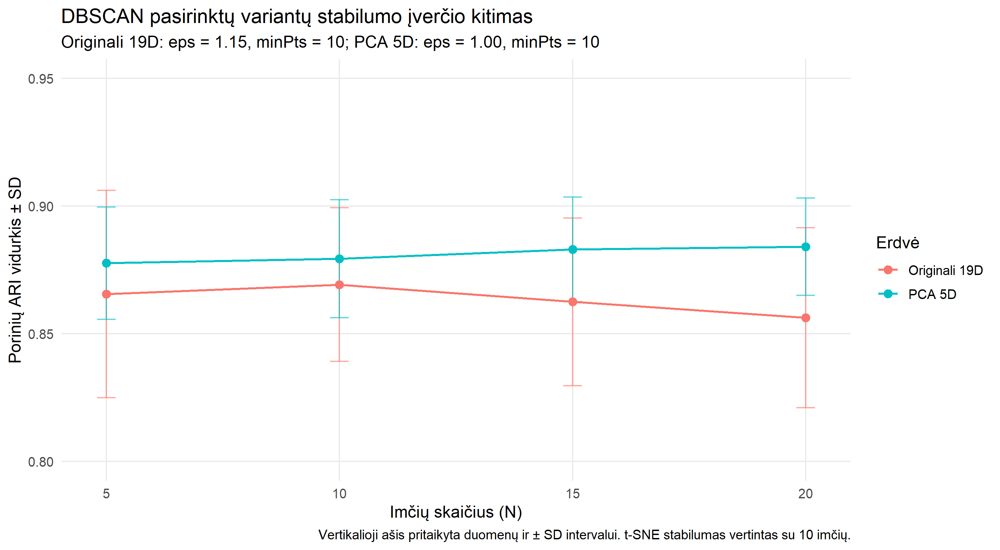

| Imčių skaičius N | Porų skaičius | Originali 19D: ARI vidurkis ± SD | PCA 5D: ARI vidurkis ± SD |
|---:|---:|---:|---:|
| 5 | 10 | 0,80303 ± 0,07515 | 0,79574 ± 0,06372 |
| 10 | 45 | 0,81757 ± 0,05654 | 0,80758 ± 0,04740 |
| 15 | 105 | 0,82194 ± 0,06303 | 0,81785 ± 0,04551 |
| 20 | 190 | 0,82767 ± 0,06291 | 0,81744 ± 0,04138 |

Didinant imčių skaičių nuo 10 iki 20, ARI vidurkis
originalioje erdvėje pasikeitė apie 0,01010,
PCA erdvėje – apie 0,00986. Pagrindinė rezultatų
interpretacija išliko tokia pati.

Todėl bendram trijų erdvių palyginimui pasirinkta
N = 10: šio imčių skaičiaus pakako pagrindinėms
nagrinėto tyrimo tendencijoms įvertinti. t-SNE
atveju 10 imčių taip pat atitinka užduoties rekomendaciją.

Toliau visų trijų erdvių rezultatai pateikiami
naudojant tas pačias pirmąsias 10 imčių ir
45 porinius palyginimus kiekvienai erdvei.

Rezultatai išsaugoti:
- `rezultatai/dbscan_stabilumas_pagal_N_20.csv`
- `rezultatai/dbscan_stabilumo_bandymai_20.csv`
- `rezultatai/dbscan_stabilumo_poros_originali_20.csv`
- `rezultatai/dbscan_stabilumo_poros_pca_20.csv`

#### Stabilumas originalioje 19D erdvėje

Visose 10 imčių gautas vienas klasteris.
Triukšmui priskirta nuo 39 iki 68 objektų
(1,24–2,16 % imties).

| Rodiklis | Vidurkis | Standartinis nuokrypis | Minimumas | Maksimumas |
|---|---:|---:|---:|---:|
| ARI | 0,81757 | 0,05654 | 0,70271 | 0,92665 |
| NMI | 0,69730 | 0,07689 | 0,55397 | 0,86496 |
| Porų Jaccard | 0,98895 | 0,00412 | 0,98053 | 0,99675 |
| Triukšmo rinkinių Jaccard | 0,70535 | 0,07878 | 0,55556 | 0,86842 |

Aukštą porų Jaccard daugiausia lemia didžiojo klasterio
objektų porų sutapimas. Triukšmo rinkinių Jaccard
vidurkis buvo 0,70535, todėl triukšmo priskyrimai
tarp imčių išliko tik iš dalies.

Rezultatas rodo pastovų vienos didelės grupės išskyrimą,
tačiau nepatvirtina kelių informatyvių klasterių struktūros.
Silhouette, CH ir DB be triukšmo neapibrėžti,
nes kiekvienoje imtyje liko vienas klasteris.

Rezultatai išsaugoti:
- `rezultatai/dbscan_stabilumo_bandymai_originali.csv`
- `rezultatai/dbscan_stabilumo_poros_originali.csv`

#### Stabilumas PCA 5D erdvėje

Naudotos tos pačios 10 atsitiktinių 80 % imčių.
Kiekvienai atskirai normuotai imčiai PCA apskaičiuota
iš naujo, paliekant penkias komponentes. Jos išlaikė
96,77–96,87 % imties dispersijos.

DBSCAN taikytas su `minPts = 10`, o geometrinis eps
kelio įvertis perskaičiuotas kiekvienai imčiai.
Visose imtyse gautas vienas klasteris.
Triukšmui priskirta nuo 60 iki 99 objektų
(1,91–3,15 % imties).

Palyginus visas 45 imčių poras tik bendriems objektams,
gauti šie rezultatai:

| Rodiklis | Vidurkis | Standartinis nuokrypis | Minimumas | Maksimumas |
|---|---:|---:|---:|---:|
| ARI | 0,80758 | 0,04740 | 0,71945 | 0,92948 |
| NMI | 0,66234 | 0,06433 | 0,56139 | 0,84489 |
| Porų Jaccard | 0,98147 | 0,00473 | 0,97203 | 0,99325 |
| Triukšmo rinkinių Jaccard | 0,69700 | 0,06548 | 0,57812 | 0,87671 |

PCA ir originalios 19D erdvės stabilumo rodikliai
buvo panašūs: ARI vidurkiai atitinkamai siekė
0,80758 ir 0,81757, o triukšmo rinkinių Jaccard –
0,69700 ir 0,70535.

Abiejose erdvėse pastoviai išskirtas vienas didelis
klasteris, tačiau triukšmo priskyrimai tarp imčių kito.
Aukštas porų Jaccard daugiausia atspindi didžiosios
grupės objektų porų sutapimą.

Silhouette, CH ir DB be triukšmo neapibrėžti,
nes visose imtyse gautas vienas klasteris.

Rezultatai išsaugoti:
- `rezultatai/dbscan_stabilumo_bandymai_pca.csv`
- `rezultatai/dbscan_stabilumo_poros_pca.csv`

#### Stabilumas t-SNE 2D erdvėje

Naudotos tos pačios 10 atsitiktinių 80 % imčių.
Kiekvienai atskirai normuotai imčiai t-SNE projekcija
apskaičiuota iš naujo, naudojant `perplexity = 30`,
`max_iter = 1000`, `pca = FALSE`, `normalize = FALSE`
ir `check_duplicates = FALSE`.

t-SNE sėklos buvo 1000–1009. Todėl tyrimas apima
bendrą jautrumą imties sudėčiai ir projekcijos
atsitiktinumui; šių poveikių atskirai nevertinome.

DBSCAN taikytas su `minPts = 4`, o geometrinis eps
kelio įvertis kiekvienai projekcijai perskaičiuotas.
Imtyse gauta nuo 61 iki 98 klasterių.
Triukšmui priskirta 96–171 objektas
(3,06–5,44 % imties).

Palyginus visas 45 imčių poras tik bendriems objektams,
gauti šie rezultatai:

| Rodiklis | Vidurkis | Standartinis nuokrypis | Minimumas | Maksimumas |
|---|---:|---:|---:|---:|
| ARI | 0,49413 | 0,05566 | 0,37446 | 0,62423 |
| NMI | 0,76594 | 0,01528 | 0,73704 | 0,80065 |
| Porų Jaccard | 0,34543 | 0,04989 | 0,24589 | 0,46849 |
| Triukšmo rinkinių Jaccard | 0,13727 | 0,02297 | 0,08649 | 0,17647 |

ARI ir porų Jaccard buvo mažesni nei originalioje
ir PCA erdvėse. Triukšmo rinkinių Jaccard vidurkis
siekė tik 0,13727, todėl triukšmui skirtingose
imtyse dažnai priskirti kiti objektai.

NMI buvo didesnis nei kitose dviejose erdvėse,
tačiau jis vertina kitą suskirstymų panašumo aspektą
ir priklauso nuo grupių struktūros bei skaičiaus.
Todėl vien pagal NMI negalima teigti, kad t-SNE
rezultatai stabilesni.

Šie rezultatai apibūdina geometrinio kelio atskaitos
procedūrą su `minPts = 4`. Jie neparodo papildomų
dviejų ir trijų klasterių variantų stabilumo.

Rezultatai išsaugoti:
- `rezultatai/dbscan_stabilumo_bandymai_tsne.csv`
- `rezultatai/dbscan_stabilumo_poros_tsne.csv`

#### Stabilumo palyginimas tarp erdvių

Visų trijų erdvių atskaitos procedūrų stabilumas palygintas
naudojant tas pačias 10 atsitiktinių 80 % imčių.
Kiekvienai erdvei atlikti 45 poriniai palyginimai,
vertinant tik bendrus objektus.

| Rodiklis (vidurkis ± SD) | Originali 19D | PCA 5D | t-SNE 2D |
|---|---:|---:|---:|
| ARI | 0,81757 ± 0,05654 | 0,80758 ± 0,04740 | 0,49413 ± 0,05566 |
| NMI | 0,69730 ± 0,07689 | 0,66234 ± 0,06433 | 0,76594 ± 0,01528 |
| Porų Jaccard | 0,98895 ± 0,00412 | 0,98147 ± 0,00473 | 0,34543 ± 0,04989 |
| Triukšmo rinkinių Jaccard | 0,70535 ± 0,07878 | 0,69700 ± 0,06548 | 0,13727 ± 0,02297 |

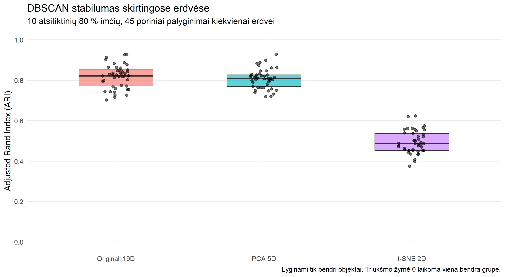

Originalios ir PCA erdvių ARI pasiskirstymai buvo panašūs.
Abiejose erdvėse visose imtyse gautas vienas klasteris,
todėl stabilumas daugiausia apibūdina didžiosios grupės
ir triukšmo priskyrimų pastovumą.

t-SNE erdvėje ARI, porų Jaccard ir triukšmo rinkinių
Jaccard buvo mažesni. Klasterių skaičius tarp imčių
svyravo nuo 61 iki 98. Tai rodo didesnį pasirinktos
t-SNE ir DBSCAN procedūros jautrumą imties sudėčiai
bei projekcijos atsitiktinumui.

NMI rezultatai erdves išrikiavo kitaip, todėl stabilumas
vertinamas pagal rodiklių visumą ir suskirstymų pobūdį.
Didesnis stabilumas savaime negarantuoja informatyvaus
ar prasmingo duomenų suskaidymo.

Grafiko taškai žymi imčių porų ARI reikšmes.
Šie palyginimai nėra nepriklausomi, nes ta pati imtis
dalyvauja keliose porose. SD apibūdina porinių rezultatų
sklaidą, o ne vidurkio standartinę paklaidą.

Rezultatai išsaugoti:
- `rezultatai/dbscan_stabilumo_suvestine.csv`
- `rezultatai/dbscan_stabilumo_poros_visos_erdves.csv`

#### Vidinių kokybės rodiklių kitimas tarp imčių

Kiekvienos imties vidiniai rodikliai skaičiuoti
atitinkamoje klasterizavimo erdvėje, neįtraukiant
triukšmo objektų.

| Rodiklis | Originali 19D | PCA 5D | t-SNE 2D (vidurkis ± SD) |
|---|---:|---:|---:|
| Silhouette | NA | NA | 0,10193 ± 0,04304 |
| CH | NA | NA | 1386,62 ± 249,68 |
| DB | NA | NA | 0,82782 ± 0,05063 |

Originalioje ir PCA erdvėse visose 10 imčių gautas
vienas klasteris, todėl Silhouette, CH ir DB
be triukšmo neapibrėžti.

t-SNE erdvėje rodikliai apskaičiuoti visoms 10 imčių.
Vidutinis siluetas buvo 0,10193, rodantis silpną
bendrą klasterių atskyrimą pagal šį matą.
Rodiklių sklaida apima imties sudėties, naujos
t-SNE projekcijos ir perskaičiuoto eps poveikį.

Kadangi tarp imčių kito klasterių skaičius ir vertintų
objektų rinkinys, rodiklių kitimas interpretuojamas
kartu su suskirstymų stabilumo rezultatais.

Rezultatai išsaugoti:
- `rezultatai/dbscan_stabilumo_vidiniai.csv`
- `rezultatai/dbscan_stabilumo_vidiniu_suvestine.csv`

### Papildomų kelių klasterių kandidatų stabilumas

#### Originalios 19D erdvės kandidatas

Papildomai patikrintas anksčiau nagrinėtas variantas
`eps = 1,15`, `minPts = 10`. Pilnoje aibėje jis išskyrė
3584 ir 15 objektų klasterius, o triukšmas sudarė 8,38 %.

Naudotos tos pačios 10 atskirai normuotų 80 % imčių.
Šiame tyrime eps ir minPts fiksuoti, todėl vertintas
konkretaus parametrų derinio jautrumas imties sudėčiai.
Tai skiriasi nuo ankstesnio atskaitos tyrimo,
kuriame eps kiekvienai imčiai perskaičiuotas.

Imtyse gauta nuo 2 iki 4 klasterių, triukšmo dalis
svyravo nuo 10,28 % iki 12,06 %. Visais atvejais
dominavo vienas didelis 2739–2798 objektų klasteris,
o kitos grupės buvo gerokai mažesnės.

| Rodiklis | Vidurkis | Standartinis nuokrypis |
|---|---:|---:|
| ARI | 0,86922 | 0,03006 |
| NMI | 0,72097 | 0,04260 |
| Porų Jaccard | 0,94581 | 0,01101 |
| Triukšmo rinkinių Jaccard | 0,78995 | 0,02604 |

Rodikliai apskaičiuoti iš 45 imčių porų, lyginant
tik bendrus objektus. Triukšmo žymė 0 laikyta
viena bendra grupe, o triukšmo rinkiniai palyginti
ir atskirai.

Bendras objektų suskirstymas buvo gana pastovus,
tačiau klasterių skaičius kito. Didžiosios grupės
dominavimas reiškia, kad aukštas ARI savaime
negarantuoja mažųjų klasterių sudėties stabilumo.
Šio varianto nelaikome patvirtintu stabiliu
dviejų klasterių sprendimu.

Rezultatai išsaugoti:
- `rezultatai/dbscan_kandidato_stabilumo_bandymai_originali.csv`
- `rezultatai/dbscan_kandidato_stabilumo_poros_originali.csv`

#### PCA 5D erdvės kandidatas

Papildomai patikrintas variantas `eps = 1,00`,
`minPts = 10`. Pilnoje aibėje jis išskyrė
3494, 17 ir 93 objektų klasterius,
o triukšmas sudarė 8,25 %.

Naudotos tos pačios 10 atskirai normuotų 80 % imčių.
Kiekvienai imčiai PCA apskaičiuota iš naujo, paliekant
penkias komponentes. DBSCAN parametrai fiksuoti.

Imtyse gauta nuo 2 iki 5 klasterių, o triukšmo dalis
svyravo nuo 10,50 % iki 12,83 %. Didžiausią klasterį
sudarė 2704–2759 objektai; kitos grupės buvo mažos.

| Rodiklis | Vidurkis | Standartinis nuokrypis |
|---|---:|---:|
| ARI | 0,87938 | 0,02305 |
| NMI | 0,72875 | 0,03572 |
| Porų Jaccard | 0,94675 | 0,01061 |
| Triukšmo rinkinių Jaccard | 0,76416 | 0,03468 |

Rodikliai apskaičiuoti iš 45 imčių porų, lyginant
tik bendrus objektus. Triukšmo žymė 0 laikyta
viena bendra grupe, o triukšmo rinkiniai palyginti
ir atskirai.

Aukšti bendro suskirstymo rodikliai daugiausia
atspindi didžiosios grupės pastovumą. Pilnos aibės
trijų klasterių skaičius nebuvo nuosekliai atkurtas,
todėl šio varianto nelaikome patvirtintu stabiliu
trijų klasterių sprendimu.

Rezultatai išsaugoti:
- `rezultatai/dbscan_kandidato_stabilumo_bandymai_pca.csv`
- `rezultatai/dbscan_kandidato_stabilumo_poros_pca.csv`

#### Papildomų t-SNE kandidatų stabilumas

Patikrinti pilnoje aibėje tris klasterius išskyręs
variantas (`eps = 3,05`, `minPts = 4`) ir du klasterius
išskyręs variantas (`eps = 3,20`, `minPts = 4`).

Naudotos jau perskaičiuotos 10 imčių t-SNE projekcijos.
DBSCAN parametrai šiame tyrime fiksuoti.

| Pilnos aibės variantas | Klasterių sk. imtyse | Triukšmas imtyse (%) | ARI vidurkis ± SD | NMI vidurkis ± SD | Porų Jaccard vidurkis ± SD |
|---|---|---|---|---|---|
| Trys klasteriai | 1–4 | 0–0,13 | 0,05948 ± 0,23331 | 0,06155 ± 0,21318 | 0,84531 ± 0,14473 |
| Du klasteriai | 1–3 | 0–0,10 | 0,08755 ± 0,28364 | 0,09074 ± 0,27925 | 0,88260 ± 0,14049 |

Kiekvienam variantui palygintos 45 imčių poros,
vertinant tik bendrus objektus. Triukšmo žymė 0
laikyta viena bendra grupe.

Trijų klasterių kandidatas tris klasterius išskyrė
tik vienoje iš 10 imčių, o dviejų klasterių kandidatas
du klasterius išskyrė keturiose imtyse. Vienodas
klasterių skaičius savaime dar nereiškia tų pačių
objektų grupių išsaugojimo.

Daugelyje imčių beveik visi objektai pateko į vieną
didelį klasterį. Tai paaiškina palyginti aukštą
porų Jaccard, nors ARI ir NMI vidurkiai buvo maži.

Rezultatai rodo, kad šie fiksuoti parametrai naujose
t-SNE projekcijose neatkuria pastovaus pilnos aibės
suskirstymo. Kadangi kartu keitėsi imties sudėtis,
projekcijos atsitiktinė pradžia ir jos geometrija,
atskirų šių veiksnių poveikio nenustatėme.

Todėl dviejų ir trijų klasterių variantai paliekami
kaip parametrų jautrumo pavyzdžiai, o ne patvirtinti
stabilūs sprendimai.

Rezultatai išsaugoti:
- `rezultatai/dbscan_kandidatu_stabilumo_bandymai_tsne.csv`
- `rezultatai/dbscan_kandidatu_stabilumo_poros_tsne.csv`

### DBSCAN tyrimo išvados

1. **Rezultatai priklausė nuo parametrų ir duomenų erdvės.**
   Keičiant eps ir minPts, kito klasterių skaičius,
   jų sudėtis ir triukšmo dalis. Geometrinis kelio
   metodas suteikė atkuriamą parametrų parinkimo
   atskaitą, bet negarantuoja prasmingiausio suskirstymo.

2. **Originalioje ir PCA erdvėse atskaitos procedūra
   nuosekliai išskyrė vieną didelį klasterį ir triukšmą.**
   Toks rezultatas išliko visose 20 imčių.
   Tai rodo procedūros pastovumą, tačiau nepatvirtina
   informatyvaus duomenų suskaidymo į kelias grupes.

3. **Mažesni eps leido išskirti papildomas mažas grupes.**
   Nagrinėtuose originalios ir PCA erdvių kandidatuose
   jų deimantai buvo stambesni ir brangesni už didžiojo
   klasterio deimantus. Tačiau grupių sudėtis priklausė
   nuo parametrų, o imtyse kito ir klasterių skaičius.

4. **t-SNE erdvėje atskaitos suskirstymas stipriai skyrėsi.**
   Pilnoje aibėje gauta 114 klasterių, o pakartotinėse
   imtyse – 61–98. Stabilumo ARI vidurkis buvo 0,49413,
   palyginti su 0,81757 originalioje ir 0,80758 PCA
   erdvėje, visur naudojant tas pačias 10 imčių.
   Šis palyginimas apima projekcijos ir parametrų
   parinkimo procedūros poveikį.

5. **Aiškesnis vaizdas negarantuoja stabilesnių grupių.**
   Papildomi t-SNE dviejų ir trijų klasterių variantai
   pilnoje aibėje turėjo palankesnius silueto rodiklius,
   tačiau su fiksuotais parametrais naujose projekcijose
   jų suskirstymai nebuvo pastovūs.

6. **Klasteriai nebuvo tapatūs Ideal ir Premium klasėms.**
   Klasių žymės naudotos tik interpretacijai.
   Daugelyje nagrinėtų klasterių buvo abiejų klasių
   deimantų, todėl dviejų klasių buvimas savaime
   nepagrindžia dviejų DBSCAN klasterių pasirinkimo.

7. **Vieno aiškiai tinkamiausio DBSCAN suskirstymo
   pagal visus vertintus kriterijus nenustatyta.**
   Geometrinio kelio variantai palikti kaip metodinės
   atskaitos, o kelių klasterių kandidatai parodė
   papildomų grupių savybes ir jautrumą. Galutinėje
   interpretacijoje kartu vertinti kokybės rodikliai,
   objektų aprėptis, stabilumas ir grupių charakteristikos.