# A02 deimantų dimensijos mažinimas

Šiame projekte atliekamas daugiamačių duomenų(A02 aibės) dimensijos mažinimas. Šis darbas pradedamas su po pirminio apdorojimo sutvarkyta duomenų aibe.
## Duomenų rinkinys

A02 duomenys aprašo realius apvaliai šlifuotus deimantus.

- Objektų skaičius: **4000**
- Stulpelių skaičius: **20**
- Skaitinių požymių skaičius: **19**
- Kategorinis požymis: `class`
- Klasės: **Ideal** ir **Premium**

Bazinė duomenų aibė: `ggplot2::diamonds`.

Pagrindiniai požymiai:

- `carat` – deimanto masė;
- `depth`, `table` – deimanto proporcijų rodikliai;
- `price` – kaina;
- `x`, `y`, `z` – geometriniai matmenys;
- `volume_xyz`, `area_xy`, `area_xz`, `area_yz`, `mean_dimension` – išvestiniai dydžio rodikliai;
- `price_per_carat`, `length_width_ratio`, `depth_ratio`, `table_depth_ratio`, `carat_per_volume`, `price_per_volume`, `dimension_cv` – išvestiniai santykiniai rodikliai.

Duomenų būklė po pirmojo darbo:

| Charakteristika | Galutinė reikšmė |
|---|---:|
| Objektai | 4000 |
| Požymiai | 20 |
| Ideal | 2000 |
| Premium | 2000 |
| Dublikatai | 0 |
| Likę NA | 0 |

---

## Trys duomenų aibės

| Aibė | Failas | Eilučių | Požymių | Aprašymas |
|---|---|---:|---|---|
| A. Pagrindinė | `aibe_A.csv` | 4000 | 19 skaitinių + `class` | Visi sutvarkyti požymiai ir objektai |
| B. Be koreliuotų požymių | `aibe_B.csv` | 4000 | 6 skaitiniai + `class` | Pašalinti perteklinais laikomi koreliuoti požymiai, objektų skaičius nesikeičia |
| C. Be ekstremumų | `aibe_C.csv` | 3928 | 19 skaitinių + `class` | Pašalintos 72 eilutės su ekstremumais |

Kiekviename faile yra papildomas stulpelis `id` (eilutės numeris A aibėje).
Pagal jį randami bendri A ir C objektai. `id` ir `class` į projekcijų
įėjimą nepatenka.

### B aibė: pašalinti koreliuoti požymiai

Šalinimo kriterijus: |Spearman r| ≥ 0,90 su paliekamu požymiu, o šalinamas
požymis neneša naujos informacijos (yra to paties požymio perskaičiavimas arba
matuoja tą patį dalyką). Naudotas Spearman koeficientas, nes požymiai
asimetriški.

| Pašalintas požymis | Paliktas požymis | Spearman r | Pagrindimas |
|---|---|---:|---|
| `x` | `carat` | 0,991 | Matmuo, matuoja deimanto dydį kaip ir `carat` |
| `y` | `carat` | 0,990 | Tas pats |
| `z` | `carat` | 0,988 | Tas pats |
| `volume_xyz` | `carat` | 0,991 | Išvestas iš `x·y·z` |
| `area_xy` | `carat` | 0,991 | Išvestas iš `x·y` |
| `area_xz` | `carat` | 0,990 | Išvestas iš `x·z` |
| `area_yz` | `carat` | 0,990 | Išvestas iš `y·z` |
| `mean_dimension` | `carat` | 0,992 | Išvestas iš `(x+y+z)/3` |
| `depth_ratio` | `depth` | 0,990 | `depth` perskaičiavimas pagal formulę |
| `dimension_cv` | `depth` | -0,990 | Su `depth_ratio` koreliuoja -0,99997 |
| `price_per_carat` | `price` | 0,943 | Išvestas iš `price / carat` |
| `price_per_volume` | `price` | 0,947 | Išvestas iš `price / volume_xyz`; su `price_per_carat` r = 0,996 |
| `table_depth_ratio` | `table` | 0,941 | Išvestas iš `table / depth` |

Palikti požymiai (6 skaitiniai + `class`): `carat`, `depth`, `table`,
`price`, `length_width_ratio`, `carat_per_volume`, `class`.

- Deimanto formą ir toliau nusako `length_width_ratio` (x/y), kuris su kitais
  požymiais koreliuoja silpnai (didžiausia |r| ≈ 0,32).
- `carat` ir `price` (r = 0,948) palikti abu: tai pagrindinis ryšys duomenyse,
  o `price` nėra išvedamas iš `carat` taip, kaip tūris iš `x`, `y`, `z`. Koreliacija tarp jų yra tikras
  duomenų ryšys, bet ne perteklius.

### C aibė: pašalinti ekstremumai

Ekstremumu laikoma reikšmė už ribų [Q1 − 3·IQR ; Q3 + 3·IQR]. Ekstremumai
ieškomi visuose 19 skaitinių požymių, o eilutė šalinama, jei ekstremumas yra
bent viename iš jų.

| Požymis | Ekstremumų kiekis | % |
|---|---:|---:|
| `carat_per_volume` | 61 | 1,52 |
| `price_per_carat` | 15 | 0,38 |
| `price_per_volume` | 8 | 0,20 |
| `carat` | 3 | 0,07 |
| `volume_xyz` | 3 | 0,07 |
| `depth_ratio` | 3 | 0,07 |
| `dimension_cv` | 3 | 0,07 |
| `table_depth_ratio` | 2 | 0,05 |
| `depth` | 1 | 0,03 |
| `table` | 1 | 0,03 |
| `price`, `x`, `y`, `z`, `area_xy`, `area_xz`, `area_yz`, `length_width_ratio`, `mean_dimension` | 0 | 0,00 |

Ekstremumų kiekių suma (100) didesnė už pašalintų eilučių skaičių (72), nes
vienoje eilutėje ekstremumų gali būti keliuose požymiuose iš karto.

**Rezultatas:** pašalinta 72 eilutės (1,80 %), liko 3928 iš 4000.

Daugiausia ekstremumų (61 iš 100) yra išvestiniame požymyje `carat_per_volume`.
Baziniuose požymiuose `price`, `x`, `y`, `z` ekstremumų nėra, todėl pašalintos
eilutės daugiausia išsiskiria santykiniais, o ne pagrindiniais matmenimis ar kaina.

---

## Mastelio keitimas

Visi dimensijos mažinimo metodai remiasi atstumais tarp objektų, todėl
požymiai turi būti vienodo mastelio. Naudojamas **Robust Scaling**:

`x' = (x − mediana) / IQR`

Pasirinkimo pagrindimas: po sutvarkymo daugelis požymių yra asimetriški ir
turi realių išskirčių, kurių pirmoje užduotyje nešalinome. Mediana ir IQR į
kraštines reikšmes reaguoja silpnai, todėl mastelis nustatomas pagal didžiąją
duomenų dalį. Min-Max ir standartizavimas (vidurkis, SD) yra jautrūs
išskirtims.

Mastelis skaičiuojamas kiekvienai aibei atskirai (A, B ir C), tik
skaitiniams požymiams. Failuose `aibe_A.csv`, `aibe_B.csv`, `aibe_C.csv`
požymiai jau yra pakeisti.

## Įėjimas projekcijoms

- Į projekcijas patenka tik skaitiniai požymiai (A: 19, B: 6, C: 19).
- `class` projekcijai kurti nenaudojama. Ji naudojama tik spalvoms ir kNN
  tikslumui.
- `id` naudojamas tik bendriems A ir C objektams (3928) rasti.
- Visi metodai gauna tą pačią paruoštą duomenų versiją.


## PCA analizė – A aibė

Pagrindinių komponenčių analizė (PCA) atlikta su pagrindine A duomenų aibe, kurią sudaro **4000 objektų ir 19 skaitinių požymių**.

Duomenims jau buvo pritaikytas **Robust Scaling** metodas, todėl papildomas standartizavimas neatliktas. PCA metu duomenys centruojami pagal vidurkį.

### PCA atlikimas

```r
pca_A <- prcomp(X_A, center = TRUE, scale. = FALSE)

summary(pca_A)
```

### Paaiškinta dispersija

Gauti rezultatai:

| Komponentė | Paaiškinta dispersija | Sukaupta dispersija |
|---|---:|---:|
| PC1 | 65,30 % | 65,30 % |
| PC2 | 18,13 % | 83,43 % |
| PC3 | 9,99 % | 93,42 % |
| PC4 | 2,87 % | 96,29 % |
| PC5 | 1,57 % | 97,86 % |

Pirmoji pagrindinė komponentė (PC1) paaiškina **65,30 %** visos duomenų dispersijos. Antroji komponentė (PC2) paaiškina papildomus **18,13 %**, o trečioji (PC3) – **9,99 %**.

Pirmosios dvi komponentės kartu paaiškina **83,43 %**, o pirmosios trys – **93,42 %** visos dispersijos.

### Paaiškintos dispersijos vizualizavimas

```r
dispersija <- 100 * pca_A$sdev^2 / sum(pca_A$sdev^2)

plot(
  dispersija,
  type = "b",
  pch = 19,
  main = "PCA – paaiškinta dispersija",
  xlab = "Pagrindinė komponentė",
  ylab = "Paaiškinta dispersija (%)"
)
```


**1 pav.** A aibės PCA pagrindinių komponenčių paaiškinta dispersija (%).


Grafike matyti, kad didžiausią dispersijos dalį paaiškina pirmoji komponentė. Antrosios ir trečiosios komponenčių indėlis mažesnis, o nuo ketvirtosios komponentės paaiškintos dispersijos dalis tampa nedidelė.

### Preliminari išvada

PCA rezultatai rodo, kad sumažinus A aibės dimensiją nuo 19 iki 3 galima išsaugoti **93,42 %** pradinės duomenų dispersijos.

Pasirinkus 2 dimensijas, išsaugoma **83,43 %** dispersijos, todėl 2D projekcija taip pat gali būti naudinga duomenų vizualizavimui.

Tolimesniame tyrime bus nagrinėjamos 2D projekcijos, o 3D vertinama kaip alternatyva, leidžianti išsaugoti didesnę dispersijos dalį. Galutinis pasirinkimas bus pagrįstas kitų dimensijos mažinimo metodų rezultatais ir projekcijų kokybės metrikomis.


### Pagrindinių komponenčių interpretacija

Siekiant nustatyti, kurie pradiniai požymiai labiausiai prisideda prie pagrindinių komponenčių, išanalizuoti PCA požymių svoriai (*loadings*).

```r
# Pirmųjų trijų komponenčių požymių svoriai
svoriai <- pca_A$rotation[, 1:3]

round(svoriai, 3)
```

#### Pirmoji komponentė (PC1)

Pirmoji komponentė paaiškina **65,30 %** visos dispersijos.

Didžiausi absoliutūs požymių svoriai:

| Požymis | PC1 svoris |
|---|---:|
| `carat_per_volume` | -0,990 |
| `dimension_cv` | -0,103 |
| `depth_ratio` | 0,086 |

PC1 beveik visiškai dominuoja `carat_per_volume` požymis, kuris nusako deimanto masės ir apskaičiuoto tūrio santykį. Kitų požymių svoriai yra gerokai mažesni.

Tai rodo, kad pirmoji komponentė daugiausia atspindi vieno požymio sklaidą, o ne visų deimanto charakteristikų bendrą kitimą.

#### Antroji komponentė (PC2)

Antroji komponentė paaiškina **18,13 %** dispersijos.

Didžiausi absoliutūs požymių svoriai:

| Požymis | PC2 svoris |
|---|---:|
| `price` | -0,369 |
| `price_per_carat` | -0,315 |
| `price_per_volume` | -0,310 |
| `carat` | -0,293 |
| `volume_xyz` | -0,291 |

PC2 daugiausia susijusi su deimanto dydžio ir kainos charakteristikomis. Šioje komponentėje reikšmingus svorius turi tiek baziniai, tiek išvestiniai požymiai.

#### Trečioji komponentė (PC3)

Trečioji komponentė paaiškina **9,99 %** dispersijos.

Didžiausi absoliutūs požymių svoriai:

| Požymis | PC3 svoris |
|---|---:|
| `dimension_cv` | -0,611 |
| `depth_ratio` | 0,575 |
| `depth` | 0,404 |
| `table_depth_ratio` | -0,259 |

PC3 daugiausia susijusi su deimanto geometrinėmis proporcijomis ir matmenų santykiais.

### PCA komponenčių interpretacijos išvada

Pirmosios trys komponentės kartu paaiškina **93,42 %** duomenų dispersijos.

- **PC1** daugiausia atspindi masės ir tūrio santykį.
- **PC2** apibendrina deimanto dydžio ir kainos charakteristikas.
- **PC3** susijusi su geometrinėmis proporcijomis.

Pastebėta, kad PC1 beveik visiškai dominuoja vienas požymis (`carat_per_volume`). Tai rodo, kad Robust Scaling neužtikrina vienodų požymių dispersijų, todėl atskiri didelę sklaidą turintys požymiai gali stipriai paveikti PCA rezultatus.

Tolimesniuose eksperimentuose bus vertinama, kaip PCA projekcija keičiasi pašalinus koreliuojančius požymius ir ekstremalias išskirtis.

### PCA 2D projekcija

Toliau nubraižyta A aibės 2D projekcija, naudojant dvi pirmąsias pagrindines komponentes.

```r
# Pirmųjų dviejų komponenčių koordinatės
pca_2d <- as.data.frame(pca_A$x[, 1:2])

# Pridedame klases
pca_2d$class <- aibe_A$class

library(ggplot2)

ggplot(pca_2d, aes(x = PC1, y = PC2, color = class)) +
  geom_point(alpha = 0.5, size = 1) +
  labs(
    title = "PCA 2D projekcija – A aibė",
    x = "PC1 (65,30 %)",
    y = "PC2 (18,13 %)",
    color = "Deimanto klasė"
  ) +
  coord_equal() +
  theme_minimal()
```


**2 pav.** A aibės 2D projekcija pagal pirmąsias dvi pagrindines komponentes.

Grafike matyti, kad `Ideal` ir `Premium` klasės aiškiai neatsiskiria. Dauguma abiejų klasių taškų persidengia centrinėje projekcijos dalyje, todėl vien pagal pirmąsias dvi PCA komponentes šių klasių atskyrimas yra ribotas.

Taip pat matomi keli stipriai nutolę taškai pagal pirmąją komponentę (PC1), dėl kurių projekcija išsitempia horizontalia kryptimi. Tai siejasi su tuo, kad pirmąją komponentę labai stipriai veikia požymis `carat_per_volume`.

Apibendrinant, PCA 2D projekcija leidžia sumažinti duomenų dimensiją ir išsaugo didelę dalį dispersijos, tačiau vizualiai `Ideal` ir `Premium` klasių aiškiai neatskiria.


### PCA 3D projekcija

Siekiant įvertinti, ar papildoma komponentė leidžia geriau atskleisti duomenų struktūrą, A aibei sudaryta trimatė PCA projekcija.

```r
library(plotly)

pca_3d <- as.data.frame(pca_A$x[, 1:3])
pca_3d$class <- aibe_A$class

plot_ly(
  data = pca_3d,
  x = ~PC1,
  y = ~PC2,
  z = ~PC3,
  color = ~class,
  type = "scatter3d",
  mode = "markers",
  marker = list(size = 2, opacity = 0.5)
) %>%
  layout(
    title = "PCA 3D projekcija – A aibė",
    scene = list(
      xaxis = list(title = "PC1 (65,30 %)"),
      yaxis = list(title = "PC2 (18,13 %)"),
      zaxis = list(title = "PC3 (9,99 %)")
    )
  )
```


**3 pav.** A aibės PCA 3D projekcija.

Trijų pagrindinių komponenčių projekcija paaiškina **93,42 %** pradinės duomenų dispersijos, t. y. 9,99 procentinio punkto daugiau nei 2D projekcija.

Grafike matyti, kad `Ideal` ir `Premium` klasių objektai išlieka persidengę, todėl aiškaus klasių atsiskyrimo nėra. Dauguma objektų susitelkę vienoje srityje, tačiau matomi ir nuo pagrindinės sankaupos nutolę taškai.

Trečioji komponentė suteikia papildomos informacijos apie geometrines deimantų proporcijas, tačiau vizualiai reikšmingo klasių atsiskyrimo pagerėjimo nepastebėta.

**Preliminari išvada:** 3D projekcija geriau išsaugo bendrą dispersiją, o 2D yra paprastesnė duomenų vizualizavimui. Galutinis projekcijos kokybės vertinimas bus atliktas naudojant kiekybines metrikas.


## PCA analizė – B aibė

B aibę sudaro 4000 deimantų ir 6 skaitiniai požymiai. Iš pradinės A aibės pašalinta 13 stipriai koreliuojančių požymių, paliekant `carat`, `depth`, `table`, `price`, `length_width_ratio` ir `carat_per_volume`.

Šio tyrimo tikslas – nustatyti, kaip perteklinių požymių pašalinimas paveikia PCA rezultatus ir duomenų projekciją.

### PCA atlikimas

```r
pca_B <- prcomp(X_B, center = TRUE, scale. = FALSE)
summary(pca_B)
```

Duomenims jau pritaikytas Robust Scaling, todėl papildomas standartizavimas neatliekamas.

### Paaiškinta dispersija

| Komponentė | Paaiškinta dispersija | Sukaupta dispersija |
|---|---:|---:|
| PC1 | 87,18 % | 87,18 % |
| PC2 | 6,00 % | 93,17 % |
| PC3 | 3,67 % | 96,85 % |
| PC4 | 1,86 % | 98,71 % |
| PC5 | 1,06 % | 99,77 % |
| PC6 | 0,23 % | 100,00 % |

Pirmoji komponentė paaiškina net **87,18 %** B aibės dispersijos. Pirmosios dvi komponentės kartu paaiškina **93,17 %**, todėl dviejų dimensijų projekcija išsaugo didžiąją dalį šios aibės dispersijos.

#### Paaiškintos dispersijos grafikas

```r
dispersija_B <- 100 * pca_B$sdev^2 / sum(pca_B$sdev^2)

plot(
  dispersija_B,
  type = "b",
  pch = 19,
  main = "PCA – B aibės paaiškinta dispersija",
  xlab = "Pagrindinė komponentė",
  ylab = "Paaiškinta dispersija (%)"
)
```


**4 pav.** B aibės PCA komponenčių paaiškinta dispersija.

Grafike matomas ryškus dispersijos sumažėjimas po pirmosios komponentės. PC1 paaiškina didžiąją dispersijos dalį, o likusių komponenčių indėlis yra gerokai mažesnis.

### Pagrindinių komponenčių interpretacija

Pirmųjų trijų komponenčių požymių svoriai apskaičiuoti:

```r
svoriai_B <- pca_B$rotation[, 1:3]
round(svoriai_B, 3)
```

| Požymis | PC1 | PC2 | PC3 |
|---|---:|---:|---:|
| `carat` | -0,009 | -0,588 | 0,142 |
| `depth` | -0,010 | 0,166 | 0,870 |
| `table` | -0,007 | -0,196 | -0,400 |
| `price` | 0,006 | -0,752 | 0,213 |
| `length_width_ratio` | -0,003 | -0,150 | -0,136 |
| `carat_per_volume` | -1,000 | 0,001 | -0,006 |

**PC1 – masės ir tūrio santykis.**

Pirmojoje komponentėje beveik visiškai dominuoja `carat_per_volume` (svoris -1,000). Tai rodo, kad PC1 daugiausia atspindi šio požymio sklaidą.

**PC2 – deimanto dydis ir kaina.**

Didžiausi absoliutūs svoriai tenka `price` (-0,752) ir `carat` (-0,588). Todėl antroji komponentė daugiausia susijusi su deimanto kaina ir mase.

**PC3 – geometrinės proporcijos.**

Trečiojoje komponentėje didžiausią įtaką turi `depth` (0,870) ir `table` (-0,400). Ši komponentė daugiausia apibūdina deimanto proporcijas.

### PCA 2D projekcija

B aibės dimensija sumažinta nuo 6 iki 2, naudojant pirmąsias dvi pagrindines komponentes.

```r
pca_2d_B <- as.data.frame(pca_B$x[, 1:2])
pca_2d_B$class <- aibe_B$class

library(ggplot2)

ggplot(pca_2d_B, aes(x = PC1, y = PC2, color = class)) +
  geom_point(alpha = 0.5, size = 1) +
  labs(
    title = "PCA 2D projekcija – B aibė",
    x = "PC1 (87,18 %)",
    y = "PC2 (6,00 %)",
    color = "Deimanto klasė"
  ) +
  coord_equal() +
  theme_minimal()
```


**5 pav.** B aibės PCA 2D projekcija, kurioje `Ideal` ir `Premium` klasės pažymėtos skirtingomis spalvomis.

Grafike matyti, kad didžioji dalis abiejų klasių deimantų susitelkusi vienoje srityje. `Ideal` ir `Premium` klasės stipriai persidengia, todėl aiškaus jų atsiskyrimo nėra.

Taip pat matomi pavieniai objektai, stipriai nutolę nuo pagrindinės sankaupos pagal PC1. Dėl jų projekcija ištempta horizontalia kryptimi.

Tokį išsidėstymą galima sieti su `carat_per_volume` požymio dominavimu pirmojoje komponentėje.

### A ir B aibių PCA palyginimas

| Rodiklis | A aibė | B aibė |
|---|---:|---:|
| Objektų skaičius | 4000 | 4000 |
| Skaitinių požymių skaičius | 19 | 6 |
| PC1 dispersija | 65,30 % | 87,18 % |
| PC1 + PC2 dispersija | 83,43 % | 93,17 % |
| PC1 + PC2 + PC3 dispersija | 93,42 % | 96,85 % |

Pašalinus 13 stipriai koreliuojančių požymių, pirmųjų dviejų komponenčių paaiškinama dispersijos dalis padidėjo nuo 83,43 % iki 93,17 %.

Vis dėlto abiejų aibių PC1 daugiausia lemia `carat_per_volume` požymis. Be to, tiek A, tiek B aibės 2D projekcijose `Ideal` ir `Premium` klasės išlieka persidengusios.

**Preliminari išvada:** pašalinus stipriai koreliuojančius požymius, didesnė B aibės dispersijos dalis sutelkiama pirmosiose komponentėse, tačiau vizualiai klasių atsiskyrimas reikšmingai nepagerėja.

Kadangi A ir B aibės turi skirtingus požymių rinkinius, jų paaiškintos dispersijos procentai nėra tiesioginis projekcijų kokybės palyginimas. Vėliau struktūros išsaugojimas bus vertinamas kiekybinėmis metrikomis.


## PCA analizė – C aibė

C aibę sudaro **3928 deimantai ir 19 skaitinių požymių**. Palyginti su pagrindine A aibe, pašalinti 72 objektai (1,80 %), turėję bent vieną ekstremalią reikšmę pagal 3 × IQR kriterijų.

Tyrimo tikslas – nustatyti, kaip ekstremalių objektų pašalinimas paveikia PCA paaiškintą dispersiją, pagrindinių komponenčių sudėtį ir dvimatę projekciją.

### PCA atlikimas

PCA atlikta naudojant C aibės duomenis, kuriems pritaikytas Robust Scaling. Papildomas standartizavimas neatliekamas, tačiau duomenys centruojami pagal vidurkį.

```r
pca_C <- prcomp(X_C, center = TRUE, scale. = FALSE)
summary(pca_C)
```

### Paaiškinta dispersija

| Komponentė | Paaiškinta dispersija | Sukaupta dispersija |
|---|---:|---:|
| PC1 | 55,77 % | 55,77 % |
| PC2 | 24,34 % | 80,11 % |
| PC3 | 9,46 % | 89,56 % |
| PC4 | 4,41 % | 93,97 % |
| PC5 | 2,87 % | 96,85 % |
| PC6 | 2,35 % | 99,20 % |

Pirmoji pagrindinė komponentė paaiškina **55,77 %** duomenų dispersijos, antroji – **24,34 %**, o trečioji – **9,46 %**.

Pirmosios dvi komponentės kartu paaiškina **80,11 %**, o pirmosios trys – **89,56 %** dispersijos.

Norint išsaugoti bent 90 % C aibės dispersijos, reikalingos keturios pagrindinės komponentės, kurios kartu paaiškina **93,97 %**.

#### Paaiškintos dispersijos grafikas

```r
dispersija_C <- 100 * pca_C$sdev^2 / sum(pca_C$sdev^2)

plot(
  dispersija_C,
  type = "b",
  pch = 19,
  main = "PCA – C aibės paaiškinta dispersija",
  xlab = "Pagrindinė komponentė",
  ylab = "Paaiškinta dispersija (%)"
)
```


**7 pav.** C aibės PCA pagrindinių komponenčių paaiškinta dispersija.

Paaiškinta dispersija tarp pirmųjų komponenčių pasiskirsčiusi tolygiau nei A ir B aibėse. Pirmosios komponentės indėlis sumažėjęs, o antroji ir trečioji komponentės paaiškina reikšmingą papildomą dispersijos dalį.

### Pagrindinių komponenčių interpretacija

Siekiant nustatyti, kurie požymiai labiausiai prisideda prie pirmųjų trijų komponenčių, išanalizuoti PCA požymių svoriai (*loadings*).

```r
svoriai_C <- pca_C$rotation[, 1:3]
round(svoriai_C, 3)
```

#### Pirmoji komponentė (PC1)

| Požymis | PC1 svoris |
|---|---:|
| `price` | -0,374 |
| `price_per_carat` | -0,309 |
| `price_per_volume` | -0,305 |
| `carat` | -0,298 |
| `volume_xyz` | -0,293 |
| `area_xy` | -0,269 |

PC1 daugiausia susijusi su deimanto dydžio ir kainos charakteristikomis. Didžiausius absoliučius svorius turi `price`, `price_per_carat`, `price_per_volume`, `carat` ir `volume_xyz`.

Skirtingai nei A aibėje, kur PC1 beveik visiškai dominavo `carat_per_volume`, C aibėje pirmoji komponentė apibendrina kelių tarpusavyje susijusių požymių kitimą.

#### Antroji komponentė (PC2)

| Požymis | PC2 svoris |
|---|---:|
| `depth` | -0,517 |
| `dimension_cv` | 0,511 |
| `depth_ratio` | -0,509 |
| `table_depth_ratio` | 0,369 |

PC2 daugiausia atspindi deimanto geometrines proporcijas. Šioje komponentėje dominuoja gylio rodikliai ir matmenų variacijos koeficientas.

#### Trečioji komponentė (PC3)

| Požymis | PC3 svoris |
|---|---:|
| `carat_per_volume` | 0,654 |
| `table` | 0,496 |
| `table_depth_ratio` | 0,398 |
| `length_width_ratio` | 0,262 |

PC3 daugiausia susijusi su masės ir tūrio santykiu bei deimanto proporcijomis.

Požymis `carat_per_volume`, kuris A ir B aibėse dominavo pirmojoje komponentėje, C aibėje didžiausią svorį turi trečiojoje komponentėje.

### PCA 2D projekcija

C aibės dimensija sumažinta nuo 19 iki 2, naudojant pirmąsias dvi pagrindines komponentes.

```r
pca_2d_C <- as.data.frame(pca_C$x[, 1:2])
pca_2d_C$class <- aibe_C$class

library(ggplot2)

ggplot(pca_2d_C, aes(x = PC1, y = PC2, color = class)) +
  geom_point(alpha = 0.5, size = 1) +
  labs(
    title = "PCA 2D projekcija – C aibė",
    x = "PC1 (55,77 %)",
    y = "PC2 (24,34 %)",
    color = "Deimanto klasė"
  ) +
  coord_equal() +
  theme_minimal()
```


**8 pav.** C aibės PCA 2D projekcija, kurioje `Ideal` ir `Premium` klasės pažymėtos skirtingomis spalvomis.

Pašalinus ekstremalius objektus ir iš naujo pritaikius Robust Scaling, projekcijoje duomenų taškai pasiskirsto tolygiau nei A ir B aibių grafikuose. Pagrindinė objektų sankaupa nebėra taip stipriai suspausta, todėl galima aiškiau įžiūrėti duomenų išsidėstymą.

Nors `Ideal` ir `Premium` klasių objektai vis dar persidengia, pastebima, kad `Premium` klasės taškai dažniau išsidėsto aukštesnėje PC2 dalyje, o `Ideal` – žemesnėje.

Tai leidžia manyti, kad geometrinės deimanto proporcijos gali padėti iš dalies atskirti klases, tačiau aiškaus jų atsiskyrimo nėra.


### PCA 3D projekcija

Siekiant įvertinti trečiosios komponentės teikiamą papildomą informaciją, sudaryta C aibės trimatė PCA projekcija.


**Pav. C aibės PCA 3D projekcija.**

Pirmosios trys pagrindinės komponentės kartu paaiškina **89,56 %** C aibės dispersijos, t. y. 9,46 procentinio punkto daugiau nei 2D projekcija.

Grafike matyti, kad pašalinus ekstremalius objektus deimantų išsidėstymas yra aiškiau matomas nei A ir B aibių projekcijose.

`Ideal` ir `Premium` klasės vis dar persidengia, tačiau pastebima dalinio atsiskyrimo tendencija pagal trečiąją komponentę. Tai leidžia manyti, kad PC3 suteikia papildomos informacijos, naudingos klasių išsidėstymui interpretuoti.

Vis dėlto vizualaus atsiskyrimo nepakanka projekcijos kokybei nustatyti, todėl vėliau bus vertinamos kiekybinės kokybės metrikos.

### Preliminari išvada

Pašalinus 72 ekstremalius objektus ir iš naujo pritaikius Robust Scaling, PCA rezultatai pastebimai pasikeitė.

Pirmoji komponentė nebedominuojama vien `carat_per_volume` požymio, o apibendrina kelias deimanto dydžio ir kainos charakteristikas.

C aibės 2D projekcija paaiškina **80,11 %** dispersijos, o 3D projekcija teoriškai paaiškintų **89,56 %**. Nors paaiškintos dispersijos dalis mažesnė nei A ir B aibėse, C aibės 2D grafike bendras objektų išsidėstymas yra aiškiau matomas.

Galutiniam projekcijų kokybės palyginimui reikės apskaičiuoti struktūros išsaugojimo metrikas ir palyginti tuos pačius objektus prieš ekstremalių reikšmių pašalinimą ir po jo.


## PCA rezultatų palyginimas

Siekiant įvertinti duomenų paruošimo poveikį PCA rezultatams, palygintos trys duomenų aibės:

- **A** – pagrindinė sutvarkyta aibė (4000 objektų, 19 skaitinių požymių).
- **B** – aibė be 13 stipriai koreliuojančių požymių (4000 objektų, 6 skaitiniai požymiai).
- **C** – aibė be 72 ekstremalių objektų (3928 objektai, 19 skaitinių požymių).

### Paaiškintos dispersijos palyginimas

| Rodiklis | A aibė | B aibė | C aibė |
|---|---:|---:|---:|
| PC1 | 65,30 % | 87,18 % | 55,77 % |
| PC1 + PC2 | 83,43 % | 93,17 % | 80,11 % |
| PC1 + PC2 + PC3 | 93,42 % | 96,85 % | 89,56 % |
| Komponenčių skaičius 90 % ribai | 3 | 2 | 4 |

B aibėje pirmosios dvi komponentės paaiškina didžiausią dispersijos dalį (93,17 %), o C aibėje – mažiausią (80,11 %).

Vis dėlto šie procentai apskaičiuoti kiekvienai aibei atskirai, todėl didesnė paaiškintos dispersijos dalis savaime nereiškia geresnio pradinės A aibės struktūros išsaugojimo.

### Komponenčių interpretacijos palyginimas

| Komponentė | A aibė | B aibė | C aibė |
|---|---|---|---|
| PC1 | Masės ir tūrio santykis | Masės ir tūrio santykis | Dydis ir kaina |
| PC2 | Dydis ir kaina | Dydis ir kaina | Geometrinės proporcijos |
| PC3 | Geometrinės proporcijos | Geometrinės proporcijos | Masės ir tūrio santykis bei proporcijos |

A ir B aibėse pirmąją komponentę beveik visiškai lemia `carat_per_volume` požymis, kurio svoriai atitinkamai yra -0,990 ir -1,000.

C aibėje pirmoji komponentė pasikeičia: didžiausią svorį turi `price` (-0,374), o reikšmingus svorius taip pat turi deimanto masės, tūrio ir kainos santykiniai rodikliai.

Tai rodo, kad pašalinus ekstremalius objektus ir iš naujo pritaikius Robust Scaling, pasikeičia dispersijos pasiskirstymas ir pagrindinių komponenčių interpretacija.

### 2D projekcijų palyginimas

A ir B aibių PCA 2D projekcijose didžioji dalis objektų susitelkusi vienoje siauroje srityje. Matomi keli stipriai nutolę taškai, dėl kurių projekcijos ištemptos pagal PC1.

C aibėje objektai pasiskirstę tolygiau, todėl bendrą duomenų struktūrą galima įžiūrėti aiškiau.

Visose trijose projekcijose `Ideal` ir `Premium` klasės persidengia. C aibėje pastebima dalinio atsiskyrimo pagal PC2 tendencija, tačiau aiškios ribos tarp klasių nėra.

### PCA palyginimo išvada

PCA rezultatai parodė, kad duomenų paruošimo sprendimai turi įtakos dimensijos mažinimui.

Pašalinus stipriai koreliuojančius požymius (B aibė), pirmosiose komponentėse sutelkiama didesnė likusios dispersijos dalis, tačiau `carat_per_volume` dominavimas išlieka.

Pašalinus ekstremalius objektus (C aibė), pasikeičia pagrindinių komponenčių svoriai ir jų interpretacija. C aibės 2D projekcijoje duomenų pasiskirstymas vizualiai aiškiau matomas.

Tačiau vien PCA paaiškintos dispersijos ir vizualizacijų nepakanka nuspręsti, kuri projekcija geriausiai išsaugo pradinę duomenų struktūrą.

Tolimesniame tyrime bus skaičiuojamos Trustworthiness, Continuity, Spearman koreliacijos ir Normalized Stress metrikos, taip pat atliekamas bendrų objektų palyginimas.


## MDS analizė

MDS (*Multidimensional Scaling*) – daugiamačių skalių metodas, kuriuo siekiama sumažinti duomenų dimensiją išsaugant atstumus tarp objektų.

Skirtingai nuo PCA, kurio pagrindinis tikslas – išsaugoti kuo daugiau dispersijos, MDS remiasi objektų tarpusavio atstumais.

### Klasikinis MDS – A aibė

Pirmiausia klasikinis MDS pritaikytas pagrindinei A aibei, kurią sudaro 4000 objektų ir 19 skaitinių požymių.

Apskaičiuoti Euklido atstumai tarp objektų, o tada duomenų dimensija sumažinta nuo 19 iki 2.

```r
atstumai_A <- dist(X_A, method = "euclidean")

mds_A <- cmdscale(atstumai_A, k = 2)

dim(mds_A)
# [1] 4000 2
```

### MDS 2D projekcija

```r
mds_2d_A <- as.data.frame(mds_A)
colnames(mds_2d_A) <- c("MDS1", "MDS2")
mds_2d_A$class <- aibe_A$class

ggplot(mds_2d_A, aes(x = MDS1, y = MDS2, color = class)) +
  geom_point(alpha = 0.5, size = 1) +
  labs(
    title = "Klasikinio MDS 2D projekcija – A aibė",
    x = "MDS1",
    y = "MDS2",
    color = "Deimanto klasė"
  ) +
  coord_equal() +
  theme_minimal()
```

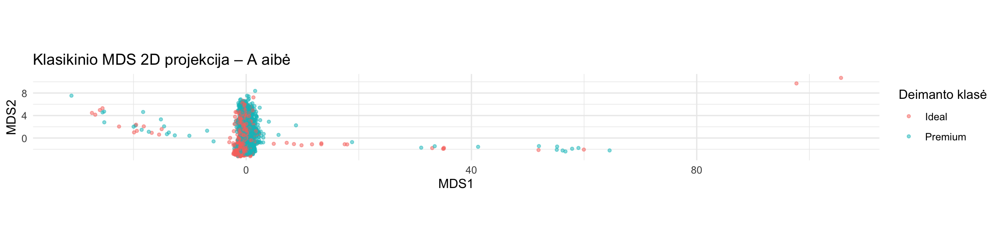

**10 pav.** Klasikinio MDS 2D projekcija su A aibe.

Grafike matyti, kad didžioji dalis deimantų susitelkusi siauroje srityje, o pavieniai stipriai nutolę objektai ištempia projekciją horizontalia kryptimi.

`Ideal` ir `Premium` klasių objektai stipriai persidengia, todėl aiškaus klasių atsiskyrimo nepastebėta.

Gauta projekcija labai panaši į PCA 2D projekciją. Tai paaiškinama tuo, kad klasikinis MDS su Euklido atstumais matematiškai atitinka PCA, kai naudojamos tos pačios centruotos duomenų koordinatės.

**Preliminari išvada:** klasikinis MDS leidžia sumažinti A aibės dimensiją nuo 19 iki 2, tačiau ekstremalūs objektai stipriai veikia projekcijos vaizdą. Projekcijos kokybė bus vertinama skaičiuojant atstumų ir kaimynystės išsaugojimo metrikas.


### Klasikinio MDS ir PCA palyginimas

Siekiant patikrinti klasikinio MDS ir PCA rezultatų atitikimą, apskaičiuotos pirmųjų dviejų komponenčių koordinatės koreliacijos.

```r
cor(pca_A$x[, 1:2], mds_A)
```

Gauti rezultatai:

| | MDS1 | MDS2 |
|---|---:|---:|
| PC1 | -1,000 | 0,000 |
| PC2 | 0,000 | -1,000 |

Pirmosios PCA ir MDS koordinatės koreliacija lygi -1, kaip ir antrosios. Tai rodo, kad abiejų metodų rezultatai sutampa, tik koordinačių kryptys yra priešingos.

Šis rezultatas patvirtina teorinį klasikinio MDS su Euklido atstumais ir PCA ryšį.

Kadangi gautos projekcijos yra lygiavertės, klasikinis MDS šiuo atveju neatskleidžia papildomos duomenų struktūros, palyginti su PCA.

### Klasikinis MDS – B aibė

Toliau klasikinis MDS pritaikytas B aibei, kurią sudaro 4000 objektų ir 6 skaitiniai požymiai.

Apskaičiuoti Euklido atstumai tarp objektų, o tada dimensija sumažinta iki 2.

```r
atstumai_B <- dist(X_B, method = "euclidean")

mds_B <- cmdscale(atstumai_B, k = 2)

dim(mds_B)
# [1] 4000 2
```

### MDS 2D projekcija

```r
mds_2d_B <- as.data.frame(mds_B)
colnames(mds_2d_B) <- c("MDS1", "MDS2")
mds_2d_B$class <- aibe_B$class

ggplot(mds_2d_B, aes(x = MDS1, y = MDS2, color = class)) +
  geom_point(alpha = 0.5, size = 1) +
  labs(
    title = "Klasikinio MDS 2D projekcija – B aibė",
    x = "MDS1",
    y = "MDS2",
    color = "Deimanto klasė"
  ) +
  coord_equal() +
  theme_minimal()
```

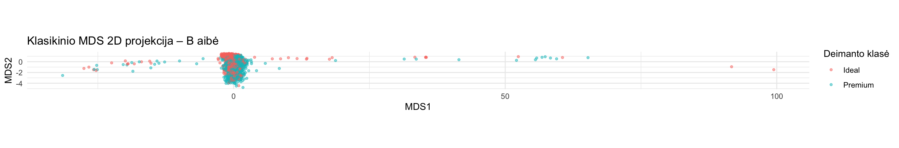

**11 pav.** Klasikinio MDS 2D projekcija su B aibe.

Grafike matyti, kad didžioji dalis objektų susitelkusi centrinėje projekcijos dalyje, tačiau keli stipriai nutolę objektai ištempia projekciją horizontalia kryptimi.

`Ideal` ir `Premium` klasių objektai stipriai persidengia, todėl aiškaus klasių atsiskyrimo nepastebėta.

### Klasikinio MDS ir PCA palyginimas – B aibė

Siekiant patikrinti klasikinio MDS ir PCA rezultatų atitikimą, apskaičiuotos pirmųjų dviejų koordinačių koreliacijos.

```r
cor(pca_B$x[, 1:2], mds_B)
```

Gauti rezultatai:

| | MDS1 | MDS2 |
|---|---:|---:|
| PC1 | -1,000 | 0,000 |
| PC2 | 0,000 | 1,000 |

Rezultatai rodo, kad klasikinio MDS ir PCA projekcijos sutampa: pirmoji koordinatė atitinka pirmąją PCA komponentę su priešingu ženklu, o antroji koordinatė sutampa su antrąja PCA komponente.

Tai patvirtina, kad ir B aibės atveju klasikinis MDS su Euklido atstumais neatskleidžia papildomos struktūros, palyginti su PCA.


### Klasikinis MDS – C aibė

Klasikinis MDS pritaikytas C aibei, kurią sudaro 3928 objektai ir 19 skaitinių požymių. Palyginti su A aibe, iš C aibės pašalinti 72 ekstremalias reikšmes turėję objektai.

Apskaičiuoti Euklido atstumai tarp objektų, o duomenų dimensija sumažinta nuo 19 iki 2.

```r
atstumai_C <- dist(X_C, method = "euclidean")

mds_C <- cmdscale(atstumai_C, k = 2)

dim(mds_C)
# [1] 3928 2
```

#### MDS 2D projekcija

```r
mds_2d_C <- as.data.frame(mds_C)
colnames(mds_2d_C) <- c("MDS1", "MDS2")
mds_2d_C$class <- aibe_C$class

ggplot(mds_2d_C, aes(x = MDS1, y = MDS2, color = class)) +
  geom_point(alpha = 0.5, size = 1) +
  labs(
    title = "Klasikinio MDS 2D projekcija – C aibė",
    x = "MDS1",
    y = "MDS2",
    color = "Deimanto klasė"
  ) +
  coord_equal() +
  theme_minimal()
```

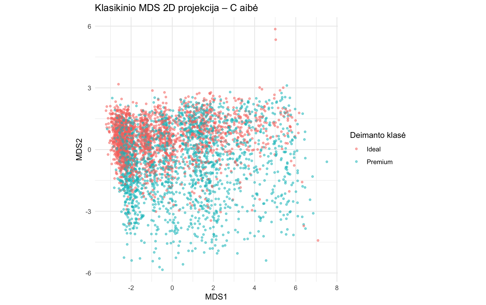

**12 pav.** Klasikinio MDS 2D projekcija su C aibe.

C aibės projekcijoje objektai pasiskirstę tolygiau nei A ir B aibėse. Pašalinus ekstremalius objektus ir iš naujo pritaikius Robust Scaling, pagrindinė objektų sankaupa nebėra taip stipriai suspausta.

`Ideal` ir `Premium` klasės vis dar persidengia, tačiau pastebima dalinio atsiskyrimo tendencija pagal antrąją MDS koordinatę. `Ideal` objektai dažniau išsidėstę aukštesnėje MDS2 dalyje, o `Premium` – žemesnėje.

#### Klasikinio MDS ir PCA palyginimas – C aibė

Siekiant patikrinti MDS ir PCA projekcijų atitikimą, apskaičiuotos koordinačių koreliacijos.

```r
cor(pca_C$x[, 1:2], mds_C)
```

Gauti rezultatai:

| | MDS1 | MDS2 |
|---|---:|---:|
| PC1 | -1,000 | 0,000 |
| PC2 | 0,000 | -1,000 |

Rezultatai rodo, kad klasikinio MDS ir PCA pirmosios dvi koordinatės visiškai atitinka, tik jų kryptys priešingos.

Taigi ir C aibėje klasikinis MDS su Euklido atstumais duoda tokią pačią dvimatę konfigūraciją kaip PCA.

### Klasikinio MDS rezultatų palyginimas

| Rodiklis | A aibė | B aibė | C aibė |
|---|---|---|---|
| Objektų skaičius | 4000 | 4000 | 3928 |
| Skaitinių požymių skaičius | 19 | 6 | 19 |
| Duomenų pasiskirstymas | Stipriai suspausta pagrindinė sankaupa | Stipriai suspausta pagrindinė sankaupa | Tolygiau matoma struktūra |
| Ekstremalių objektų įtaka | Ryški | Ryški | Sumažėjusi |
| Klasių atsiskyrimas | Didelis persidengimas | Didelis persidengimas | Dalinis atsiskyrimas, bet persidengimas išlieka |
| MDS ir PCA atitikimas | Sutampa | Sutampa | Sutampa |

Klasikinio MDS rezultatai parodė, kad duomenų paruošimas turi įtakos projekcijos vaizdui.

A ir B aibių projekcijose matomi pavieniai stipriai nutolę objektai, o C aibėje bendras objektų išsidėstymas yra lengviau įžiūrimas.

Visose trijose aibėse klasikinio MDS projekcijos atitinka PCA projekcijas. Tai patvirtina teorinį šių metodų ryšį, kai klasikiniam MDS naudojami Euklido atstumai.

Vis dėlto vizualaus projekcijų palyginimo nepakanka nustatyti, kuris duomenų paruošimo variantas geriausiai išsaugo objektų tarpusavio ryšius. Tam reikalingos kiekybinės kokybės metrikos.


### Metrinis MDS (SMACOF) – A aibė

Papildomai išbandytas metrinis MDS, naudojant SMACOF algoritmą. Šis algoritmas iteracijomis optimizuoja dvimatę objektų konfigūraciją, siekdamas sumažinti atstumų neatitikimą (Stress).

Analizei naudota A aibė, kurią sudaro 4000 objektų ir 19 skaitinių požymių. Pradinis taškų išdėstymas gautas klasikiniu MDS.

#### Stress rezultatai

| Optimizavimo etapas | Stress |
|---|---:|
| Po pirmųjų 100 iteracijų | 0,1128 |
| Po papildomų iteracijų | 0,1028 |

Papildomai optimizuojant projekciją, Stress sumažėjo nuo 0,1128 iki 0,1028. Tai rodo geresnį pradinių atstumų atkūrimą pagal naudojamą Stress kriterijų.

Pirmojo etapo metu buvo pasiektas iteracijų limitas, todėl rezultatas po papildomų iteracijų laikomas geriausiu iki šiol gautu rezultatu, nepatvirtinus galutinės konvergencijos.

#### SMACOF 2D projekcija

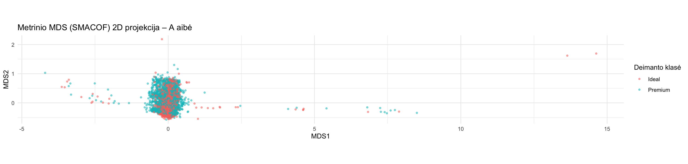

**13 pav.** Metrinio MDS (SMACOF) 2D projekcija su A aibe.

Grafike matyti, kad didžioji dalis deimantų susitelkusi centrinėje srityje, tačiau išlieka keli stipriai nutolę objektai.

`Ideal` ir `Premium` klasės vis dar stipriai persidengia, todėl aiškaus jų atsiskyrimo nepastebėta.

Palyginti su klasikiniu MDS, taškų išsidėstymas pasikeitė, nes SMACOF tiesiogiai optimizuoja atstumų neatitikimą. Vis dėlto vien iš grafiko negalima nustatyti, kiek pagerėjo atstumų išsaugojimas.


### Klasikinio MDS ir SMACOF kokybės palyginimas – A aibė

Siekiant objektyviai palyginti klasikinio MDS ir metrinio MDS (SMACOF) rezultatus, abiem metodams apskaičiuotas normalizuotas Stress rodiklis.

Skaičiuojant naudoti tie patys pradiniai Euklido atstumai ir vienoda Stress formulė. Kad skirtingas projekcijų mastelis neturėtų įtakos rezultatams, prieš apskaičiuojant Stress parinktas optimalus bendras mastelio koeficientas.

| Metodas | Normalizuotas Stress |
|---|---:|
| Klasikinis MDS | 0,1866 |
| Metrinis MDS (SMACOF) | 0,1028 |

SMACOF Stress yra maždaug 45 % mažesnis nei klasikinio MDS.

Tai rodo, kad SMACOF algoritmas geriau išsaugojo pradinius objektų tarpusavio atstumus dvimatėje projekcijoje.

Klasikinis MDS siekia atkurti atstumų geometriją, remdamasis spektriniu skaidymu, o SMACOF tiesiogiai optimizuoja Stress kriterijų.

**Išvada:** pagal normalizuotą Stress metriką SMACOF su A aibe pasiekė geresnį rezultatą nei klasikinis MDS. Tačiau galutiniam metodų palyginimui taip pat reikės įvertinti lokalių kaimynysčių išsaugojimą.


### Metrinis MDS (SMACOF) – B aibė

Metrinis MDS su SMACOF algoritmu pritaikytas B aibei, kurią sudaro 4000 objektų ir 6 skaitiniai požymiai.

Algoritmas pradėtas nuo klasikinio MDS projekcijos ir optimizuotas siekiant sumažinti Stress rodiklį.

```r
mds_smacof_B <- smacofSym(
  delta = atstumai_B,
  ndim = 2,
  init = mds_B,
  type = "ratio",
  itmax = 100
)

mds_smacof_B2 <- smacofSym(
  delta = atstumai_B,
  ndim = 2,
  init = mds_smacof_B$conf,
  type = "ratio",
  itmax = 200
)
```

#### Stress rezultatai

| Optimizavimo etapas | Stress |
|---|---:|
| Po 100 iteracijų | 0,08139493 |
| Po papildomų iteracijų | 0,08138936 |

Papildomų iteracijų metu Stress sumažėjo labai nežymiai, todėl tolimesnei analizei pasirinkta antroji SMACOF projekcija.

#### SMACOF 2D projekcija

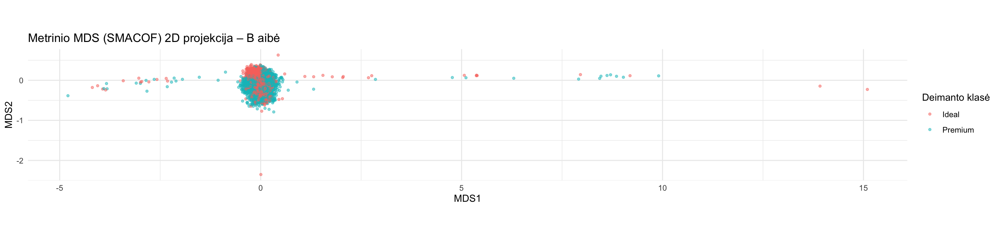

**Pav.** B aibės metrinio MDS (SMACOF) 2D projekcija.

Grafike matyti, kad didžioji dalis deimantų susitelkusi centrinėje srityje, tačiau išlieka pavienių stipriai nutolusių objektų.

`Ideal` ir `Premium` klasės stipriai persidengia, todėl aiškaus klasių atsiskyrimo nėra.

#### Klasikinio MDS ir SMACOF palyginimas

Abiem projekcijoms apskaičiuotas normalizuotas Stress pagal tą pačią formulę ir tuos pačius pradinius Euklido atstumus.

```r
c(
  klasikinis_MDS = stress1(atstumai_B, mds_B),
  SMACOF = stress1(atstumai_B, mds_smacof_B2$conf)
)
```

| Metodas | Normalizuotas Stress |
|---|---:|
| Klasikinis MDS | 0,13920 |
| Metrinis MDS (SMACOF) | 0,08139 |

SMACOF sumažino normalizuotą Stress maždaug 41,5 %, palyginti su klasikiniu MDS.

Tai rodo, kad metrinis MDS geriau atkūrė B aibės objektų tarpusavio atstumus dvimatėje erdvėje.

Vis dėlto projekcijoje abi deimantų klasės išlieka persidengusios. Geresnis atstumų išsaugojimas nebūtinai reiškia geresnį klasių atskyrimą.


### Metrinis MDS (SMACOF) – C aibė

Metrinis MDS su SMACOF algoritmu pritaikytas C aibei, kurią sudaro 3928 objektai ir 19 skaitinių požymių. Šioje aibėje pašalinti 72 ekstremalių reikšmių turėję objektai.

Kaip ir A bei B aibėse, SMACOF pradėtas nuo klasikinio MDS projekcijos, siekiant sumažinti atstumų neatitikimą dvimatėje erdvėje.

```r
mds_smacof_C <- smacofSym(
  delta = atstumai_C,
  ndim = 2,
  init = mds_C,
  type = "ratio",
  itmax = 100
)

mds_smacof_C2 <- smacofSym(
  delta = atstumai_C,
  ndim = 2,
  init = mds_smacof_C$conf,
  type = "ratio",
  itmax = 200
)
```

#### Stress rezultatai

| Optimizavimo etapas | Stress |
|---|---:|
| Po 100 iteracijų | 0,1346586 |
| Po papildomų iteracijų | 0,1346553 |

Papildomų iteracijų metu Stress sumažėjo labai nežymiai, todėl tolesnei analizei pasirinkta antroji SMACOF projekcija.

#### SMACOF 2D projekcija

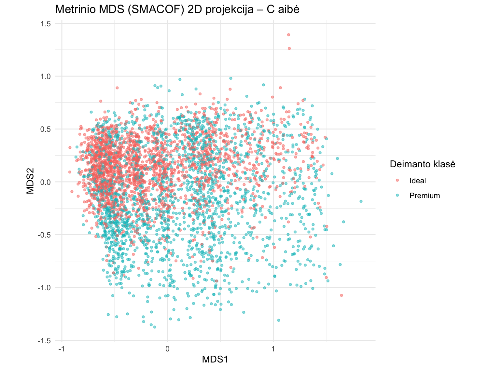

**Pav.** C aibės metrinio MDS (SMACOF) 2D projekcija.

Grafike matyti, kad objektai pasiskirstę tolygiau nei A ir B aibių projekcijose. Pagrindinė duomenų sankaupa nebėra taip stipriai suspausta, todėl lengviau įžiūrėti bendrą objektų išsidėstymą.

`Ideal` ir `Premium` klasės vis dar persidengia, tačiau matoma dalinio atsiskyrimo tendencija pagal MDS2 koordinatę. `Ideal` objektai dažniau išsidėsto aukštesnėje projekcijos dalyje, o `Premium` – žemesnėje.

#### Klasikinio MDS ir SMACOF palyginimas

Abiem metodams apskaičiuotas normalizuotas Stress, naudojant tuos pačius pradinius Euklido atstumus ir vienodą skaičiavimo formulę.

```r
c(
  klasikinis_MDS = stress1(atstumai_C, mds_C),
  SMACOF = stress1(atstumai_C, mds_smacof_C2$conf)
)
```

| Metodas | Normalizuotas Stress |
|---|---:|
| Klasikinis MDS | 0,15669 |
| Metrinis MDS (SMACOF) | 0,13466 |

SMACOF sumažino Stress maždaug 14,1 %, palyginti su klasikiniu MDS.

Tai rodo, kad SMACOF geriau atkūrė C aibės objektų tarpusavio atstumus dvimatėje projekcijoje.

### Bendras MDS rezultatų palyginimas

| Aibė | Klasikinio MDS Stress | SMACOF Stress | Pagerėjimas |
|---|---:|---:|---:|
| A | 0,18655 | 0,10279 | 44,9 % |
| B | 0,13920 | 0,08139 | 41,5 % |
| C | 0,15669 | 0,13466 | 14,1 % |

Visose trijose aibėse metrinis MDS su SMACOF algoritmu pasiekė mažesnį normalizuotą Stress nei klasikinis MDS.

Didžiausias santykinis Stress sumažėjimas gautas A aibėje, mažiausias – C aibėje.

A ir B aibių projekcijose didžioji dalis objektų išlieka susitelkusi siauroje srityje, o pavieniai nutolę objektai stipriai veikia bendrą projekcijos vaizdą.

C aibėje objektai pasiskirstę tolygiau, taip pat pastebima ryškesnė dalinio klasių atsiskyrimo tendencija. Vis dėlto aiškios ribos tarp `Ideal` ir `Premium` klasių nėra.

**Išvada:** SMACOF geriau nei klasikinis MDS išsaugojo atstumus visose trijose aibėse pagal pasirinktą Stress rodiklį. Tačiau skirtingų aibių Stress reikšmės nėra tiesioginis jų kokybės palyginimas, nes skiriasi pradinės duomenų erdvės.

Galutiniame metodų vertinime papildomai bus nagrinėjamas lokalių kaimynysčių išsaugojimas ir kitų dimensijos mažinimo metodų rezultatai.


## t-SNE analizė – A aibė

t-SNE (t-distributed Stochastic Neighbor Embedding) – netiesinis
dimensijos mažinimo metodas, skirtas pirmiausia lokaliai duomenų
struktūrai atskleisti. Metodas siekia, kad pradinėje požymių erdvėje
panašūs objektai išliktų artimi mažesnės dimensijos projekcijoje.

Šiame tyrime t-SNE pritaikytas A aibei, kurią sudaro **4000 deimantų
ir 19 skaitinių požymių**.

Duomenims jau pritaikytas **Robust Scaling**, todėl papildomas
požymių mastelio keitimas neatliktas. `class` ir `id` į projekcijos
įėjimą neįtraukti. `class` naudojama taškų spalvoms ir rezultatų
interpretacijai, o `id` išsaugomas tolesniam tų pačių objektų
palyginimui.

### Pirmasis t-SNE paleidimas

Pradinei analizei pasirinkta dvimatė projekcija ir perplexity = 30.
Šis paleidimas naudojamas kaip pradinis atskaitos variantas,
o ne kaip iš anksto geriausias sprendimas.

Naudoti nustatymai:

| Parametras | Reikšmė |
|---|---:|
| Tikslinė dimensija (`dims`) | 2 |
| `perplexity` | 30 |
| Atsitiktinė sėkla | 42 |
| Iteracijų skaičius (`max_iter`) | 1000 |
| Papildomas PCA (`pca`) | FALSE |
| Vidinis normalizavimas (`normalize`) | FALSE |
| Barnes–Hut aproksimacijos parametras (`theta`) | 0,5 |

Papildomas PCA išjungtas, kad t-SNE gautų visus 19 paruoštų
skaitinių požymių. Vidinis normalizavimas išjungtas, kad būtų
naudojamas grupės paruoštas įėjimas.

```r
library(Rtsne)
library(ggplot2)

set.seed(42)

tsne_A <- Rtsne(
  X_A,
  dims = 2,
  perplexity = 30,
  max_iter = 1000,
  pca = FALSE,
  normalize = FALSE,
  verbose = TRUE
)

dim(tsne_A$Y)
# [1] 4000 2
```

Gauta matrica turi 4000 eilučių ir 2 stulpelius: kiekvienam deimantui
apskaičiuotos dvi projekcijos koordinatės.

Galutinė algoritmo pateikta KL paklaida – **1,408716**.
Ši paklaida nusako t-SNE optimizuojamų panašumų tikimybių
neatitikimą ir nėra tiesiogiai lygi MDS Stress rodikliui.

### A aibės t-SNE 2D projekcija

```r
tsne_2d_A <- data.frame(
  TSNE1 = tsne_A$Y[, 1],
  TSNE2 = tsne_A$Y[, 2],
  class = aibe_A$class,
  id = aibe_A$id
)

grafikas_tsne_A <- ggplot(
  tsne_2d_A,
  aes(x = TSNE1, y = TSNE2, color = class)
) +
  geom_point(alpha = 0.5, size = 1) +
  coord_equal() +
  labs(
    title = "t-SNE 2D projekcija – A aibė",
    subtitle = "Perplexity = 30; sėkla = 42",
    x = "t-SNE 1",
    y = "t-SNE 2",
    color = "Deimanto klasė"
  ) +
  theme_minimal()

print(grafikas_tsne_A)
```

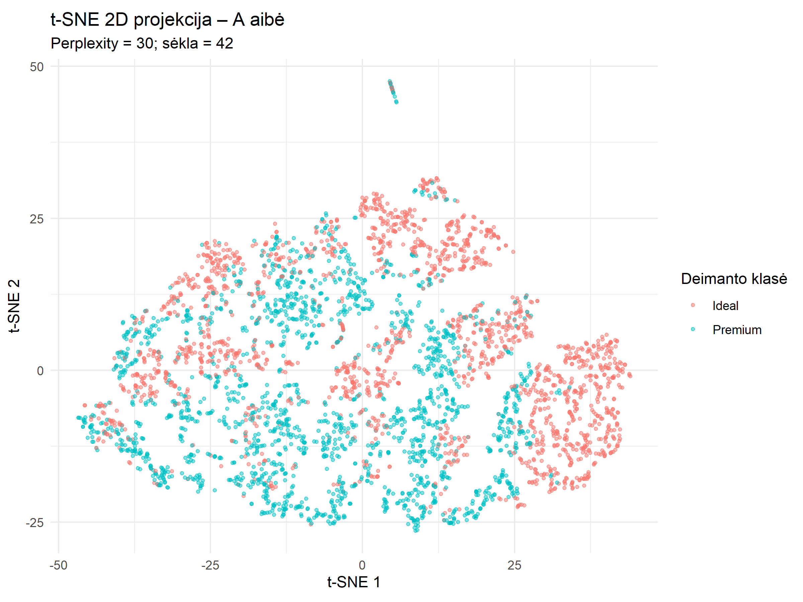

**Pav.** A aibės t-SNE 2D projekcija: perplexity = 30,
sėkla = 42, 1000 iteracijų.

Projekcijoje matomas dalinis `Ideal` ir `Premium` klasių
susitelkimas skirtingose srityse. `Ideal` objektai dažniau
išsidėstę dešinėje ir viršutinėje dalyje, o `Premium` – centrinėje
ir apatinėje dalyje. Dešiniajame krašte išsiskiria sritis,
kurioje daugiausia `Ideal` objektų.

Vis dėlto dalyje projekcijos abiejų klasių taškai persidengia.
Todėl šiame dvimačiame vaizde nėra visiško klasių atsiskyrimo.
Iš to negalima daryti išvados, kad klasės neatskiriamos
pradinėje 19 požymių erdvėje.

Taip pat matomos smulkios taškų salelės ir ruožai bei nedidelė
nuo pagrindinės sankaupos atsiskyrusi grupė viršutinėje dalyje.
Vien iš projekcijos negalima nustatyti, ar tai realios atskiros
grupės, ekstremalūs objektai, ar algoritmo suformuoto
išdėstymo ypatybės. Tam reikėtų patikrinti atitinkamų objektų
pradinius požymius ir jų kaimynystes.

t-SNE ašys neturi tiesioginės fizinės interpretacijos:
aukštesnė ar dešinesnė padėtis savaime nereiškia didesnės
masės, kainos ar geresnės pjūvio kokybės. Atstumai tarp
atskirų salelių ir jų plotai nėra patikimas pradinių atstumų
ar grupių sklaidos matas.

### Perplexity parametro tyrimas

Siekiant įvertinti t-SNE jautrumą kaimynystės masteliui,
palygintos trys perplexity reikšmės: **5, 30 ir 50**.

Mažesnė perplexity labiau akcentuoja labai artimas kaimynystes,
o didesnė į panašumų vertinimą įtraukia platesnę aplinką.
Perplexity nėra tiesiogiai nustatytas klasterių skaičius.

Visiems variantams naudota ta pati A aibė, 2D projekcija,
sėkla 42 ir 1000 iteracijų. Kiti nustatymai nekeisti.

```r
perplexity_reiksmes <- c(5, 30, 50)

tsne_A_variantai <- list()
tsne_A_variantai[["30"]] <- tsne_A

for (p in c(5, 50)) {
  set.seed(42)

  tsne_A_variantai[[as.character(p)]] <- Rtsne(
    X_A,
    dims = 2,
    perplexity = p,
    max_iter = 1000,
    pca = FALSE,
    normalize = FALSE,
    verbose = TRUE
  )
}
```

#### Skaitiniai rezultatai

| Perplexity | Sėkla | Iteracijos | Galutinė KL paklaida |
|---|---:|---:|---:|
| 5 | 42 | 1000 | 1,510557 |
| 30 | 42 | 1000 | 1,408716 |
| 50 | 42 | 1000 | 1,287090 |

Didėjant perplexity, šiame eksperimente galutinė KL paklaida
mažėjo. Tačiau keičiant perplexity keičiasi ir pradinių
panašumų tikimybės, todėl šios reikšmės nėra tiesioginis
projekcijų kokybės palyginimas.

Visi paleidimai pasiekė nustatytą 1000 iteracijų skaičių.
Paskutinėse iteracijose paklaida dar mažėjo, todėl šie rezultatai
savaime nepatvirtina galutinės konvergencijos.

#### Projekcijų palyginimas

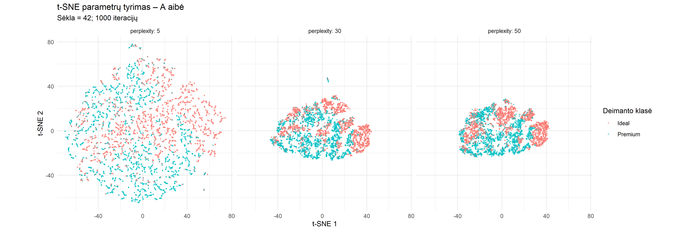

**Pav.** A aibės t-SNE projekcijos su perplexity = 5, 30 ir 50.
Visais atvejais naudota sėkla 42 ir 1000 iteracijų.

| Požymis | Perplexity = 5 | Perplexity = 30 | Perplexity = 50 |
|---|---|---|---|
| Vaizdo struktūra | Daug smulkių fragmentų ir grandinėlių | Stambesnės, vientisesnės sritys | Vientisesnės sritys, vizualiai panašios į 30 variantą |
| Klasių išsidėstymas | Dalinis susitelkimas, persidengimas išlieka | Matomos sritys, kuriose vyrauja viena klasė, bet yra persidengimo | Taip pat matomos vienos klasės vyraujamos sritys, bet persidengimas išlieka |
| Vizualiai atokūs objektai | Matomi pavieniai nutolę taškai | Matoma nedidelė atskira grupė | Atokios grupės mažiau ryškios |

Kai perplexity = 5, projekcija labiau fragmentuota: matoma
daug smulkių grandinėlių ir salelių. Jų negalima automatiškai
laikyti tikrais duomenų klasteriais.

Kai perplexity = 30 arba 50, vizualiai išryškėja vientisesnės
sritys. Abiem atvejais dalyje sričių vyrauja viena deimantų
klasė, tačiau `Ideal` ir `Premium` persidengimas išlieka.

Variantų su perplexity = 30 ir 50 vizualus panašumas yra
pradinis pastebėjimas apie parametrų poveikį, tačiau jis
nepatvirtina stabilumo keičiant atsitiktines sėklas.

Skirtingas projekcijų užimamas plotas ar mažesnis matomų
atokiai esančių taškų skaičius savaime nereiškia geresnės
kokybės. Objektai nebuvo šalinami: kiekvienoje projekcijoje
yra tie patys 4000 deimantų.

### Preliminari A aibės tyrimo išvada

Perplexity parametro keitimas paveikė t-SNE projekcijos
fragmentuotumą ir objektų išsidėstymą. Mažiausia tirta reikšmė
(5) sudarė smulkiau fragmentuotą vaizdą, o reikšmės 30 ir 50 –
vientisesnes sritis.

Visuose variantuose pastebimas dalinis klasių susitelkimas,
tačiau visiško jų atsiskyrimo nėra. Vien vizualaus vaizdo
ir KL paklaidos nepakanka geriausiam variantui pasirinkti.

### Rezultatų išsaugojimas

Grafikai išsaugoti:
- `grafikai/tsne_2d_A_p30_seed42.png`;
- `grafikai/tsne_A_perplexity_palyginimas.png`.

Parametrų tyrimo suvestinė išsaugota:
- `rezultatai/tsne_A_perplexity_suvestine.csv`.

Visi trys apskaičiuoti t-SNE rezultatai išsaugoti:
- `rezultatai/tsne_A_perplexity_variantai.rds`.

RDS faile išsaugotus rezultatus galima nuskaityti
nekartojant t-SNE skaičiavimų:

```r
tsne_A_variantai <- readRDS(
  "rezultatai/tsne_A_perplexity_variantai.rds"
)
```

### Pradinių kaimynų išsaugojimas

Kiekvienam objektui nustatyti k artimiausi kaimynai pradinėje
19 požymių erdvėje ir t-SNE projekcijoje. Apskaičiuota sutampančių
kaimynų dalis ir jos vidurkis visiems 4000 objektų.

Naudoti Euklido atstumai; pats objektas į savo kaimynus neįtrauktas.
Vienodi atstumai surikiuoti pagal objekto eilutės indeksą.
Klasės žymos šiame skaičiavime nenaudotos.

| Perplexity | k = 5 | k = 15 | k = 50 |
|---|---:|---:|---:|
| 5 | **0,5718** | 0,4791 | 0,4439 |
| 30 | 0,5539 | **0,5326** | 0,5234 |
| 50 | 0,5206 | 0,5251 | **0,5286** |

Perplexity = 5 geriausiai išsaugojo labai artimą kaimynystę
(k = 5), tačiau platesnėse kaimynystėse jo rezultatai buvo
mažesni nei kitų variantų.

Perplexity = 30 pasiekė didžiausią kaimynų išsaugojimą su
k = 15, o perplexity = 50 – su k = 50. Pastaruoju atveju
30 ir 50 variantų skirtumas buvo nedidelis – apie
0,53 procentinio punkto.

Taigi parametro pasirinkimas priklauso nuo dominančio
kaimynystės mastelio. Vien šis rodiklis neleidžia paskelbti
vieno varianto geriausiu: Papildomas vertinimas pateiktas tolesniuose poskyriuose.

### Trustworthiness ir Continuity

Papildomai įvertinti Trustworthiness (T) ir Continuity (C)
rodikliai su k = 5, 15 ir 50.

Trustworthiness baudžia už objektus, kurie projekcijoje tapo
artimais kaimynais, nors pradinėje erdvėje tokie nebuvo.
Continuity baudžia už pradinių artimų kaimynų praradimą.
Abiem atvejais didesnė reikšmė reiškia geresnį rezultatą.

Skaičiavimams naudoti Euklido atstumų rangai. Vienodi atstumai
rikiuoti pagal objekto eilutės indeksą, nuosekliai su ankstesniu
kaimynų išsaugojimo skaičiavimu.

| Perplexity | k | Trustworthiness | Continuity |
|---|---:|---:|---:|
| 5 | 5 | 0,996629 | 0,981523 |
| 5 | 15 | 0,985594 | 0,965496 |
| 5 | 50 | 0,957142 | 0,940764 |
| 30 | 5 | 0,996487 | 0,984459 |
| 30 | 15 | 0,991372 | 0,974173 |
| 30 | 50 | 0,975803 | 0,956637 |
| 50 | 5 | 0,995376 | 0,984253 |
| 50 | 15 | 0,990034 | 0,975480 |
| 50 | 50 | 0,975666 | 0,959179 |

Labai lokalioje kaimynystėje (k = 5) visų variantų rezultatai
panašūs: perplexity = 5 pasiekė didžiausią T, o perplexity = 30 –
didžiausią C.

Kai k = 15 ir 50, perplexity = 30 ir 50 abiem rodikliais
lenkia perplexity = 5. Tarp 30 ir 50 variantų skirtumai nedideli:
30 pasiekė didesnį T abiem šiais masteliais, o 50 – didesnį C.

Visais atvejais T yra didesnis už C. Tai rodo, kad pagal
naudojamą rangų baudos kriterijų pradinių kaimynų praradimo
iškraipymas yra didesnis už naujų kaimynų atsiradimo iškraipymą.

Aukšti T ir C neprieštarauja mažesniam tiksliam kaimynų
sutapimui: rodikliai vertina skirtingus aspektus. Kaimynų
išsaugojimas skaičiuoja sutampančius objektus, o T ir C
atsižvelgia ir į nesutampančių kaimynų rangus.

### Darbinis parametro pasirinkimas

Tolesniam stabilumo ir A/B/C aibių palyginimui kaip darbinis
variantas pasirenkama perplexity = 30.

Šis variantas pasiekė didžiausią kaimynų išsaugojimą su k = 15,
aukštus T ir C bei panašius rezultatus į perplexity = 50
platesnėje kaimynystėje. Pasirinkimas yra kompromisinis,
o ne įrodymas, kad 30 yra universaliai geriausia reikšmė.

Parametrų palyginimas atliktas su sėkla 42. Pasirinkto perplexity = 30 varianto stabilumas su penkiomis sėklomis vertinamas kitame poskyryje.

### Stabilumo tyrimas su penkiomis sėklomis

Siekiant patikrinti rezultatų jautrumą atsitiktinei inicializacijai,
t-SNE paleistas su penkiomis sėklomis: 42, 123, 2026, 7 ir 99.

Visais atvejais naudota ta pati A aibė, perplexity = 30,
2D projekcija ir 1000 iteracijų. Kiti nustatymai nekeisti.

Kiekvienam paleidimui apskaičiuoti Trustworthiness,
Continuity ir pradinių kaimynų išsaugojimo rodikliai.
Lentelėje pateikiamas vidurkis ± imties standartinis nuokrypis
per penkis paleidimus.

| k | Trustworthiness | Continuity | Kaimynų išsaugojimas |
|---|---:|---:|---:|
| 5 | 0,996482 ± 0,000123 | 0,984174 ± 0,000782 | 0,554880 ± 0,002705 |
| 15 | 0,991191 ± 0,000263 | 0,973863 ± 0,000832 | 0,533983 ± 0,001005 |
| 50 | 0,975617 ± 0,000223 | 0,956151 ± 0,001227 | 0,521761 ± 0,000985 |

Visų trijų rodiklių standartiniai nuokrypiai nedideli.
Trustworthiness ir Continuity išlieka aukšti visais
tirtais kaimynystės masteliais.

Vidutiniškai išsaugoma apie 55,49 % pradinių kaimynų,
kai k = 5, 53,40 %, kai k = 15, ir 52,18 %, kai k = 50.
Kaimynų išsaugojimo standartinis nuokrypis neviršija
0,28 procentinio punkto.

Rezultatai rodo, kad pasirinkto perplexity = 30 varianto
lokalios struktūros kokybės rodikliai mažai jautrūs
tirtoms atsitiktinėms sėkloms.

Ši išvada taikoma rodiklių stabilumui. Panašios rodiklių
reikšmės savaime negarantuoja vienodų projekcijų ar tų pačių
kaimynysčių visuose paleidimuose.

### Globalios struktūros išsaugojimas

Globali struktūra įvertinta porinių atstumų Spearman koreliacija
ir normalizuotu Stress. Vertintos visos 7 998 000 unikalių
objektų porų, naudojant Euklido atstumus.

Spearman koreliacija apskaičiuota kaip Pearson koreliacija tarp
atstumų rangų. Vienodiems atstumams suteikti vidutiniai rangai.

Stress skaičiuotas pagal tą pačią formulę kaip MDS tyrime.
Prieš skaičiuojant parinktas optimalus bendras projekcijos
mastelio koeficientas, minimizuojantis atstumų skirtumų
kvadratų sumą.

| Sėkla | Perplexity | Spearman | Normalizuotas Stress |
|---|---:|---:|---:|
| 42 | 30 | 0,691963 | 0,779956 |
| 123 | 30 | 0,697737 | 0,778548 |
| 2026 | 30 | 0,710331 | 0,777534 |
| 7 | 30 | 0,681417 | 0,779907 |
| 99 | 30 | 0,694478 | 0,778522 |
| **Vidurkis ± SD** | **30** | **0,695185 ± 0,010445** | **0,778893 ± 0,001032** |

Spearman rezultatai rodo, kad porinių atstumų tvarka išsaugoma
iš dalies. Tačiau aukštas normalizuotas Stress rodo didelį
pradinių ir projekcijos atstumų neatitikimą net suderinus
bendrą mastelį.

Palyginimui, su ta pačia A aibe klasikinio MDS Stress buvo
apie 0,1866, o metrinio MDS (SMACOF) – 0,1028.
Taigi pagal šį kriterijų t-SNE gerokai prasčiau išlaiko
globalius atstumus.

Tai dera su metodų paskirtimi: t-SNE optimizuoja vietinių
panašumų tikimybių atitikimą, o ne visų porinių atstumų
atkūrimą. Maža rezultatų sklaida tarp sėklų rodo, kad
nustatytas globalių atstumų iškraipymas kartojasi visuose
penkiuose paleidimuose.

### A aibės t-SNE tyrimo apibendrinimas

Pasirinkus perplexity = 30, gauti aukšti Trustworthiness
ir Continuity rodikliai bei nedidelė jų sklaida tarp penkių
sėklų. Priklausomai nuo k, vidutiniškai išsaugota apie
52–55 % tų pačių pradinių kaimynų.

Tačiau globalių atstumų išsaugojimas gerokai silpnesnis:
Spearman vidurkis siekia apie 0,695, o normalizuotas
Stress – apie 0,779.

Todėl ši projekcija labiau tinka lokalioms grupavimosi
tendencijoms nagrinėti nei tiksliems atstumams tarp tolimų
objektų ar atskirų grupių interpretuoti.

Koreliuotų požymių ir ekstremalių objektų pašalinimo poveikis nagrinėjamas B ir C skyriuose.

### Papildomas tikslinės dimensijos tyrimas: 2D ir 3D

Siekiant įvertinti papildomos dimensijos naudą, A aibei
apskaičiuota 3D t-SNE projekcija. Naudoti tie patys
4000 objektų, 19 skaitinių požymių, perplexity = 30,
sėkla 42 ir 1000 iteracijų. Keista tik tikslinė dimensija.

```r
set.seed(42)

tsne_A_3d <- Rtsne(
  X_A,
  dims = 3,
  perplexity = 30,
  max_iter = 1000,
  pca = FALSE,
  normalize = FALSE,
  verbose = TRUE
)
```

Gauta **4000 × 3** koordinačių matrica.
Galutinė KL paklaida – **1,250155**.
Dimensijos nauda vertinta bendromis kokybės metrikomis,
lyginant 2D ir 3D paleidimus su sėkla 42.

#### Lokali kokybė

| Dimensija | k | Trustworthiness | Continuity | Kaimynų išsaugojimas |
|---|---:|---:|---:|---:|
| 2D | 5 | 0,996487 | 0,984459 | 0,553850 |
| 2D | 15 | 0,991372 | 0,974173 | 0,532600 |
| 2D | 50 | 0,975803 | 0,956637 | 0,523390 |
| 3D | 5 | 0,998256 | 0,991092 | 0,605100 |
| 3D | 15 | 0,993617 | 0,984419 | 0,562483 |
| 3D | 50 | 0,983509 | 0,972138 | 0,552615 |

3D projekcija pasiekė didesnius Trustworthiness,
Continuity ir kaimynų išsaugojimo rodiklius visais
tirtais kaimynystės dydžiais.

Kaimynų išsaugojimas padidėjo:
- apie 5,13 procentinio punkto, kai k = 5;
- apie 2,99 procentinio punkto, kai k = 15;
- apie 2,92 procentinio punkto, kai k = 50.

Taigi šiame paleidime papildoma dimensija padėjo geriau
išsaugoti pradinės erdvės lokalias kaimynystes.

#### Globali kokybė

| Dimensija | Spearman | Normalizuotas Stress |
|---|---:|---:|
| 2D | 0,691963 | 0,779956 |
| 3D | 0,721742 | 0,758551 |

3D projekcija geriau išlaikė porinių atstumų tvarką
ir pasiekė mažesnį normalizuotą Stress.

Vis dėlto globalių atstumų neatitikimas išliko didelis,
todėl net 3D projekcijos atstumai neturėtų būti
interpretuojami kaip tikslūs pradinių atstumų atitikmenys.

#### Tikslinės dimensijos pasirinkimas

Šiame vienos sėklos eksperimente 3D pagerino visus
vertintus kokybės rodiklius. Tačiau papildomos dimensijos
pranašumo stabilumas su kitomis sėklomis nepatikrintas.

Pagrindiniams parametrų ir A/B/C palyginimams paliekama
2D projekcija: ji leidžia rezultatus pateikti plokštumoje
ir išlaikyti vienodas palyginimo sąlygas.

Kai svarbesnis geresnis kaimynysčių išsaugojimas ir
galima interaktyvi peržiūra, 3D yra pagrįsta alternatyva.

#### Grafinė 3D projekcija

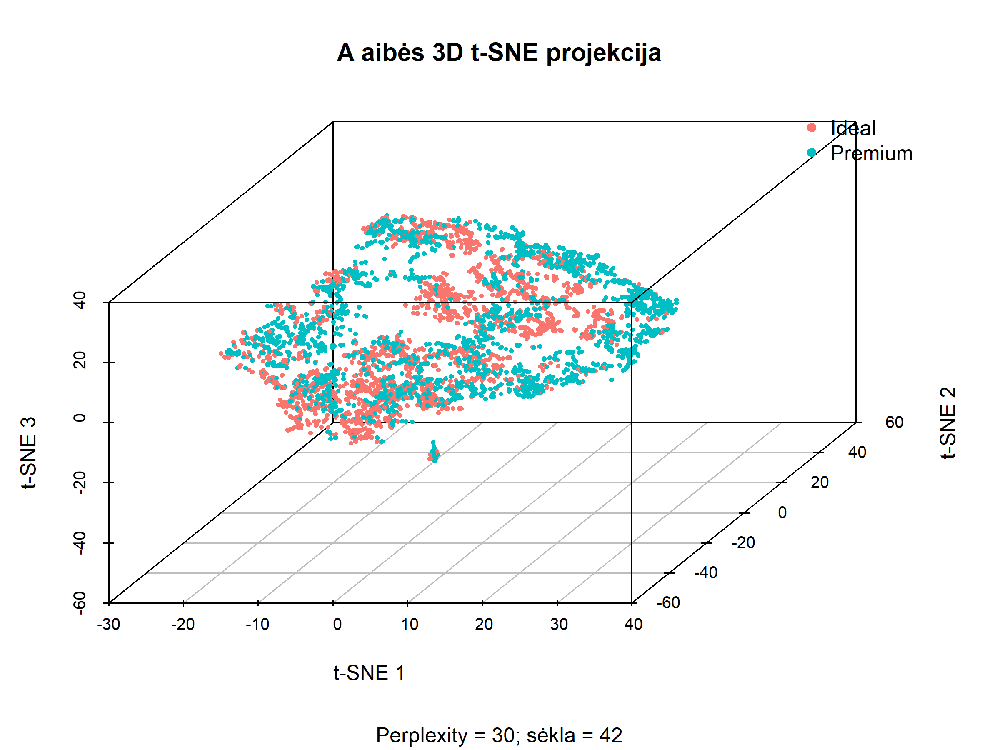

**Pav. A aibės 3D t-SNE projekcija:** perplexity = 30,
sėkla 42. Spalvos žymi klases, kurios projekcijai
apskaičiuoti nenaudotos.

[Interaktyvi grafiko versija](grafikai/tsne_A_3d.html)

#### Rezultatų išsaugojimas

- 3D t-SNE rezultatas:
  `rezultatai/tsne_A_3d_p30_seed42.rds`.
- 3D koordinatės:
  `rezultatai/tsne_A_3d_koordinates.csv`.
- 2D ir 3D lokalios kokybės palyginimas:
  `rezultatai/tsne_A_2d_3d_lokali_kokybe.csv`.
- 2D ir 3D globalios kokybės palyginimas:
  `rezultatai/tsne_A_2d_3d_globali_kokybe.csv`.

## t-SNE analizė – B aibė

B aibę sudaro **4000 deimantų ir 6 skaitiniai požymiai**:
`carat`, `depth`, `table`, `price`, `length_width_ratio`
ir `carat_per_volume`.

Palyginti su A aibe, pašalinta 13 koreliuotų požymių.
Objektų skaičius ir jų eiliškumas nepasikeitė.

Tyrimo tikslas – nustatyti, kaip požymių atranka pakeičia
pradines objektų kaimynystes ir t-SNE projekcijos kokybę.

### t-SNE atlikimas

Naudoti tokie pat nustatymai kaip pagrindiniame A aibės
paleidime:

| Parametras | Reikšmė |
|---|---:|
| Tikslinė dimensija | 2 |
| Perplexity | 30 |
| Atsitiktinė sėkla | 42 |
| Iteracijų skaičius | 1000 |
| Papildomas PCA | FALSE |
| Vidinis normalizavimas | FALSE |
| Theta | 0,5 |

Duomenims jau pritaikytas Robust Scaling.
`class` ir `id` į projekcijos įėjimą neįtraukti.

Prieš paleidžiant patikrinta, kad A ir B objektų
identifikatoriai pateikti ta pačia tvarka.

```r
stopifnot(
  nrow(X_B) == 4000,
  ncol(X_B) == 6,
  identical(aibe_A$id, aibe_B$id)
)

set.seed(42)

tsne_B <- Rtsne(
  X_B,
  dims = 2,
  perplexity = 30,
  max_iter = 1000,
  pca = FALSE,
  normalize = FALSE,
  verbose = TRUE
)

dim(tsne_B$Y)
# [1] 4000 2
```

Gauta 4000 × 2 koordinačių matrica.
Galutinė algoritmo pateikta KL paklaida – **1,341245**.

Šios paklaidos negalima tiesiogiai naudoti A ir B projekcijų
kokybei palyginti, nes skiriasi jų pradinės požymių erdvės
ir pagal jas apskaičiuotos panašumų tikimybės.

Paskutinėse iteracijose paklaida dar mažėjo, todėl 1000
iteracijų pasiekimas savaime nepatvirtina galutinės konvergencijos.

### B aibės t-SNE 2D projekcija

```r
tsne_2d_B <- data.frame(
  TSNE1 = tsne_B$Y[, 1],
  TSNE2 = tsne_B$Y[, 2],
  class = aibe_B$class,
  id = aibe_B$id
)

grafikas_tsne_B <- ggplot(
  tsne_2d_B,
  aes(TSNE1, TSNE2, color = class)
) +
  geom_point(alpha = 0.5, size = 1) +
  coord_equal() +
  labs(
    title = "t-SNE 2D projekcija – B aibė",
    subtitle = "6 požymiai; perplexity = 30; sėkla = 42",
    x = "t-SNE 1",
    y = "t-SNE 2",
    color = "Deimanto klasė"
  ) +
  theme_minimal()

print(grafikas_tsne_B)
```

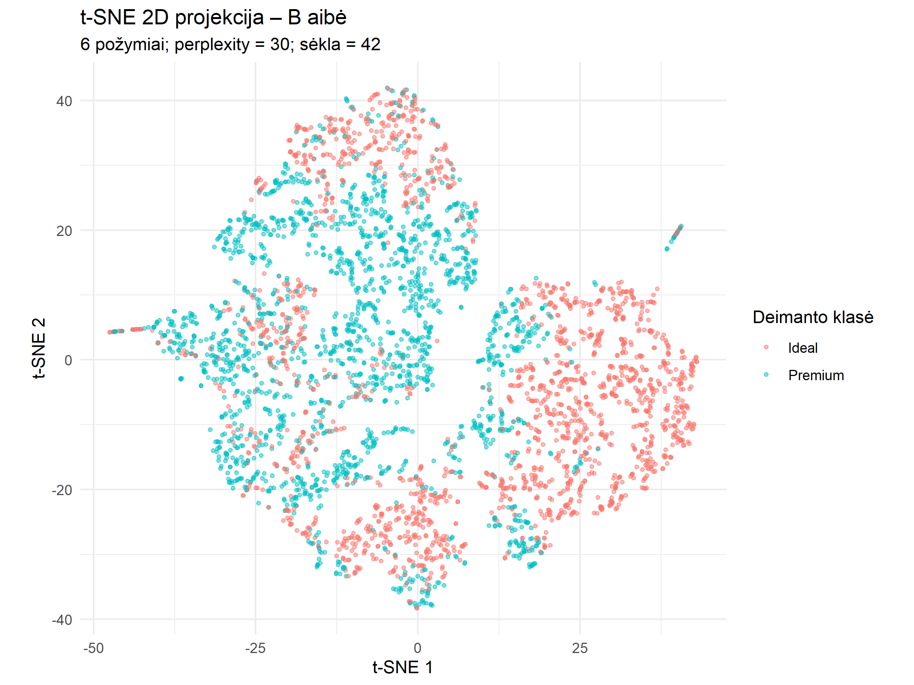

**Pav.** B aibės t-SNE 2D projekcija:
6 skaitiniai požymiai, perplexity = 30, sėkla = 42.

Projekcijoje matomos kelios sritys, kuriose vyrauja `Ideal`
objektai. Ryškiausia tokia sritis yra dešinėje, kita –
apatinėje projekcijos dalyje. Kairiojoje dalyje išlieka
ryškus `Ideal` ir `Premium` objektų persidengimas.

Pagal vizualų palyginimą kai kurios vienos klasės sritys
B projekcijoje atrodo ryškesnės nei A projekcijoje.
Tačiau tai savaime neįrodo geresnio pradinės struktūros
išsaugojimo ar klasifikavimo kokybės.

Taip pat matomi atokūs siauri taškų ruožai. Vien projekcijos
vaizdo nepakanka jų laikyti duomenų klaidomis, dublikatais
ar tikrais atskirais klasteriais.

Ašių kryptys neturi tiesioginės fizinės interpretacijos.
Projekcijos užimamas plotas ir tarpai tarp salelių
nenaudojami kaip kokybės kriterijai.

### B projekcijos lokali kokybė

B projekcija vertinta dviejų atskaitos erdvių atžvilgiu:

- **B erdvės:** ar projekcija išsaugo 6 naudotų požymių struktūrą?
- **A erdvės:** kiek projekcijoje išlieka originalių 19 požymių
  apibrėžta struktūra?

Abiem atvejais lyginti tie patys 4000 objektų.
Naudoti Euklido atstumai, o vienodi atstumai rikiuoti
pagal objekto eilutės indeksą.

| Atskaitos erdvė | k | Trustworthiness | Continuity | Kaimynų išsaugojimas |
|---|---:|---:|---:|---:|
| B | 5 | 0,997026 | 0,987225 | 0,582500 |
| B | 15 | 0,991360 | 0,977866 | 0,536150 |
| B | 50 | 0,979423 | 0,962215 | 0,522505 |
| A | 5 | 0,988791 | 0,973175 | 0,397300 |
| A | 15 | 0,977122 | 0,958424 | 0,404883 |
| A | 50 | 0,957419 | 0,928268 | 0,418290 |

Savo B erdvės atžvilgiu projekcija pasiekė aukštus
Trustworthiness ir Continuity rodiklius.
Priklausomai nuo k, išsaugota apie **52–58 %** tų pačių
pradinių B kaimynų.

Originalios A erdvės atžvilgiu visi rodikliai mažesni:
išsaugota apie **40–42 %** pradinių A kaimynų.
Tai rodo, kad geras B struktūros atvaizdavimas nėra
tapatus geram originalios A struktūros išsaugojimui.

### Pradinių A ir B kaimynysčių palyginimas

Siekiant atskirti požymių atrankos poveikį nuo t-SNE
poveikio, tiesiogiai palygintos kaimynystės pradinėse
A ir B erdvėse, dar netaikant dimensijos mažinimo.

| k | A ir B pradinių kaimynysčių sutapimas |
|---|---:|
| 5 | 0,535750 |
| 15 | 0,588433 |
| 50 | 0,635355 |

Pašalinus požymius, išliko apie **54–64 %** tų pačių kaimynų.
Plačiausioje tirtoje kaimynystėje (k = 50) sutapimas
buvo didžiausias.

Taigi požymių atranka pakeitė objektų geometriją dar prieš
t-SNE taikymą. Stipri požymių koreliacija savaime
negarantuoja, kad jų pašalinimas nepakeis kaimynysčių.

### A ir B projekcijų palyginimas bendroje A atskaitoje

Siekiant palyginti originalios struktūros išsaugojimą,
abi projekcijos įvertintos tos pačios A erdvės atžvilgiu.
Abiem paleidimams naudota perplexity = 30 ir sėkla 42.

#### Trustworthiness ir Continuity

| k | A projekcijos T | B projekcijos T | A projekcijos C | B projekcijos C |
|---|---:|---:|---:|---:|
| 5 | 0,996487 | 0,988791 | 0,984459 | 0,973175 |
| 15 | 0,991372 | 0,977122 | 0,974173 | 0,958424 |
| 50 | 0,975803 | 0,957419 | 0,956637 | 0,928268 |

#### Pradinių A kaimynų išsaugojimas

| k | A projekcija | B projekcija |
|---|---:|---:|
| 5 | 0,553850 | 0,397300 |
| 15 | 0,532600 | 0,404883 |
| 50 | 0,523390 | 0,418290 |

Visais tirtais k A projekcija geriau išsaugojo originalios
A erdvės lokalią struktūrą pagal visus tris rodiklius.

Kai k = 5, A projekcija išsaugojo 55,39 % pradinių kaimynų,
o B projekcija – 39,73 %. Kai k = 50, atitinkamos reikšmės
buvo 52,34 % ir 41,83 %.
  
### Globalios struktūros vertinimas

Vertintos visos 7 998 000 unikalių objektų porų.
Apskaičiuota atstumų Spearman koreliacija ir normalizuotas
Stress, prieš tai optimaliai suderinus bendrą lyginamos
erdvės atstumų mastelį.

| Palyginimas | Spearman | Normalizuotas Stress |
|---|---:|---:|
| A erdvė ir B erdvė | 0,926223 | 0,217770 |
| B erdvė ir B projekcija | 0,397095 | 0,865215 |
| A erdvė ir B projekcija | 0,339726 | 0,779486 |

Pradinių A ir B erdvių atstumų Spearman koreliacija yra
aukšta (0,926223). Tai rodo, kad pašalinus požymius bendra
porinių atstumų tvarka liko panaši, nors ankstesnis
kaimynysčių tyrimas parodė reikšmingus lokalius pokyčius.

B projekcijos atstumų Spearman koreliacija su pradine
B erdve siekia 0,397095, o Stress – 0,865215.
Vadinasi, aukšti lokalūs T ir C rodikliai nereiškia,
kad gerai išsaugoti globalūs atstumai.

### A ir B projekcijų globalus palyginimas A atskaitoje

Abiem projekcijoms naudota perplexity = 30 ir sėkla 42.
Abi vertintos tos pačios pradinės A erdvės atžvilgiu.

| Projekcija | Spearman su A atstumais | Normalizuotas Stress |
|---|---:|---:|
| A t-SNE projekcija | 0,691963 | 0,779956 |
| B t-SNE projekcija | 0,339726 | 0,779486 |

B projekcijos Stress beveik nesiskiria nuo A projekcijos,
tačiau jos atstumų Spearman koreliacija gerokai mažesnė.

Šie rodikliai matuoja skirtingus aspektus: Stress vertina
atstumų dydžių neatitikimą po mastelio suderinimo,
o Spearman – atstumų rangų tvarką. Todėl vien panašaus
Stress nepakanka projekcijas laikyti lygiavertėmis.

Šiame paleidime A projekcija geriau išsaugojo originalios
A erdvės atstumų tvarką ir lokalias kaimynystes.  

### Preliminari B aibės išvada

Koreliuotų požymių pašalinimas sumažino skaitinių požymių
skaičių nuo 19 iki 6, tačiau pakeitė pradines kaimynystes.

B projekcija gerai atvaizduoja savo 6 požymių erdvę,
bet originalios A erdvės lokalią struktūrą išsaugo
prasčiau nei A projekcija.

Todėl vizualiai ryškesnės vienos klasės sritys nėra
pakankamas pagrindas B projekciją laikyti geresne.
Pasirinkimas priklauso nuo to, kurios požymių erdvės
struktūrą siekiama išlaikyti.

Globalus vertinimas parodė, kad B projekcija stipriai iškraipo atstumus. Originalios A erdvės atstumų tvarka joje išsaugoma prasčiau nei A projekcijoje. Šios išvados kol kas pagrįstos viena sėkla.

### Rezultatų išsaugojimas

- Grafikas: `grafikai/tsne_2d_B_p30_seed42.png`.
- t-SNE rezultatas: `rezultatai/tsne_B_p30_seed42.rds`.
- Lokali kokybė: `rezultatai/tsne_B_lokali_kokybe.csv`.
- Pradinių A/B kaimynysčių sutapimas:
  `rezultatai/AB_pradiniu_kaimynysciu_sutapimas.csv`.
  `rezultatai/tsne_AB_globalus_palyginimas.csv`.
  
  ## t-SNE analizė – C aibė

C aibę sudaro **3928 deimantai ir 19 skaitinių požymių**.
Palyginti su A aibe, pašalinti 72 objektai (1,80 %),
turėję bent vieną ekstremalią reikšmę pagal 3 × IQR kriterijų.

Šie objektai pašalinti jautrumo tyrimo tikslais.
Ekstremali reikšmė savaime nelaikoma duomenų klaida.

Tyrimo tikslas – nustatyti, kaip ekstremalių objektų
pašalinimas ir mastelio perskaičiavimas pakeičia t-SNE
projekciją bei likusių objektų struktūros išsaugojimą.

### t-SNE atlikimas

Naudoti tokie pat algoritmo nustatymai kaip pagrindiniuose
A ir B aibių paleidimuose.

| Parametras | Reikšmė |
|---|---:|
| Tikslinė dimensija | 2 |
| Perplexity | 30 |
| Atsitiktinė sėkla | 42 |
| Iteracijų skaičius | 1000 |
| Papildomas PCA | FALSE |
| Vidinis normalizavimas | FALSE |
| Theta | 0,5 |

C aibei Robust Scaling pritaikytas atskirai.
`class` ir `id` į projekcijos įėjimą neįtraukti.

```r
stopifnot(
  nrow(X_C) == 3928,
  ncol(X_C) == 19,
  !anyDuplicated(aibe_C$id),
  all(aibe_C$id %in% aibe_A$id)
)

set.seed(42)

tsne_C <- Rtsne(
  X_C,
  dims = 2,
  perplexity = 30,
  max_iter = 1000,
  pca = FALSE,
  normalize = FALSE,
  verbose = TRUE
)

dim(tsne_C$Y)
# [1] 3928 2

tail(tsne_C$itercosts, 1)
# [1] 1.391911
```

Gauta **3928 × 2** koordinačių matrica.
Galutinė algoritmo pateikta KL paklaida – **1,391911**.

Šios reikšmės negalima tiesiogiai naudoti C projekcijos
pranašumui prieš A ar B pagrįsti, nes skiriasi objektų
rinkinys, duomenų geometrija ir panašumų tikimybės.

Paskutinėse iteracijose paklaida dar mažėjo, todėl
1000 iteracijų pasiekimas savaime nepatvirtina
galutinės konvergencijos.

### C aibės t-SNE 2D projekcija

```r
tsne_2d_C <- data.frame(
  TSNE1 = tsne_C$Y[, 1],
  TSNE2 = tsne_C$Y[, 2],
  class = aibe_C$class,
  id = aibe_C$id
)

grafikas_tsne_C <- ggplot(
  tsne_2d_C,
  aes(TSNE1, TSNE2, color = class)
) +
  geom_point(alpha = 0.5, size = 1) +
  coord_equal() +
  labs(
    title = "t-SNE 2D projekcija – C aibė",
    subtitle = "Be 72 ekstremalių objektų; perplexity = 30; sėkla = 42",
    x = "t-SNE 1",
    y = "t-SNE 2",
    color = "Deimanto klasė"
  ) +
  theme_minimal()

print(grafikas_tsne_C)
```

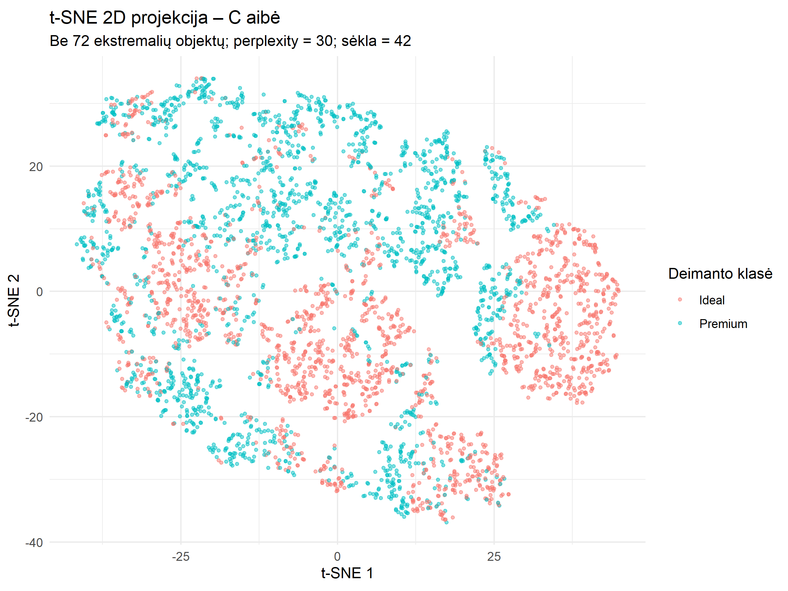

**Pav.** C aibės t-SNE 2D projekcija:
3928 objektai, perplexity = 30, sėkla = 42.

Projekcijoje matomos kelios sritys, kuriose vyrauja
`Ideal` objektai: ryškiausia dešinėje, kitos – centrinėje
ir kairiojoje dalyse. `Premium` objektų daug matoma
viršutinėje projekcijos dalyje.

Apatinėje dešinėje ir viršutinėje kairėje dalyse
abi klasės ryškiai persidengia. Taigi matomas dalinis
klasių susitelkimas, tačiau visiško atsiskyrimo nėra.

Palyginti su ankstesniais grafikais, vizualiai mažiau
ryškūs atokūs siauri ruožai ir pluošteliai. Tačiau vien
šis vaizdas neįrodo, kad pašalinti būtent tuos ruožus
sudarę objektai – tam reikėtų patikrinti jų `id`.

Matomos salelės nebūtinai yra tikri duomenų klasteriai.
Taip pat iš jų ploto ar kompaktiškumo negalima spręsti,
kad viena klasė pradinėje erdvėje yra įvairesnė už kitą.

### Preliminarus vizualus A, B ir C palyginimas

| Aspektas | A aibė | B aibė | C aibė |
|---|---|---|---|
| Objektai | 4000 | 4000 | 3928 |
| Skaitiniai požymiai | 19 | 6 | 19 |
| Vienos klasės vyraujamos sritys | Matomos | Matomos | Matomos |
| Klasių persidengimas | Išlieka | Išlieka | Išlieka |
| Atokūs ruožai ar pluošteliai | Matomi | Matomi | Mažiau ryškūs |

Skirtingas projekcijų užimamas plotas, jų orientacija,
salelių skaičius ar tarpai tarp jų nenaudojami kaip
projekcijos kokybės įrodymas.

C grafiko vizualus vientisumas savaime nereiškia
geresnio struktūros išsaugojimo ar didesnio stabilumo.

### A ir C palyginimo metodika

Kadangi A ir C objektų skaičius skiriasi, tiesiogiai
lyginti visos A aibės ir C aibės rodiklius nepakanka.

Vertinimui naudojami tik **3928 bendri objektai**,
sulygiuoti pagal `id`.

1. Paimama anksčiau su visais 4000 objektų apskaičiuota
   A projekcija.
2. Joje paliekami tik C aibėje esantys objektai.
3. Šis išdėstymas lyginamas su naujai apskaičiuota
   C projekcija.
4. Atstumų rangai ir kaimynystės perskaičiuojami
   tik bendrų objektų imtyje.

```r
indeksai_A <- match(aibe_C$id, aibe_A$id)

stopifnot(
  !anyNA(indeksai_A),
  identical(aibe_A$id[indeksai_A], aibe_C$id),
  identical(colnames(X_A), colnames(X_C))
)

X_A_bendri <- X_A[indeksai_A, , drop = FALSE]

Y_A_bendri <- tsne_A_seklos[["42"]]$Y[
  indeksai_A, , drop = FALSE
]

Y_C <- tsne_C$Y
```

Lokali kokybė vertinama trimis atvejais:

| Projekcija | Atskaitos erdvė | Paskirtis |
|---|---|---|
| A projekcija, palikus bendrus objektus | A erdvė, palikus bendrus objektus | Pradinis palyginimo variantas |
| C projekcija | A erdvė, palikus bendrus objektus | Tiesioginis originalios likusių objektų struktūros išsaugojimo palyginimas |
| C projekcija | C erdvė | C projekcijos kokybė jos pačios įėjimo atžvilgiu |

Skaičiuojami Trustworthiness, Continuity ir kaimynų
išsaugojimas su k = 5, 15 ir 50. Papildomai lyginamos
pradinių A/C erdvių ir abiejų projekcijų kaimynystės.

Svarbu, kad C aibei masteliai perskaičiuoti atskirai.
Todėl šis eksperimentas vertina bendrą ekstremalių
objektų pašalinimo ir mastelio perskaičiavimo poveikį.
Jis neatskiria šių dviejų veiksmų įtakos.

### Lokali kokybė bendrų objektų imtyje

A ir C projekcijos palygintos naudojant tik tuos pačius
3928 objektus, sulygiuotus pagal `id`.

A projekcija nebuvo perskaičiuota: iš anksčiau su visais
4000 objektų gauto išdėstymo atrinkti bendri objektai.
Atstumų rangai ir kaimynystės perskaičiuoti tik šioje imtyje.

#### Bendroje A atskaitos erdvėje

| Projekcija | k | Trustworthiness | Continuity | Kaimynų išsaugojimas |
|---|---:|---:|---:|---:|
| A | 5 | 0,996969 | 0,984325 | 0,550509 |
| A | 15 | 0,992795 | 0,974031 | 0,528683 |
| A | 50 | 0,981333 | 0,958676 | 0,523987 |
| C | 5 | 0,996843 | 0,983363 | 0,561507 |
| C | 15 | 0,992379 | 0,972991 | 0,531721 |
| C | 50 | 0,980656 | 0,956838 | 0,521283 |

Abiejų projekcijų rodikliai panašūs. A projekcija pasiekė
šiek tiek didesnius T ir C visais tirtais k.
C projekcija išsaugojo daugiau tų pačių kaimynų su
k = 5 ir 15, bet mažiau su k = 50.

Didžiausias kaimynų išsaugojimo pagerėjimas C projekcijoje
buvo apie 1,10 procentinio punkto, kai k = 5.
Todėl nėra vienareikšmio lokalios kokybės pagerėjimo
pagal visus rodiklius.

#### C projekcijos kokybė savo C erdvės atžvilgiu

| k | Trustworthiness | Continuity | Kaimynų išsaugojimas |
|---|---:|---:|---:|
| 5 | 0,996834 | 0,983275 | 0,560743 |
| 15 | 0,992349 | 0,972878 | 0,531195 |
| 50 | 0,980563 | 0,956705 | 0,520362 |

Rezultatai artimi vertinimui bendroje A atskaitoje.
Tai dera su dideliu pradinių A ir C kaimynysčių sutapimu.

### Pradinių erdvių ir projekcijų kaimynysčių sutapimas

| k | Pradinių A/C erdvių sutapimas | A/C projekcijų sutapimas |
|---|---:|---:|
| 5 | 0,990173 | 0,775051 |
| 15 | 0,991141 | 0,779905 |
| 50 | 0,992846 | 0,781589 |

Pradinės kaimynystės, vertinamos tik tarp bendrų objektų,
sutampa apie 99 %. Vadinasi, C mastelio perskaičiavimas
likusių objektų lokalias kaimynystes pakeitė nedaug.
Šis palyginimas nevertina pašalintų objektų, kurie galėjo
būti likusių objektų kaimynai visoje A aibėje.

Projekcijų kaimynystės sutampa apie 78 %. Taigi naujai
apskaičiuota C projekcija dalį kaimynysčių išdėsto kitaip,
nors pradinės bendrų objektų kaimynystės beveik nepasikeitė.

Šio skirtumo negalima priskirti vien ekstremalių objektų
pašalinimui: kartu perskaičiuoti masteliai ir iš naujo
atlikta stochastinė optimizacija. Ta pati sėkla, esant
skirtingam objektų skaičiui, neužtikrina vienodos bendrų
objektų inicializacijos.

### Globalus A ir C palyginimas bendrų objektų imtyje

Visi palyginimai atlikti su tais pačiais 3928 objektais,
sulygiuotais pagal `id`. Naudoti Euklido atstumai,
Spearman koreliacija ir normalizuotas Stress su optimaliu
bendru mastelio koeficientu.

| Palyginimas | Spearman | Normalizuotas Stress |
|---|---:|---:|
| Pradinė A bendrų objektų erdvė ir C erdvė | 0,999987 | 0,002199 |
| Pradinė A bendrų objektų erdvė ir A projekcija | 0,726463 | 0,316108 |
| Pradinė A bendrų objektų erdvė ir C projekcija | 0,722813 | 0,313679 |
| C erdvė ir C projekcija | 0,722292 | 0,313937 |
| A ir C projekcijos | 0,889631 | 0,198845 |

Pradinių A ir C erdvių atstumai tarp bendrų objektų
beveik sutampa: Spearman siekia 0,999987, o Stress –
0,002199. Tai rodo, kad atskiras C mastelio perskaičiavimas
likusių objektų globalią geometriją pakeitė labai mažai.

Vertinant abi projekcijas bendroje A atskaitoje,
A projekcija pasiekė šiek tiek didesnę Spearman koreliaciją
(0,726463, palyginti su 0,722813), o C projekcija –
šiek tiek mažesnį Stress (0,313679, palyginti su 0,316108).
Taigi aiškaus pagerėjimo pagal abu rodiklius nenustatyta.

Visoje 4000 objektų A imtyje tos pačios A projekcijos
Stress buvo 0,779956. Palikus vertinimui tik bendrus
3928 objektus, jis sumažėjo iki 0,316108, nors likusių
objektų projekcijos koordinatės nebuvo keičiamos.

Šis sumažėjimas rodo didelį pašalintus objektus apimančių
porų poveikį visos A imties Stress rodikliui. Jis nėra
projekcijos pagerėjimo po naujo mokymo įrodymas:
pasikeitė vertinamos poros ir perskaičiuotas optimalus
mastelio koeficientas.

A ir C projekcijų porinių atstumų Spearman koreliacija
siekia 0,889631. Tai rodo panašią, bet ne identišką jų
atstumų tvarką. Šis rodiklis apibūdina projekcijų
tarpusavio panašumą, o ne jų kokybę pradinės erdvės atžvilgiu.

### C aibės tyrimo išvada

Pašalinus 72 ekstremalius objektus ir perskaičiavus
mastelius, likusių objektų pradinė lokali ir globali
struktūra išliko beveik nepakitusi.

Bendrų objektų imtyje A ir C projekcijų kokybė panaši.
Lokalūs rodikliai nerodo vienareikšmio C pranašumo.
Globaliame vertinime A turi šiek tiek didesnę Spearman
koreliaciją, o C – šiek tiek mažesnį Stress.

Didelį visos A imties Stress stipriai veikė pašalintus
objektus apimančios poros. Vien jų pašalinimas iš
vertinimo gerokai sumažino rodiklį ir nepakeitus
likusių objektų A projekcijos koordinačių.

Todėl vizualiai vientisesnės C projekcijos negalima
automatiškai laikyti kokybiškesne. A/C palyginimas
kol kas pagrįstas viena sėkla.

### Rezultatų išsaugojimas

- Grafikas: `grafikai/tsne_2d_C_p30_seed42.png`.
- t-SNE rezultatas: `rezultatai/tsne_C_p30_seed42.rds`.
- Lokali A/C kokybė: `rezultatai/tsne_AC_lokali_kokybe.csv`.
- Kaimynysčių sutapimas:
  `rezultatai/tsne_AC_kaimynysciu_sutapimas.csv`.
- Globalus A/C palyginimas:
  `rezultatai/tsne_AC_globalus_palyginimas.csv`.
  
## Bendros t-SNE tyrimo išvados

1. Perplexity parametro poveikis priklauso nuo kaimynystės
   mastelio. Iš trijų tirtų variantų perplexity = 5 geriausiai
   išsaugojo tuos pačius pradinius kaimynus su k = 5,
   o perplexity = 30 ir 50 geriau išlaikė platesnes
   kaimynystes su k = 15 ir 50. Tolesniam tyrimui
   pasirinkta perplexity = 30 kaip kompromisinis variantas.

2. A aibėje pasirinkto 2D varianto kokybės rodikliai mažai
   svyravo tarp penkių sėklų. Vidutinis Trustworthiness
   siekė 0,976–0,996, Continuity – 0,956–0,984.
   Išsaugota apie 52–55 % tų pačių pradinių kaimynų.
   Tai rodo rodiklių stabilumą, bet negarantuoja identiškų
   projekcijų.

3. Globalūs atstumai 2D projekcijoje išsaugoti prasčiau:
   A aibės Spearman vidurkis buvo 0,695, o normalizuotas
   Stress – 0,779. Todėl t-SNE labiau tinka lokalioms
   grupavimosi tendencijoms vizualizuoti nei tiksliems
   atstumams tarp tolimų objektų interpretuoti.

4. Pašalinus koreliuotus požymius, pasikeitė pradinės
   kaimynystės. B projekcija gerai atvaizdavo savo
   6 požymių erdvę, tačiau originalios A erdvės
   kaimynystes ir atstumų tvarką išsaugojo prasčiau
   nei A projekcija.

5. Bendrų 3928 objektų imtyje A ir C projekcijų kokybė
   buvo panaši. Ekstremalių objektų pašalinimas ir mastelio
   perskaičiavimas nesuteikė vienareikšmio pagerėjimo.
   Didelį visos A imties Stress stipriai veikė
   pašalintus objektus apimančios poros.

6. Vizualus klasių susitelkimas nėra pakankamas
   projekcijos kokybės įrodymas. Galutiniam palyginimui
   su PCA, MDS ir UMAP reikia bendrų metrikų,
   vienodų atskaitos erdvių ir sutampančių objektų.
   
7. Papildomame A aibės palyginime su sėkla 42
   3D projekcija pagerino visus vertintus kokybės rodiklius,
   palyginti su 2D. Šio pranašumo stabilumas su kitomis
   sėklomis netikrintas. Pagrindiniai parametrų ir A/B/C
   palyginimai atlikti 2D.

### Tyrimo ribotumai

Parametrų palyginimas ir B/C jautrumo eksperimentai atlikti
su viena sėkla. Penkių sėklų stabilumas tikrintas tik A aibės
2D projekcijai su perplexity = 30. Papildomas A aibės
2D ir 3D palyginimas atliktas tik su sėkla 42.

Visiems paleidimams nustatyta 1000 iteracijų;
galutinė konvergencija atskirai nepatvirtinta.
C tyrime kartu keistas objektų rinkinys ir perskaičiuoti
masteliai, todėl jų poveikis neatskirtas.

## t-SNE tyrimo atkuriamumas

Naudota programinė aplinka:

| Programa / paketas | Versija |
|---|---|
| R | 4.5.2 (2025-10-31 ucrt) |
| Rtsne | 0.17 |
| ggplot2 | 4.0.2 |

Visa sesijos informacija išsaugota faile
`rezultatai/sessionInfo.txt`.

Tyrimui paleisti reikia projekto aplanke esančių paruoštų
`aibe_A.csv`, `aibe_B.csv` ir `aibe_C.csv` failų.
Jei jų nėra, pirmiausia vykdomi `vykdymas.R` 1–16 skyriai.
Tada paleidžiamas `tsne.R`.

Parametrų ir A/B/C palyginimams naudota sėkla 42.
A aibės 2D projekcijos stabilumui tirti naudotos sėklos:
42, 123, 2026, 7 ir 99.
Papildomam A aibės 2D ir 3D palyginimui naudota sėkla 42.

## t-SNE šaltiniai

1. Krijthe, J. H. (2015). Rtsne: T-Distributed Stochastic
   Neighbor Embedding using a Barnes-Hut Implementation.
   https://github.com/jkrijthe/Rtsne

2. van der Maaten, L., & Hinton, G. (2008).
   Visualizing Data using t-SNE.
   Journal of Machine Learning Research, 9, 2579–2605.

3. van der Maaten, L. (2014).
   Accelerating t-SNE using Tree-Based Algorithms.
   Journal of Machine Learning Research, 15, 3221–3245.